> **온디바이스 LLM 시리즈** · [전체 목차](/blog/2026/11/16/ondevice-llm-series/)  
> → 다음: [2. 4비트로 줄이고도 답을 지키는 법](/blog/2026/11/16/ondevice-llm-02-llm-quantization/)

> 이 글의 예제 코드 전체: [kjoh94/ondevice-llm-examples/tree/main/01-roofline](https://github.com/kjoh94/ondevice-llm-examples/tree/main/01-roofline) (`python example.py`)

> 이 글은 공개 자료만 사용했고, 어떤 회사의 공식 입장도 아닙니다. 글에 나오는 "가상 엣지 NPU"의 숫자는 공개된 일반 스펙 수준의 값에 가정을 더한 계산 예시입니다.

> **처음이라면 이것만 기억하세요.** LLM이 답을 한 토큰씩 쓸 때(decode)는 **모델 가중치 전체를 메모리에서 한 번씩 읽어야** 해요. 그래서 속도의 상한은 `대역폭 ÷ 토큰당 읽는 바이트`로 정해지고, TOPS는 거의 상관이 없어요. 8B 모델을 4비트로 줄이면 약 4.1 GB이고, 153.6 GB/s 메모리에서는 **초당 37토큰이 한계**예요.

선수 글: [PyTorch 9장 — 메모리 왕복](/blog/2026/10/25/pytorch-09-compiler-opt/), [PyTorch 11장 — prefill·decode](/blog/2026/10/25/pytorch-11-llm-inference/), [tokens 0편 — TTFT/TPS](/blog/2026/10/30/tokens-00-prologue-prefill-decode/)

엣지 NPU 자료를 보면 "80 TOPS" 같은 큰 숫자가 먼저 눈에 들어와요. 그런데 같은 장치로 8B LLM을 돌리면 초당 수십 토큰에 그쳐요. 80조 번 계산할 수 있는 칩이 왜 초당 30토큰밖에 못 쓸까요? 이 장에서는 그 답을 **직접 계산하고, CPU에서 재 보고, 논문으로 확인**해요. [PyTorch 9장](/blog/2026/10/25/pytorch-09-compiler-opt/)에서 본 "연산 수보다 메모리 왕복"이라는 감각을 숫자 하나하나로 바꾸는 장이에요. 여기서 만드는 `roofline_calc()`는 3·7·8·9장에서 계속 다시 써요.

## 0. 비유로 먼저

### 0-1. 주방장 80명, 냉장고 문은 하나

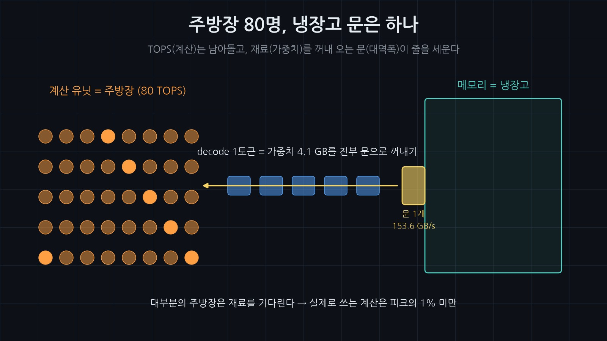

**그림 1.** 주방에 주방장(계산 유닛)이 80명 있어요. 요리 하나(토큰 하나)를 만들려면 냉장고에 있는 재료(가중치) **4.1 GB를 전부 한 번씩** 꺼내 와야 해요. 그런데 냉장고 문은 하나이고, 1초에 153.6 GB만 지나갈 수 있어요. 주방장이 아무리 많아도 요리는 초당 `153.6 ÷ 4.1 ≈ 37`개를 넘지 못해요. 대부분의 주방장은 재료를 기다리면서 놀고 있어요.

### 0-2. 그런데 손님이 한꺼번에 오면?

질문을 읽는 단계(prefill)는 달라요. 질문 토큰 1000개를 **같은 재료 한 번 꺼낸 걸로** 한꺼번에 처리해요. 재료 1바이트당 할 일이 1000배가 되니 이번에는 주방장이 모자라요. 그래서 **prefill은 계산(TOPS)이, decode는 대역폭이** 속도를 정해요. 이 장의 모든 식은 이 두 문장을 숫자로 바꾼 거예요.

### 0-3. 직접 재 보기: 같은 가중치를 읽으면서 계산만 늘리면

CPU 1스레드에서 가중치 `W`(8192×16384, FP32 512 MB)를 두고, 입력 줄 수 `M`만 바꿔서 `x @ W`를 쟀어요. `M=1`이 decode(GEMV), `M=512`가 prefill(GEMM)과 같은 모양이에요.

```python
K, N = 8192, 16384                      # 가중치 512 MB > 이 PC의 L3(320 MiB) → DRAM에서 읽게
W = torch.randn(K, N)
for M in (1, 2, 4, 8, 16, 32, 64, 128, 256, 512):
    x = torch.randn(M, K)
    t = timeit(lambda: x @ W)
    flops = 2 * M * K * N; byts = 4 * (K * N + M * K + M * N)
    print(M, t, flops / t / 1e9, flops / byts)     # 시간, GFLOP/s, 연산 강도
```

이 환경(CPU 1스레드, PyTorch 2.15)에서 실제로 잰 결과예요.

| M (입력 줄 수) | 시간 | GFLOP/s | 연산 강도 (FLOP/B) |
|---|---|---|---|
| 1 (decode 모양) | 32.7 ms | 8.2 | 0.5 |
| 8 | 83.1 ms | 25.9 | 4.0 |
| 64 | 146.1 ms | 117.6 | 31.6 |
| 512 (prefill 모양) | 676.3 ms | 203.2 | 234.1 |

계산량은 512배인데 시간은 21배만 늘었어요. `M=1`일 때 CPU는 피크(213.5 GFLOP/s)의 **4%**만 쓰고, 나머지 시간은 가중치를 기다려요. 이 표 하나가 이 장 전체의 요약이에요.

이제 정식 용어로 하나씩 자세히 볼게요.

## 1. TOPS의 정의와 "피크"의 뜻

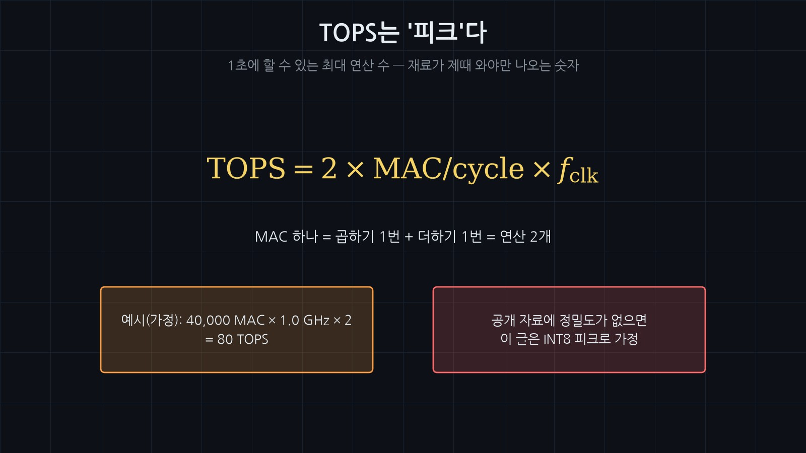

**그림 2.** TOPS(Tera Operations Per Second)는 1초에 할 수 있는 연산 수의 **최대치**다. 곱셈-누산기(MAC) 하나는 매 사이클 곱셈 1번과 덧셈 1번, 즉 연산 2개를 한다.

> **유도 1 — TOPS 공식**
> `TOPS = 2 × (사이클당 MAC 수) × 클럭`
> 예시(가정): MAC 40,000개 × 1.0 GHz × 2 = **80 × 10¹² 연산/초 = 80 TOPS**

이 숫자에는 두 가지 조건이 숨어 있다.

1. **정밀도.** INT8 MAC 하나가 INT4 MAC 두 개로 쪼개지는 구조라면 같은 칩이 "INT4 160 TOPS"가 된다. FP16은 보통 더 낮다. 그래서 TOPS에 정밀도가 안 적혀 있으면 비교할 수 없다. **이 시리즈의 가상 엣지 NPU는 "80 TOPS, 정밀도 미표기 → INT8 피크로 가정"** 한다.
2. **재료가 제때 와야 한다.** 피크는 모든 MAC이 매 사이클 바쁠 때의 값이다. 입력이 늦게 오면 MAC은 논다.

두 번째 조건을 정량화하는 도구가 Roofline 모델이다(Williams·Waterman·Patterson, CACM 2009).

## 2. 연산 강도: 바이트 하나로 몇 번 계산하나

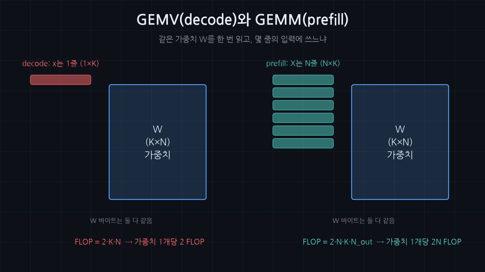

**그림 3.** decode에서는 새 토큰 1개(1×K)가 가중치 W(K×N)와 곱해진다(GEMV). prefill에서는 N개 토큰이 한꺼번에 곱해진다(GEMM). W를 메모리에서 읽는 양은 둘 다 같다.

**연산 강도(Arithmetic Intensity, AI)** = 연산 수 ÷ 메모리에서 옮긴 바이트 수.

> **유도 2 — decode GEMV의 연산 강도**
> 가중치 원소 하나당 곱셈 1 + 덧셈 1 = 2 FLOP. 원소 하나의 크기가 b 바이트면
> `AI = 2 / b` → FP32 0.5, FP16 **1**, INT8 2, INT4 **4** FLOP/B.
> group-128 4비트(scale 포함 4.125 bit, 2장)는 `2 ÷ (4.125/8) = 3.88` FLOP/B.

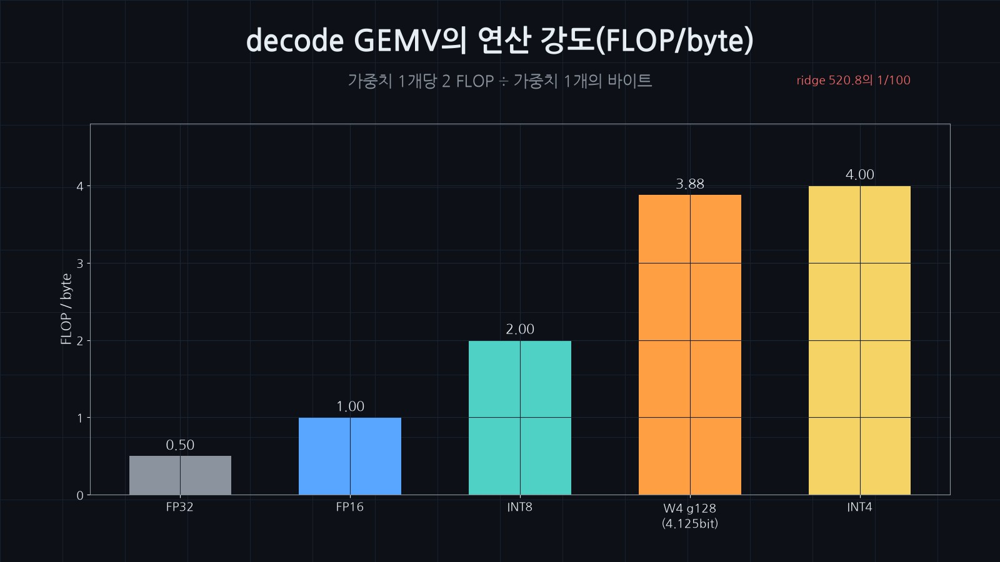

**그림 4.** decode의 연산 강도는 어떤 형식이든 한 자리 수다. 비교를 위해 빨간 점선으로 가상 엣지 NPU의 ridge point(다음 절)의 1/100을 그렸다. 4비트로 줄여도 ridge의 1%도 안 된다.

이 계산에서 활성값·출력 바이트는 무시했다. 4096짜리 hidden 벡터는 8 KB라서, 수 GB짜리 가중치 앞에서는 반올림 오차다.

## 3. Roofline과 ridge point

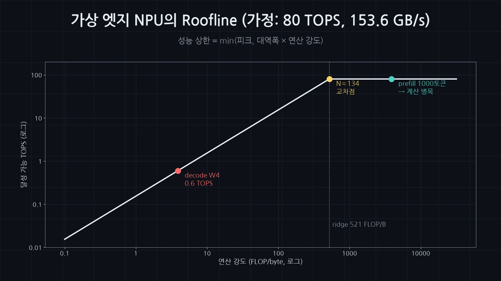

**그림 5.** 가로축은 연산 강도, 세로축은 낼 수 있는 성능(둘 다 로그). 왼쪽 기울어진 지붕은 `대역폭 × AI`(메모리가 한계), 오른쪽 평평한 지붕은 피크(계산이 한계)다.

`달성 가능 성능 = min(피크, 대역폭 × AI)`

두 지붕이 만나는 점이 **ridge point**다.

> **유도 3 — 가상 엣지 NPU의 ridge point**
> 대역폭: LPDDR5X-9600 × 128 bit 버스(16 bit 채널 8개, 가정) = 9600 × 10⁶ × 16 B = **153.6 GB/s**
> ridge = 80 × 10¹² ÷ 153.6 × 10⁹ = **520.8 FLOP/B**
> decode W4의 AI는 3.88 → 달성 가능 성능 = 153.6 GB/s × 3.88 = **0.6 TOPS**, 피크의 0.75%

```python
def lpddr_bw(mts=9600, bus_bits=128):
    return mts * 1e6 * bus_bits / 8           # 153.6e9 B/s

def roofline_calc(params, bits, bw, tops, kv_bytes=0.0, util_bw=1.0, util_tops=1.0):
    w_bytes = params * bits / 8
    bytes_per_tok = w_bytes + kv_bytes
    tok_s_mem = bw * util_bw / bytes_per_tok
    flops_per_tok = 2 * params
    tok_s_cmp = tops * util_tops / flops_per_tok
    ridge = tops / bw
    ai_decode = flops_per_tok / bytes_per_tok
    return dict(weight_GB=w_bytes / 1e9, tok_s=min(tok_s_mem, tok_s_cmp),
                need_TOPS=flops_per_tok * min(tok_s_mem, tok_s_cmp) / 1e12,
                ridge=ridge, ai_decode=ai_decode, prefill_cross_N=ridge / ai_decode)
```

같은 그림을 이 PC로 그려 보면 이렇다.

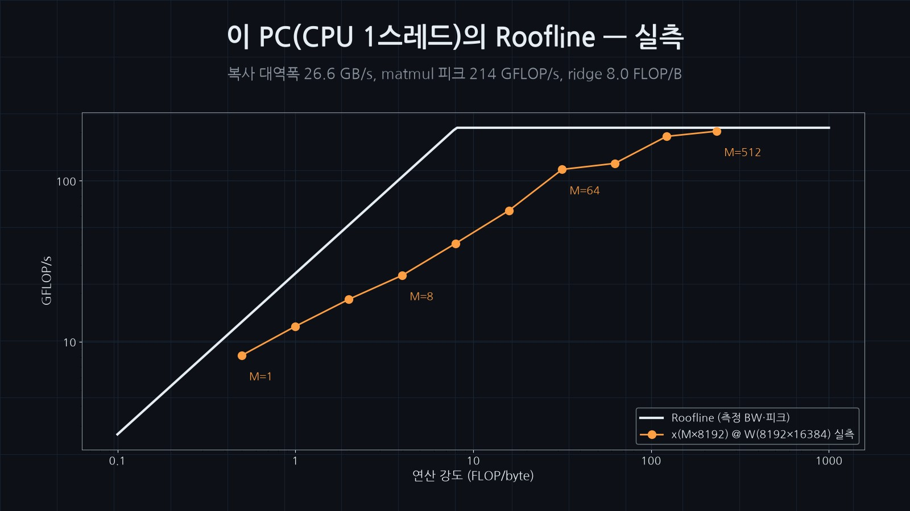

**그림 6.** CPU 1스레드에서 잰 복사 대역폭 26.6 GB/s와 matmul 피크 213.5 GFLOP/s로 그린 Roofline(흰 선)과, 0-3절의 실측점(주황). ridge는 8.0 FLOP/B로 NPU보다 65배 낮다. 실측점은 M이 작을 때 메모리 지붕 아래, M이 커지면 계산 지붕 아래에 붙는다.

```python
def measure_bw(mb=256):
    a = torch.empty(mb * 2**20 // 4); b = torch.empty_like(a)
    t = timeit(lambda: b.copy_(a), reps=7)
    return 2 * a.numel() * 4 / t                # 읽기 + 쓰기

def measure_peak(n=2048):
    a = torch.randn(n, n); b = torch.randn(n, n)
    return 2 * n ** 3 / timeit(lambda: a @ b, reps=5)
```

`M=1`의 실효 대역폭은 16.4 GB/s로 복사 대역폭의 62%다. GEMV 커널이 순수 복사보다 비효율적인 부분(곱셈·누산 명령, 캐시 라인 활용)이 섞인 값이다. 이 "이용률"은 7절과 7장에서 다시 나온다.

## 4. decode 상한 유도: tok/s ≤ 대역폭 ÷ 토큰당 바이트

decode 한 스텝에서 모든 층의 모든 가중치가 한 번씩 쓰인다. 캐시에 남아 재사용되는 일이 없다고 보면(수 GB는 어떤 SRAM에도 안 들어간다), 토큰 하나에 읽는 바이트는 `가중치 바이트 + KV 캐시 바이트`다. KV는 3장에서 다루고 여기서는 0으로 둔다.

> **유도 4 — Llama-3.1-8B W4의 decode 상한**
> 파라미터 8.03 × 10⁹ × 4.125 bit ÷ 8 = **4.14 GB**
> 153.6 GB/s ÷ 4.14 GB = **37.1 tok/s** (메모리 채널을 절반만 쓰는 76.8 GB/s 구성이면 18.5)
> 이때 실제 필요한 연산: 2 × 8.03 × 10⁹ × 37.1 = **0.60 TOPS** — 80 TOPS의 0.75%

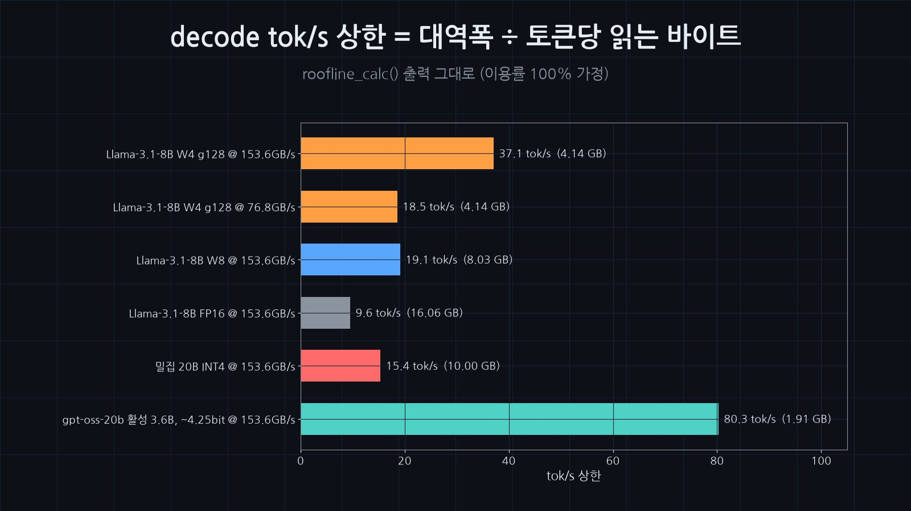

**그림 7.** `roofline_calc()` 출력 그대로. 이용률 100% 가정이라 실제로는 이보다 낮다.

| 모델 · 형식 | 대역폭 | 가중치 | 상한 tok/s | 필요 TOPS |
|---|---|---|---|---|
| Llama-3.1-8B W4 g128 | 153.6 GB/s | 4.14 GB | **37.1** | 0.60 |
| Llama-3.1-8B W4 g128 | 76.8 GB/s | 4.14 GB | 18.5 | 0.30 |
| Llama-3.1-8B W8 | 153.6 GB/s | 8.03 GB | 19.1 | 0.31 |
| Llama-3.1-8B FP16 | 153.6 GB/s | 16.06 GB | 9.6 | 0.15 |
| 밀집 20B INT4 | 153.6 GB/s | 10.00 GB | 15.4 | 0.61 |
| gpt-oss-20b 활성 3.6B, 약 4.25 bit | 153.6 GB/s | 1.91 GB | 80.3 | 0.58 |

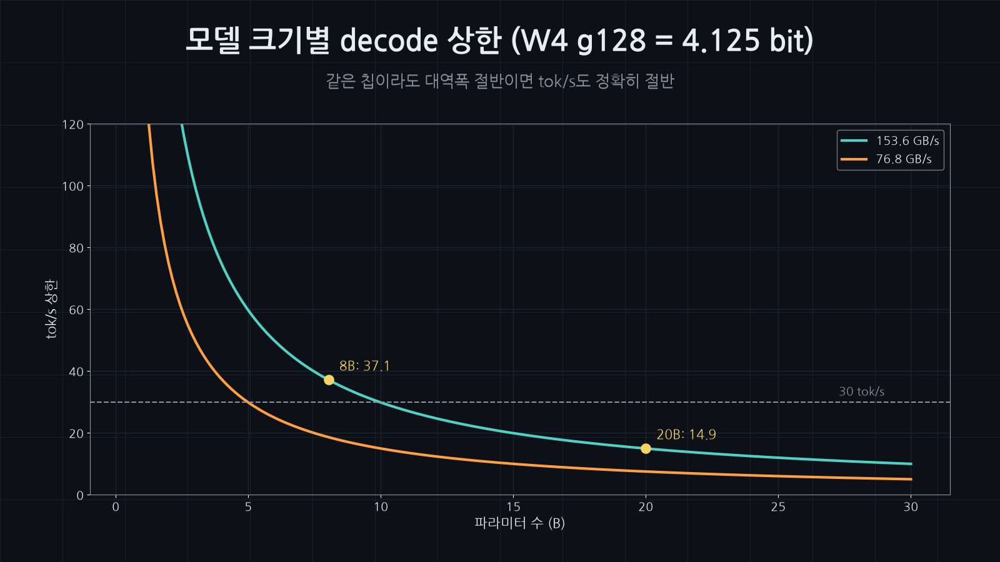

**그림 8.** 파라미터 수 P에 대해 `tok/s = BW / (P × 4.125/8)`은 반비례 곡선이다. 30 tok/s를 넘으려면 153.6 GB/s에서도 모델이 약 10B보다 작아야 한다. 대역폭을 반으로 줄이면 곡선 전체가 정확히 반으로 내려간다.

### 예측 vs 실측: 미니 Llama decode

이 식이 맞는지 CPU에서 확인했다. 공용 `tiny_llama.py`로 dim 1024, 8층, 어휘 32000인 155.7M 파라미터 모델(FP32 623 MB, L3보다 크다)을 만들고 decode 1토큰 시간을 40번 쟀다.

```python
cfg = Config(vocab=32000, dim=1024, n_layers=8, n_heads=16, n_kv_heads=4, ffn=2816, max_seq=256)
model = TinyLlama(cfg).eval()
caches = make_caches(cfg)
model(torch.randint(0, cfg.vocab, (1, 16)), 0, caches)          # prefill
for i in range(40):
    t0 = time.perf_counter(); model(torch.tensor([[5]]), 16 + i, caches); ts.append(time.perf_counter() - t0)
t_pred = n_params(cfg) * 4 / measure_bw()                         # 예측: 가중치 바이트 ÷ 대역폭
```

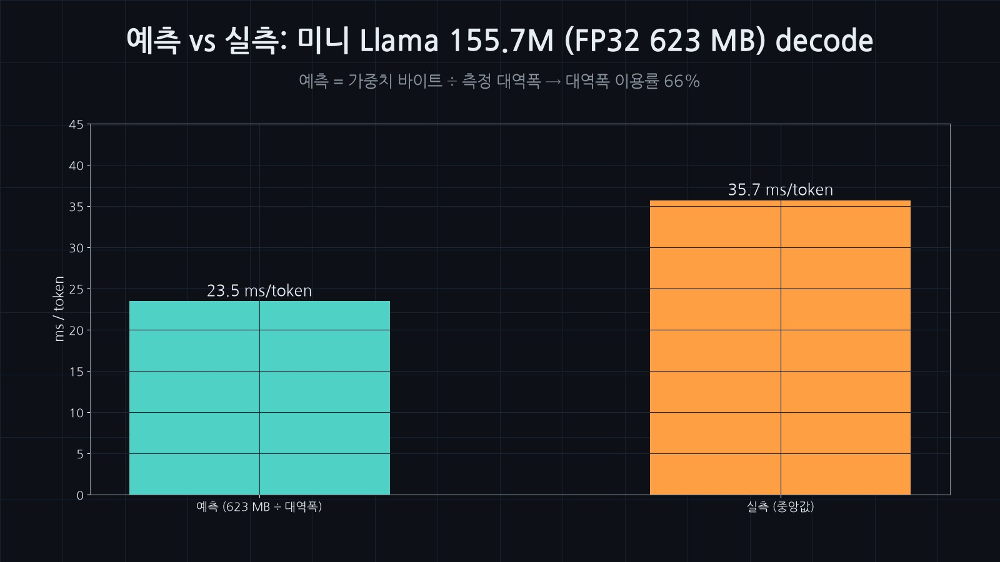

**그림 12.** 예측과 실측.

| | ms/token | tok/s |
|---|---|---|
| 예측 (623 MB ÷ 26.6 GB/s) | 23.5 | 42.6 |
| 실측 (중앙값) | 35.7 | 28.0 |
| **대역폭 이용률** | **66%** | |

식은 상한이고, 실측은 그 66%다. 차이는 GEMV 커널 효율(3절의 62%와 비슷하다), 층마다 반복되는 작은 연산과 파이썬 호출 비용이다. 두 숫자가 같은 자릿수라는 점이 중요하다. **CPU든 NPU든 decode 속도는 "가중치 바이트 ÷ 대역폭 × 이용률"로 예측된다.**

## 5. prefill: 언제 계산 병목이 되나

prefill에서 N개 토큰을 한 번에 넣으면 같은 가중치 바이트로 N배 계산한다. 연산 강도도 N배다.

> **유도 5 — prefill 교차점과 TTFT 하한**
> AI(N) ≈ 3.88 × N. ridge 520.8과 같아지는 N = 520.8 ÷ 3.88 ≈ **134 토큰**.
> 그보다 긴 프롬프트는 계산 병목 → TTFT 하한 = 2·P·N ÷ (TOPS × 이용률)
> 1000토큰, 8B: 2 × 8.03 × 10⁹ × 1000 = 16 TFLOP → 이용률 100%면 **0.20 s**, 40%면 **0.50 s**

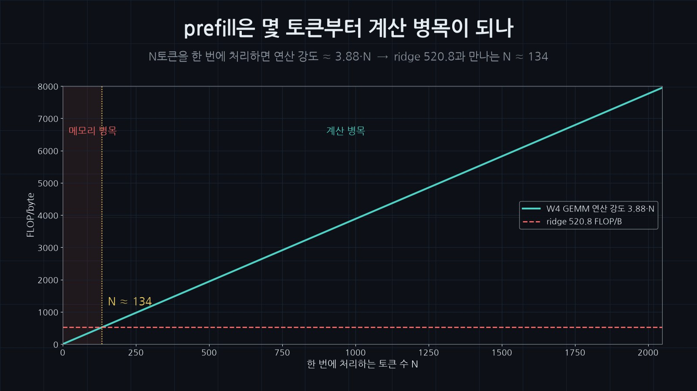

**그림 9.** 134토큰보다 짧은 프롬프트는 decode처럼 메모리가 한계이고, 길어질수록 계산 지붕에 붙는다. W8이면 AI가 2N이라 교차점은 약 260토큰이 된다(퀴즈 3).

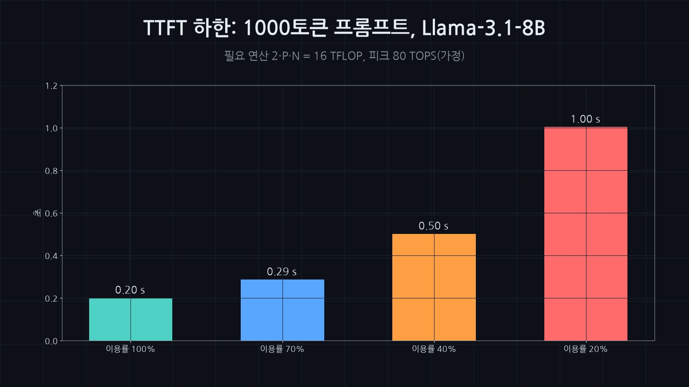

**그림 10.** 이용률에 따른 TTFT 하한. 실제 NPU는 attention·softmax 같은 비행렬 연산(4장)과 데이터 이동 때문에 피크의 일부만 쓴다. 그래서 TTFT는 "TOPS × 이용률"로, decode TPS는 "대역폭 × 이용률"로 읽는 것이 정직하다(7장).

이 PC에서는 ridge가 8 FLOP/B라 2~3토큰만 넘어도 계산 병목이다. 7장에서 프롬프트 길이를 바꿔 가며 TTFT를 재면 128–512토큰 구간에서 `2·P·N ÷ 피크` 예측과 3% 안으로 맞는다(1024토큰부터는 attention의 N² 항이 보이기 시작한다).

## 6. MoE가 엣지에 맞는 이유 (예고)

MoE(Mixture of Experts)는 토큰마다 일부 전문가만 쓴다. 토큰 하나가 읽는 바이트는 **총 파라미터가 아니라 활성 파라미터**에 비례한다. gpt-oss-20b(총 20.9B, 활성 3.6B, 모델 카드 공개값)를 전부 약 4.25 bit로 가정하면 1.91 GB → **상한 80 tok/s**다. 밀집 20B INT4(15.4 tok/s)보다 5배 빠르다.

현실의 숫자는 이보다 낮다. 9장에서 직접 세어 보면 공개 체크포인트는 전문가만 MXFP4이고 어텐션·unembedding은 BF16이라, 토큰당 바이트가 2배쯤 된다(상한 41 tok/s). 여기에 KV 읽기(3장)와 이용률이 더해진다. "20B급 MoE를 수십 tok/s"라는 엣지 장치 발표가 가능한 이유와, 그 숫자를 그대로 믿으면 안 되는 이유가 둘 다 이 식 안에 있다.

## 7. 대역폭 이용률과 메모리 안 계산(PIM)

이론 대역폭 153.6 GB/s는 버스가 쉬지 않고 데이터를 보낼 때의 값이다. 실제 DRAM은 행(row)을 여닫는 시간, 리프레시, 읽기/쓰기 전환, 버스트 길이에 안 맞는 접근 때문에 보통 60–80%만 나온다. 이 PC의 GEMV는 복사 대역폭의 62%, 미니 Llama decode는 66%였다.

GEMV는 **데이터를 칩으로 가져와서 겨우 2 FLOP/원소만 하고 버리는** 연산이다. 그렇다면 계산을 데이터 옆(DRAM 뱅크 안)으로 옮기면 어떨까? 이것이 PIM(Processing-in-Memory)이다. 칩 바깥 버스 대신 뱅크 안의 훨씬 넓은 내부 대역폭을 쓰므로, Roofline의 기울어진 지붕 자체가 올라간다. 공개 논문으로는 HBM-PIM(ISCA 2021), GDDR6 기반 AiM(ISSCC 2022), attention을 PIM으로 보내는 AttAcc(ASPLOS 2024)가 있다. 9장에서 "GEMV만 PIM으로 보냈을 때"의 상한을 Amdahl 식으로 계산한다.

> **엣지 NPU에서는:** 세대가 바뀔 때 체감 decode 속도를 가장 크게 바꾸는 숫자는 TOPS가 아니라 **메모리 버스 폭과 전송률**이다. 같은 80 TOPS라도 128 bit LPDDR5X(153.6 GB/s)와 64 bit(76.8 GB/s)는 decode 상한이 정확히 2배 차이 난다(그림 8). 반대로 TOPS를 2배로 올려도 decode 상한은 그대로다(아래 실패 장면).

## 실패 장면: "TOPS 2배 칩이면 tok/s도 2배"

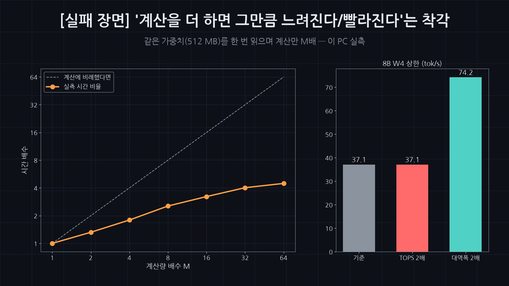

**그림 11.** 왼쪽: 같은 가중치를 읽으면서 계산만 M배로 늘린 실측(0-3절과 같은 실험). 계산에 비례했다면 회색 점선이어야 하는데, 실제로는 16배 계산에 시간이 3.2배다. 오른쪽: `roofline_calc()`로 TOPS만 2배(160 TOPS)로 한 경우와 대역폭만 2배로 한 경우.

```python
r_2x = roofline_calc(8.03e9, 4.125, 153.6e9, 2 * 80e12)   # TOPS 2배
r_bw = roofline_calc(8.03e9, 4.125, 2 * 153.6e9, 80e12)   # 대역폭 2배
# → 37.1 tok/s (변화 없음) vs 74.2 tok/s
```

| 계산량 배수 M (실측) | 1 | 2 | 4 | 8 | 16 |
|---|---|---|---|---|---|
| 시간 배수 | 1.00 | 1.32 | 1.79 | 2.54 | 3.22 |

| 바꾼 것 | 8B W4 decode 상한 |
|---|---|
| 기준 (80 TOPS, 153.6 GB/s) | 37.1 tok/s |
| TOPS 2배 | **37.1 tok/s** (그대로) |
| 대역폭 2배 | **74.2 tok/s** |

계산 자원이 남는 영역에서는 계산을 줄이든 늘리든 시간은 바이트가 정한다. 이 사실을 거꾸로 이용하는 기법이 8장의 추측 디코딩이다. 남는 계산으로 토큰 여러 개를 한 번에 검증한다.

## 자주 묻는 질문

**Q. TOPS 표기에 정밀도가 왜 그렇게 중요한가요?**
같은 실리콘이 INT8로 80, INT4로 160, FP16으로 40 TOPS가 될 수 있어요. 비교하려면 "무슨 형식으로 몇 TOPS"인지 알아야 해요. 이 글은 공개 자료에 정밀도가 없어서 INT8로 가정했어요.

**Q. 배치를 키우면 해결되지 않나요?**
서버는 그래요. 사용자 8명의 토큰을 묶으면 가중치 한 번 읽기로 8토큰을 만들어요(AI 8배). 그런데 폰·노트북·로봇의 엣지 장치는 사용자가 한 명이라 배치가 1이에요. 그래서 엣지 decode는 늘 메모리 지붕 아래에 있어요. 8장의 추측 디코딩은 "한 사용자 안에서 배치를 만드는" 방법이에요.

**Q. NPU 안의 SRAM이 크면 해결되나요?**
수 MB SRAM에는 수 GB 가중치가 안 들어가요. 매 토큰 전부를 읽는다는 사실은 바뀌지 않아요. SRAM은 활성값, KV 일부, 타일 재사용에 쓰여서 이용률을 높이는 데 도움이 돼요.

**Q. PIM은 만능인가요?**
아니에요. GEMV는 빨라지지만 softmax·샘플링·KV 관리 같은 나머지가 남고(4장의 Amdahl), 메모리 안 연산기는 정밀도와 연산 종류가 제한돼요. 9장에서 계산해요.

## 퀴즈

1. 피크 40 TOPS, 대역폭 100 GB/s인 장치의 ridge point는? → 400 FLOP/B.
2. Llama-3.1-8B를 W8(8 bit)로 153.6 GB/s 장치에서 돌리면 decode 상한은? → 8.03 GB, 약 19.1 tok/s.
3. W8이면 prefill이 계산 병목이 되는 토큰 수(가상 엣지 NPU)는? → AI = 2N, 520.8 ÷ 2 ≈ 260토큰.

## 정리

- decode 상한 = 대역폭 ÷ 토큰당 읽는 바이트. 8B W4는 153.6 GB/s에서 37.1 tok/s이고, 이때 필요한 계산은 0.6 TOPS뿐이다.
- Roofline: 성능 = min(피크, 대역폭 × 연산 강도). 가상 엣지 NPU의 ridge는 520.8 FLOP/B이고, decode(3.88)는 그 1%도 안 된다.
- prefill은 약 134토큰부터 계산 병목이다. TTFT는 TOPS × 이용률로 읽는다.
- CPU 실측에서 예측과 실측의 비율(대역폭 이용률)은 66%였다. 이 비율이 7장 벤치마크의 기준이 된다.

## 참고 (공개 자료)

- S. Williams, A. Waterman, D. Patterson, "Roofline: An Insightful Visual Performance Model for Multicore Architectures", *CACM* 52(4), 2009. doi:[10.1145/1498765.1498785](https://doi.org/10.1145/1498765.1498785)
- J. Austin et al., *How to Scale Your Model* — "All About Rooflines". <https://jax-ml.github.io/scaling-book/roofline/>
- K. Alizadeh et al., "LLM in a flash: Efficient Large Language Model Inference with Limited Memory", arXiv:[2312.11514](https://arxiv.org/abs/2312.11514)
- A. Grattafiori et al., "The Llama 3 Herd of Models", arXiv:[2407.21783](https://arxiv.org/abs/2407.21783) (Llama-3.1-8B 구조 수치)
- OpenAI, "gpt-oss-120b & gpt-oss-20b Model Card", arXiv:[2508.10925](https://arxiv.org/abs/2508.10925) (총·활성 파라미터)
- S. Lee et al., "Hardware Architecture and Software Stack for PIM Based on Commercial DRAM Technology", ISCA 2021. doi:[10.1109/ISCA52012.2021.00013](https://doi.org/10.1109/ISCA52012.2021.00013)
- J. Park et al., "AttAcc! Unleashing the Power of PIM for Batched Transformer-based Generative Model Inference", ASPLOS 2024. doi:[10.1145/3620665.3640422](https://doi.org/10.1145/3620665.3640422)

검증 환경: 모든 측정치는 Intel Xeon 가상머신(8 vCPU, L3 320 MiB)의 **CPU 1스레드**, Python 3.13.5, PyTorch 2.15.0+cpu에서 `python example.py`로 실제로 잰 값이다. 결과 원본은 예제 저장소의 `01-roofline/results/01.json`.

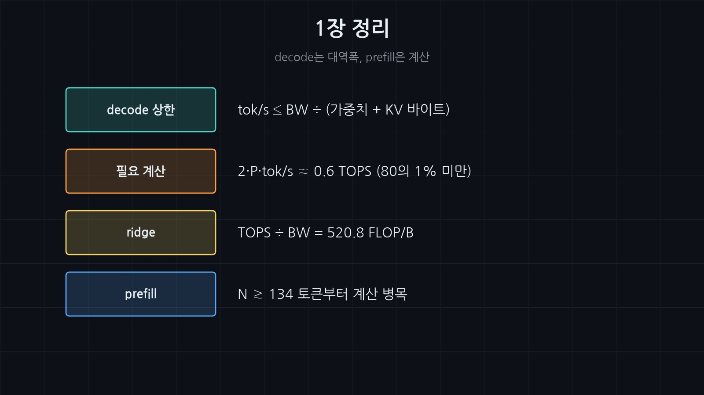

**그림 13.** 1장 정리.

---

> **온디바이스 LLM 시리즈** · [전체 목차](/blog/2026/11/16/ondevice-llm-series/)  
> → 다음: [2. 4비트로 줄이고도 답을 지키는 법](/blog/2026/11/16/ondevice-llm-02-llm-quantization/)
