> **온디바이스 LLM 시리즈** · [전체 목차](/blog/2026/11/16/ondevice-llm-series/)  
> ← 이전: [1. 80 TOPS인데 왜 30 tok/s일까](/blog/2026/11/16/ondevice-llm-01-roofline-bandwidth/)  
> → 다음: [3. 메모장이 가중치보다 커질 때](/blog/2026/11/16/ondevice-llm-03-kv-cache-design/)

> 이 글의 예제 코드 전체: [kjoh94/ondevice-llm-examples/tree/main/02-quantization](https://github.com/kjoh94/ondevice-llm-examples/tree/main/02-quantization) (`python example.py`, 실제 모델은 `python example.py --real`)

> 이 글은 공개 자료만 사용했고, 어떤 회사의 공식 입장도 아닙니다. "가상 엣지 NPU"의 숫자는 공개된 일반 스펙 수준의 값에 가정을 더한 계산 예시입니다.

> **처음이라면 이것만 기억하세요.** 1장에서 decode 속도는 "읽는 바이트"가 정한다고 했어요. 그래서 가중치를 16비트에서 4비트로 줄이면 거의 4배 빨라져요. 문제는 품질이에요. 그냥 반올림(RTN)하면 실제 모델(SmolLM2-135M)의 perplexity가 13.5에서 29로 무너지고, **GPTQ·AWQ처럼 "어떤 입력이 들어오는지"를 보고 양자화하면 16대로 지켜져요.**

선수 글: [PyTorch 10장 — scale/zero-point, per-channel](/blog/2026/10/25/pytorch-10-quantization/), [tokens 1편 — GGUF Q4_K_M·AWQ/GPTQ 소개](/blog/2026/10/30/tokens-01-quantization/)

[PyTorch 10장](/blog/2026/10/25/pytorch-10-quantization/)에서 scale과 zero-point로 숫자를 줄이는 법을 봤고, [tokens 1편](/blog/2026/10/30/tokens-01-quantization/)에서 GPTQ·AWQ라는 이름을 소개했어요. 이 장은 그다음 단계예요. 다섯 가지 방법을 **직접 30줄 안팎으로 구현하고**, 합성 데이터와 실제 모델에서 같은 표로 비교해요. 마지막에는 NPU의 정수 연산기 입장에서 어떤 형식이 실제로 이득인지 봐요.

## 0. 비유로 먼저

### 0-1. 자로 재는 눈금이 16칸뿐이라면

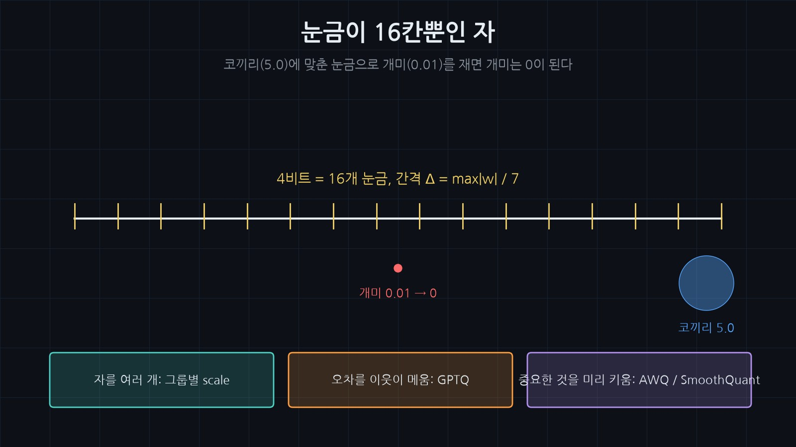

**그림 1.** 4비트는 눈금이 16칸인 자예요. 자 하나로 개미(0.01)와 코끼리(5.0)를 같이 재면, 코끼리에 맞춘 눈금 간격(0.3)이 개미보다 커서 개미는 전부 0이 돼요. 해결책은 두 가지예요. **자를 여러 개 쓰거나**(그룹별 scale), **중요한 것부터 정확히 재고 오차를 다른 데서 메우는 것**(GPTQ), 또는 **잴 때 자주 쓰이는 것을 미리 크게 만들어 두는 것**(AWQ, SmoothQuant)이에요.

### 0-2. 직접 재 보기: 실제 모델을 4비트로 깎으면

SmolLM2-135M(공개 모델)의 Linear 210개를 4비트로 양자화하고, 『이상한 나라의 앨리스』(퍼블릭 도메인) 중간 이후 4096토큰으로 perplexity를 쟀어요. 보정(calibration)에는 앞부분 8192토큰을 썼어요.

| 방법 | 형식 | PPL (낮을수록 좋음) |
|---|---|---|
| FP32 원본 | 32 bit | **13.49** |
| RTN, 출력 채널별 scale | W4 | 28.99 |
| RTN, 64개 그룹별 scale | W4 g64 (4.25 bit) | 18.60 |
| AWQ | W4 g64 | **16.23** |
| GPTQ | W4 g64 | **16.55** |
| 활성값까지 INT8, 그냥 | W8A8 | 29.49 |
| SmoothQuant | W8A8 | **16.49** |

그냥 반올림은 PPL을 2배 넘게 망가뜨리고, 입력을 보고 양자화하는 방법들은 원본의 1.2배 안으로 지켜요. 같은 4.25비트인데 차이가 이만큼 나요.

이제 정식 용어로 하나씩 자세히 볼게요.

## 1. 비트당 비용: 4비트는 사실 4비트가 아니다

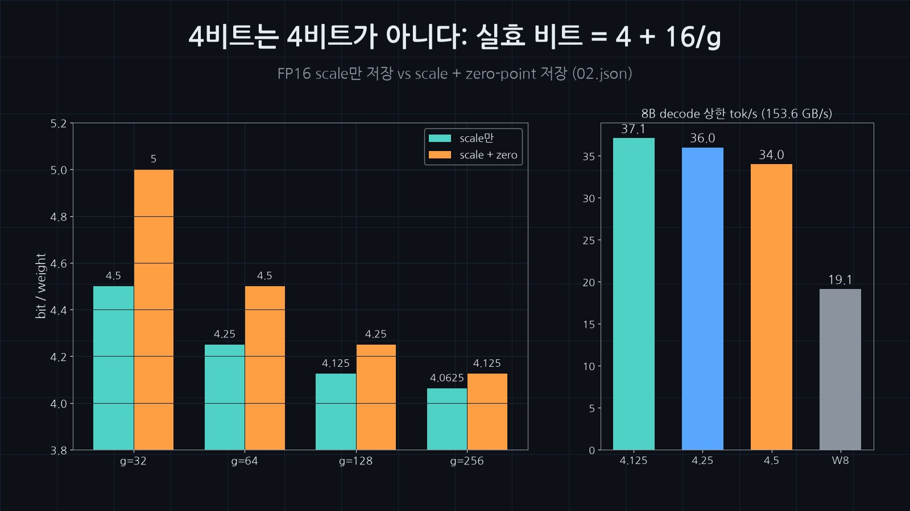

**그림 2.** 그룹 양자화는 g개 가중치마다 scale(보통 FP16) 하나를 같이 저장한다. 비대칭이면 zero-point도 저장한다.

> **유도 1 — 실효 비트와 tok/s**
> `실효 비트 = 4 + 16/g` (scale만), `4 + 32/g` (scale + zero-point)
> g=32 → 4.5 / 5.0, g=64 → **4.25** / 4.5, g=128 → **4.125** / 4.25
> 1장 상한 식에 대입(Llama-3.1-8B, 153.6 GB/s): 4.125 bit → 37.1, 4.25 bit → 36.0, 4.5 bit → 34.0, W8 → 19.1 tok/s

그룹을 작게 할수록 정확해지지만 바이트와 scale 연산이 늘어난다. 4.125비트와 4.5비트의 차이는 decode 속도로 9%다.

## 2. W4A16 · W8A8 · W4A8: 어디서 역양자화하나

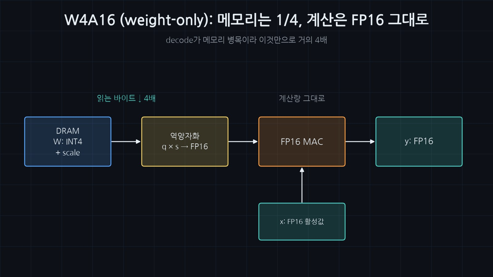

**그림 3.** **W4A16**(weight-only): 가중치만 4비트로 저장하고, 읽어 온 직후 16비트로 풀어서 FP16 MAC으로 곱한다. 메모리 바이트는 1/4이 되지만 계산은 FP16 그대로다. decode는 메모리 병목이니 이것만으로 거의 4배 빨라진다.

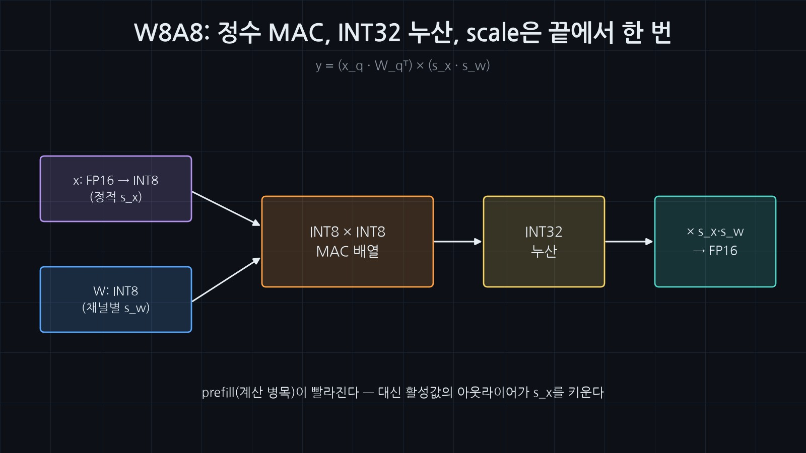

**그림 4.** **W8A8**: 가중치와 활성값을 둘 다 INT8로 만들어 **정수 MAC**으로 곱하고, INT32로 누산한 뒤 끝에서 한 번만 `scale_x × scale_w`를 곱한다. 정수 MAC은 같은 면적에서 FP16보다 여러 배 많이 넣을 수 있어 **prefill(계산 병목)**이 빨라진다. 대신 활성값을 양자화해야 해서 아웃라이어 문제가 생긴다(3절).

```python
# W8A8 한 줄 요약 — 정수 곱, INT32 누산, 끝에서 scale 한 번
y_int32 = x_int8.to(torch.int32) @ w_int8.to(torch.int32).T     # NPU의 정수 MAC 배열
y = y_int32.float() * (s_x * s_w)                                  # per-tensor s_x, per-channel s_w
```

Roofline(1장)으로 보면 W4A16은 점을 **오른쪽으로**(AI 1 → 3.88) 옮기고, W8A8은 **지붕을 위로**(정수 피크) 올린다. W4A8은 둘 다 노린다.

## 3. 아웃라이어: 몇 개 채널이 다른 채널보다 수십 배 크다

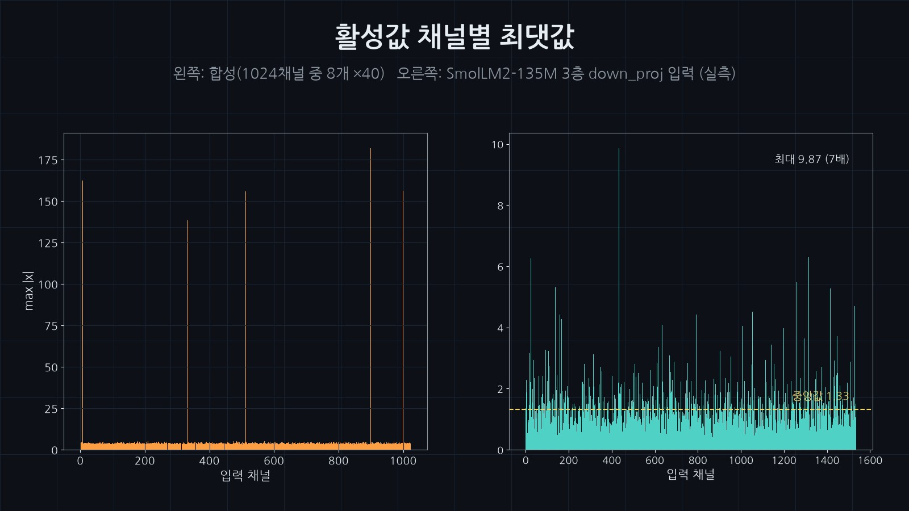

**그림 5.** 왼쪽: 합성 데이터의 채널별 최댓값(1024채널 중 8개를 40배로 키움). 오른쪽: SmolLM2-135M 3층 `down_proj` 입력의 실제 채널별 최댓값(보정 데이터 8192토큰).

LLM.int8() 논문(Dettmers et al., 2022)은 6.7B 이상 모델에서 소수의 hidden 채널이 다른 채널보다 최대 수십~100배 큰 값을 꾸준히 낸다는 것을 보였다. 135M 모델에서는 덜 극단적이다. 실측으로 3층 `q_proj` 입력은 채널 중앙값 0.60, 최대 5.41(9배), `down_proj` 입력은 중앙값 1.33, 최대 9.87(7배)였다. 그런데도 0-2절의 W8A8은 PPL 29로 무너졌다. **per-tensor scale 하나가 모든 토큰의 최댓값을 감당해야 해서**, 보통 값들은 255칸 중 몇 칸만 쓰게 되기 때문이다.

## 4. RTN → per-channel → per-group: 오차 식과 실측

양자화 간격이 Δ인 균일 양자화에서 반올림 오차는 [−Δ/2, Δ/2]에 고르게 퍼진다고 보면 분산은 Δ²/12다.

> **유도 2 — 균일 양자화 오차 Δ²/12**
> 대칭 absmax 4비트: Δ = max|w| / 7
> 오차 ε ~ U(−Δ/2, Δ/2) → E[ε²] = ∫ ε² dε / Δ = **Δ²/12**
> scale을 잘게 나눌수록(텐서 → 채널 → 그룹) 각 구간의 max|w|가 작아져 Δ도 작아진다.

```python
def q_sym(w, bits, dim=None, group=None):
    qmax = 2 ** (bits - 1) - 1
    if group:
        O, I = w.shape; wg = w.reshape(O, I // group, group)
        s = wg.abs().amax(-1, keepdim=True) / qmax
        return ((wg / s).round().clamp(-qmax - 1, qmax) * s).reshape(O, I)
    s = (w.abs().amax() if dim is None else w.abs().amax(dim, keepdim=True)) / qmax
    return (w / s).round().clamp(-qmax - 1, qmax) * s
```

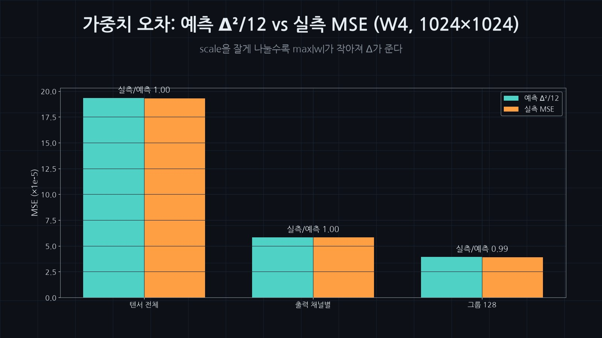

**그림 6.** 같은 1024×1024 가중치에서 scale을 나누는 세 가지 방법과, 예측(Δ²/12)과 실측 가중치 MSE.

| W4 scale 단위 | 예측 Δ²/12 | 실측 MSE | 실측/예측 |
|---|---|---|---|
| 텐서 전체 | 1.934e-4 | 1.930e-4 | 1.00 |
| 출력 채널별 | 5.836e-5 | 5.828e-5 | 1.00 |
| 그룹 128 | 3.933e-5 | 3.901e-5 | 0.99 |

식이 세 자리까지 맞는다. 그런데 **가중치 MSE가 작다고 출력이 정확한 것은 아니다.** 출력 `y = Wx`의 오차는 `(Ŵ − W)x`라서, 큰 입력 채널(아웃라이어)에 곱해지는 가중치의 오차가 훨씬 비싸다. 아래 GPTQ·AWQ는 이 점을 이용한다.

## 5. GPTQ: 한 열씩 양자화하고 오차를 남은 열에 떠넘긴다

GPTQ(Frantar et al., 2022)는 층별로 출력 오차 ‖WX − ŴX‖²를 최소화한다. 목표 함수의 Hessian은 `H = 2XXᵀ`(입력의 2차 통계)이고, Optimal Brain Surgeon(OBS)의 결과를 쓰면 열 i를 양자화하면서 생긴 오차를 아직 양자화하지 않은 열들에 최적으로 보정할 수 있다.

> **유도 3 — GPTQ의 열 업데이트**
> 열 i의 양자화 오차 e = (wᵢ − q(wᵢ)) / [H⁻¹]ᵢᵢ
> 남은 열 업데이트: W[:, i+1:] ← W[:, i+1:] − e · [H⁻¹]ᵢ,ᵢ₊₁:
> 계산을 안정적으로 하려고 H⁻¹의 Cholesky 상삼각 U를 쓰면 위 두 줄이 그대로 `U[i,i]`, `U[i, i+1:]`가 된다.

```python
def gptq(w, X=None, bits=4, group=128, damp=0.01, H=None):
    W = w.clone().double(); O, I = W.shape; qmax = 2 ** (bits - 1) - 1
    H = (2 * X.double().T @ X.double() / X.shape[0]) if H is None else H.clone()
    H += damp * H.diag().mean() * torch.eye(I, dtype=H.dtype)          # 수치 안정용 감쇠
    U = torch.linalg.cholesky(torch.cholesky_inverse(torch.linalg.cholesky(H)), upper=True)
    Q = torch.zeros_like(W)
    for i in range(I):
        if i % group == 0:                                               # 그룹 시작: 보정된 현재 값으로 scale
            s = W[:, i:i + group].abs().amax(1).clamp(min=1e-8) / qmax
        q = (W[:, i] / s).round().clamp(-qmax - 1, qmax) * s
        Q[:, i] = q
        err = (W[:, i] - q) / U[i, i]
        W[:, i + 1:] -= err.unsqueeze(1) * U[i, i + 1:].unsqueeze(0)    # OBS 보정
    return Q.float()
```

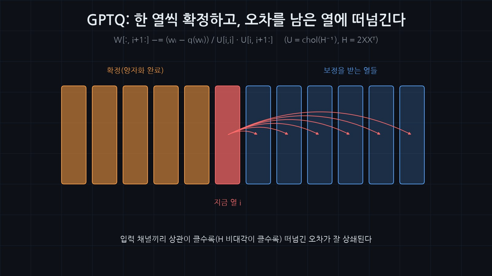

**그림 7.** 왼쪽 열부터 하나씩 확정하고(진한 색), 그 오차를 오른쪽 열들이 흡수한다. 입력끼리 상관이 클수록(H의 비대각 성분이 클수록) 보정 효과가 크다.

실험하면서 배운 점 하나. 입력 채널이 서로 독립인 i.i.d. 가우시안으로 합성 데이터를 만들었더니 GPTQ가 오히려 RTN보다 나빴다. H가 거의 단위행렬이면 다른 열로 떠넘길 "상관"이 없고, 보정 표본 수(2048)가 차원(1024)에 비해 적으면 보정 데이터에 과적합한다. 실제 활성값처럼 "저차원 + 잡음" 구조를 넣고 표본을 4096개로 늘리자 1.39e-2 → **3.24e-3**으로 4배 좋아졌다(6절 표).

## 6. AWQ: 중요한 입력 채널의 가중치를 키워서 양자화한다

AWQ(Lin et al., 2023)의 관찰은 간단하다. 큰 활성값이 곱해지는 가중치 채널(약 1%)만 지켜도 오차가 크게 준다. 그런데 그 채널만 FP16으로 두면 형식이 섞여 하드웨어가 싫어한다. 그래서 **입력 채널 j의 가중치를 s_j배 키운 뒤 양자화하고, 입력은 1/s_j배** 한다. 수학적으로 `W·x = (W·diag(s))·(diag(s)⁻¹·x)`라서 결과는 같지만, 키운 채널은 양자화 간격 대비 값이 커져 상대오차가 준다.

```python
def awq(w, X, bits=4, group=128, grid=20):
    xmean = X.abs().mean(0); ref = X @ w.T; best = (float("inf"), None, None)
    for a in torch.linspace(0, 1, grid + 1):               # s = mean|x|^α 에서 α 탐색
        s = xmean ** a; s = s / (s.max() * s.min()).sqrt()
        wq = q_sym(w * s, bits, group=group) / s            # 실제 배포에선 1/s를 앞 층에 접어 넣는다
        e = ((X @ wq.T - ref) ** 2).mean().item()
        if e < best[0]: best = (e, wq, float(a))
    return best[1], best[2]
```

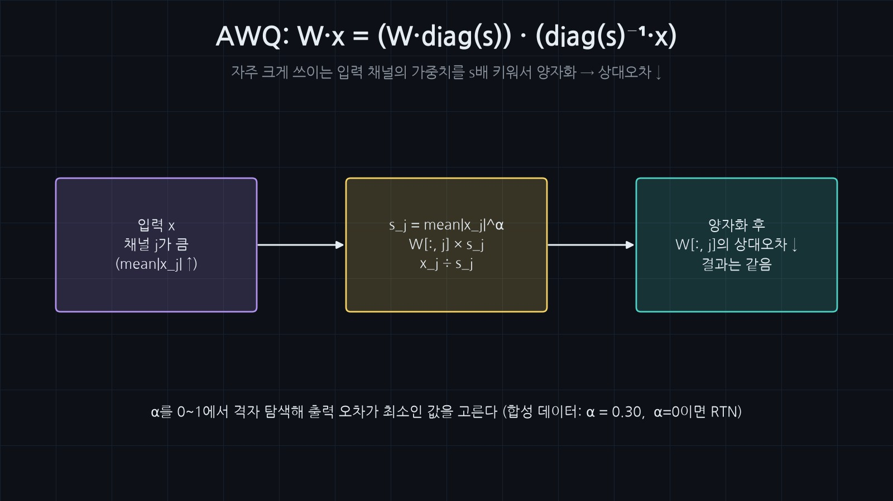

**그림 8.** α를 0에서 1까지 바꾸며 보정 데이터의 출력 오차를 잰다. 합성 데이터에서는 α=0.30이 골라졌다. α=0이면 RTN과 같다.

## 7. SmoothQuant: 활성값의 어려움을 가중치로 옮긴다

W8A8에서는 활성값도 양자화해야 하는데, 아웃라이어 채널이 per-tensor scale을 키운다. SmoothQuant(Xiao et al., 2022)는 AWQ와 같은 등식을 반대 방향으로 쓴다. 활성값 채널 j를 s_j로 **나누고** 가중치 행을 s_j배 한다.

> **유도 4 — SmoothQuant 이동 강도 α**
> `Y = (X·diag(s)⁻¹)·(diag(s)·W)`,  `s_j = max|X_j|^α / max|W_j|^(1−α)`
> α=0.5이면 스무딩 후 채널 j의 활성값 최대 = √(max|X_j|·max|W_j|) = 가중치 최대 → 두 쪽이 같은 "난이도"
> α↑ → 활성값은 쉬워지고 가중치가 어려워진다.

```python
def smooth_scales(X, w, alpha=0.5):
    return X.abs().amax(0).clamp(min=1e-5) ** alpha / w.abs().amax(0).clamp(min=1e-5) ** (1 - alpha)

s = smooth_scales(Xc, w); sc = (Xc / s).abs().amax() / 127          # 보정 데이터로 정적 scale
y = q_act(Xt / s, scale=sc) @ q_sym(w * s, 8, dim=1).T                # INT8 × INT8
```

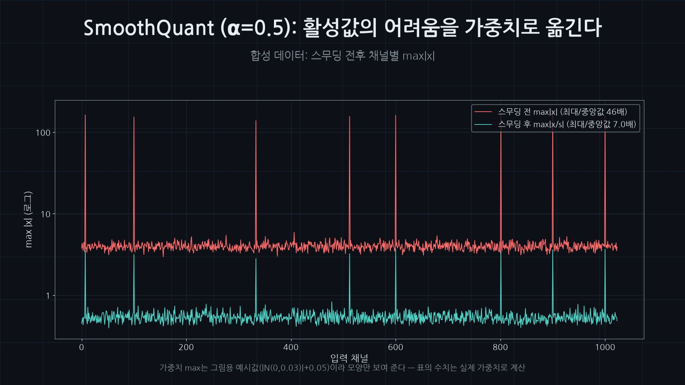

**그림 9.** 합성 데이터에서 스무딩 전후의 활성값 채널별 최댓값(α=0.5). 뾰족한 채널이 깎이고 그만큼 가중치 쪽이 커진다. 그림의 가중치 최댓값은 모양을 보여 주기 위한 예시값이고, 아래 표의 수치는 실제 가중치로 계산했다.

합성 Linear(1024×1024, 아웃라이어 8채널 ×40)에서 다섯 방법을 같은 표로 비교했다(출력 상대오차, 낮을수록 좋음).

| 방법 | 출력 상대오차 |
|---|---|
| W4 per-tensor RTN | 6.82e-2 |
| W4 per-channel RTN | 2.05e-2 |
| W4 g128 RTN | 1.39e-2 |
| W4 g128 GPTQ | **3.24e-3** |
| W4 g128 AWQ | **3.07e-3** |
| W8A8 그냥 | 1.18e-2 |
| W8A8 SmoothQuant | **4.69e-4** |

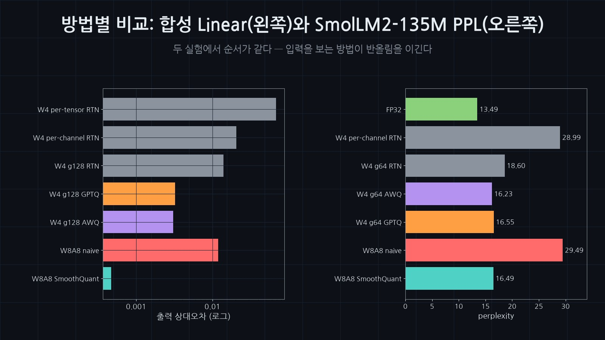

**그림 10.** 위 표(왼쪽, 합성)와 0-2절의 SmolLM2-135M perplexity(오른쪽, 실측)를 나란히 그렸다. 두 실험에서 순서가 같다. 입력을 보는 방법이 RTN을 이기고, 그룹이 채널을 이긴다.

## 8. 회전 계열과 1.58비트 — 어디까지 왔나

아웃라이어를 "옮기는" 대신 **없애는** 방법도 있다. QuaRot(Ashkboos et al., 2024)은 hidden 차원에 직교 행렬(아다마르 회전)을 곱한다. `x·W = (x·R)(Rᵀ·W)`이고, 회전된 x는 큰 값이 모든 채널에 고르게 퍼져서 W4A4까지 간다. SpinQuant(Liu et al., 2024)는 회전을 학습한다. 반대쪽 끝에는 처음부터 가중치를 {−1, 0, +1}로 학습하는 BitNet b1.58(Ma et al., 2024)이 있다. 곱셈이 덧셈이 되므로 NPU 설계 자체가 바뀌는 방향이다. 이들은 이 장의 예제에서 구현하지 않았고, 개념만 소개한다.

## 9. NPU 관점: 형식이 연산기와 맞아야 이득이다

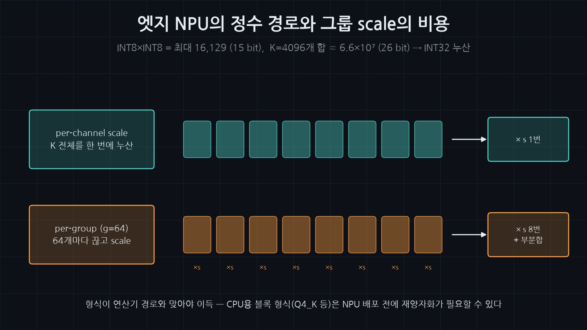

**그림 11.** 엣지 NPU의 정수 경로. INT8×INT8 곱을 INT32로 누산하고, 출력 채널별 scale을 마지막에 곱한다. per-group scale(g=64)이면 K방향 64개마다 누산을 끊고 scale을 곱해 다시 더해야 해서, 누산기·scale 곱셈기·제어가 더 필요하다.

> **유도 5 — 누산 폭**
> INT8×INT8 곱의 최대 크기 127 × 127 = 16,129 (15 bit). K=4096개를 더하면 최대 4096 × 16,129 ≈ 6.6 × 10⁷ (26 bit)
> → INT16 누산은 넘치고, **INT32**는 여유가 있다(4장 RMSNorm에서 같은 문제를 실제로 재현한다).

정리하면, 엣지 NPU에서 의미 있는 질문은 "몇 비트냐"가 아니라 **"이 형식을 연산기가 직접 먹느냐"**다.

- 가중치만 4비트(W4A16)는 연산기에 FP16(또는 INT8로 다시 양자화한) 경로가 있어야 하고, 역양자화 유닛이 대역폭을 따라와야 한다. decode에 가장 효과적이다.
- W8A8은 정수 MAC을 쓰므로 prefill에 효과적이지만, 활성값 보정(SmoothQuant 등)과 정적 scale이 필요하다.
- GGUF의 Q4_K 같은 블록 형식(6장)은 CPU용으로 설계돼 NPU 정수 경로와 맞지 않을 수 있다. 그러면 배포 전에 재양자화해야 한다.

> **엣지 NPU에서는:** 공개 자료에 "양자화 변형(quantized variant) 벤치마크"라고만 적혀 있고 형식이 없다면, 위의 어느 경로인지 알 수 없다. W4A16이면 decode가, W8A8이면 prefill이 주로 빨라진다. 발표 숫자를 읽을 때 **형식(가중치 비트·활성값 비트·그룹 크기)을 먼저 확인**해야 하는 이유다.

## 실패 장면: calibration 데이터를 엉뚱하게 고르면

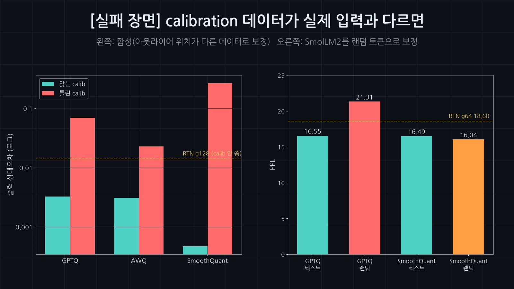

**그림 12.** 보정 데이터가 실제 입력과 다를 때. 왼쪽: 합성 데이터에서 아웃라이어 채널 위치가 다른 데이터로 보정. 오른쪽: SmolLM2-135M을 텍스트 대신 **랜덤 토큰**으로 보정.

| 합성 Linear (출력 상대오차) | 맞는 calib | 틀린 calib |
|---|---|---|
| RTN g128 (calib 안 씀) | 1.39e-2 | 1.39e-2 |
| GPTQ g128 | 3.24e-3 | **6.91e-2** (RTN의 5배 나쁨) |
| AWQ g128 | 3.07e-3 | **2.27e-2** |
| SmoothQuant W8A8 | 4.69e-4 | **2.64e-1** |

| SmolLM2-135M (PPL) | 텍스트 calib | 랜덤 토큰 calib |
|---|---|---|
| GPTQ W4 g64 | 16.55 | **21.31** (RTN g64 18.60보다 나쁨) |
| SmoothQuant W8A8 | 16.49 | 16.04 |

GPTQ는 보정 데이터의 2차 통계(H)에 맞춰 가중치를 **적극적으로 비튼다.** 그래서 보정이 틀리면 아무것도 안 한 RTN보다 나빠진다. 흥미롭게도 실제 모델의 SmoothQuant는 랜덤 토큰으로 보정해도 나빠지지 않았다. 원인은 측정하지 않았지만 가장 그럴듯한 설명(추정)은 이렇다. 랜덤 토큰에서 잰 활성값 최댓값이 텍스트와 달라 per-tensor 정적 scale이 바뀌었고, 실제 텍스트의 드문 큰 값을 잘라 내는(clipping) 손해보다 나머지 값의 해상도 이득이 컸다. "최댓값으로 scale을 잡는 것이 최선은 아니다"라는 percentile 보정의 근거와 같은 현상이다. 보정 데이터는 **실제로 쓸 도메인의 텍스트**로, 수백~수천 토큰 이상을 쓰는 것이 기본이다.

## 자주 묻는 질문

**Q. GPTQ와 AWQ 중 무엇을 고르나요?**
이 실험에서는 비슷했어요(합성 3.24e-3 vs 3.07e-3, 실제 16.55 vs 16.23). AWQ는 가중치를 비틀지 않고 scale만 바꿔서 보정 데이터 과적합에 덜 민감하고 빠르며, GPTQ는 그룹·순서 같은 옵션이 많아요. 둘을 같이 쓰기도 해요(AWQ scale 적용 후 GPTQ).

**Q. 4비트면 품질도 1/4이 되나요?**
아니에요. 크기는 1/4(정확히는 4.125/16)이지만, 잘 하면 PPL은 원본의 1.2배 안이에요. 큰 모델일수록 4비트에 더 강하다는 보고가 많아요.

**Q. KV 캐시도 4비트로 줄일 수 있나요?**
네, 그리고 엣지에서는 중요해요. K와 V는 분포가 달라서 축을 다르게 잡아요. 3장에서 다뤄요.

**Q. 요즘 FP8·MXFP4 얘기가 나오는 이유는요?**
정수 대신 지수를 가진 작은 부동소수점은 큰 값과 작은 값을 같이 표현하기 쉬워요. MXFP4는 4비트 값 32개가 8비트 지수 scale 하나를 공유하는 형식(OCP Microscaling 명세)이고, gpt-oss의 전문가 가중치가 이 형식으로 공개됐어요(9장).

## 퀴즈

1. g=64, scale(FP16)만 저장할 때 실효 비트는? → 4 + 16/64 = 4.25 bit.
2. SmoothQuant에서 α를 1로 하면? → s_j = max|X_j| / 1 → 활성값은 모든 채널 최대가 1이 되고, 어려움이 전부 가중치로 간다.
3. W4A16에서 MAC은 몇 비트로 도나요? → 가중치를 16비트로 풀어 FP16(또는 BF16) MAC으로 돈다. 정수 4비트 MAC이 아니다.

## 정리

- 실효 비트는 4 + 16/g. decode 속도는 비트에 반비례한다(1장 식).
- RTN은 쉽지만 실제 모델 PPL을 13.5 → 29로 무너뜨렸다. 그룹(18.6) → AWQ·GPTQ(16.2–16.6)로 갈수록 지켜진다.
- W8A8은 활성값 아웃라이어가 문제이고, SmoothQuant가 그 어려움을 가중치로 옮겨 PPL 29.5 → 16.5로 지켰다.
- 보정 데이터가 틀리면 GPTQ는 RTN보다 나빠진다. NPU에서는 형식이 연산기 경로와 맞아야 이득이다.

## 참고 (공개 자료)

- E. Frantar et al., "GPTQ: Accurate Post-Training Quantization for Generative Pre-trained Transformers", arXiv:[2210.17323](https://arxiv.org/abs/2210.17323)
- J. Lin et al., "AWQ: Activation-aware Weight Quantization for LLM Compression and Acceleration", arXiv:[2306.00978](https://arxiv.org/abs/2306.00978)
- G. Xiao et al., "SmoothQuant: Accurate and Efficient Post-Training Quantization for Large Language Models", arXiv:[2211.10438](https://arxiv.org/abs/2211.10438)
- T. Dettmers et al., "LLM.int8(): 8-bit Matrix Multiplication for Transformers at Scale", arXiv:[2208.07339](https://arxiv.org/abs/2208.07339)
- S. Ashkboos et al., "QuaRot: Outlier-Free 4-Bit Inference in Rotated LLMs", arXiv:[2404.00456](https://arxiv.org/abs/2404.00456)
- Z. Liu et al., "SpinQuant: LLM quantization with learned rotations", arXiv:[2405.16406](https://arxiv.org/abs/2405.16406)
- S. Ma et al., "The Era of 1-bit LLMs: All Large Language Models are in 1.58 Bits", arXiv:[2402.17764](https://arxiv.org/abs/2402.17764)
- B. D. Rouhani et al., "Microscaling Data Formats for Deep Learning", arXiv:[2310.10537](https://arxiv.org/abs/2310.10537)
- PyTorch torchao: <https://github.com/pytorch/ao>
- L. Ben Allal et al., "SmolLM2: When Smol Goes Big", arXiv:[2502.02737](https://arxiv.org/abs/2502.02737) · 모델: <https://huggingface.co/HuggingFaceTB/SmolLM2-135M>
- 평가 텍스트: Lewis Carroll, *Alice's Adventures in Wonderland*, Project Gutenberg #11 (퍼블릭 도메인) <https://www.gutenberg.org/ebooks/11>

검증 환경: 합성 실험은 CPU 1스레드, `--real`은 CPU 8스레드(perplexity라 시간과 무관), PyTorch 2.15.0+cpu, transformers 5.23.0. 모든 양자화는 fake-quant(양자화 후 즉시 역양자화)로 검증했다. 결과 원본은 `02-quantization/results/02.json`, `02_real.json`.

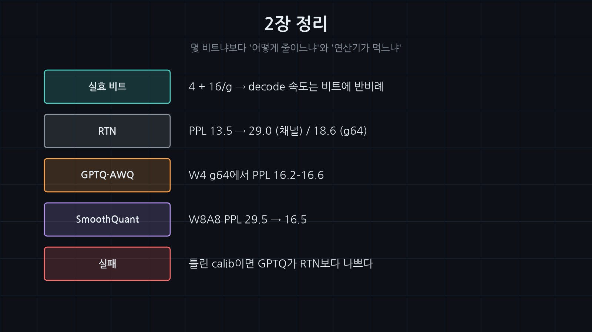

**그림 13.** 2장 정리.

---

> **온디바이스 LLM 시리즈** · [전체 목차](/blog/2026/11/16/ondevice-llm-series/)  
> ← 이전: [1. 80 TOPS인데 왜 30 tok/s일까](/blog/2026/11/16/ondevice-llm-01-roofline-bandwidth/)  
> → 다음: [3. 메모장이 가중치보다 커질 때](/blog/2026/11/16/ondevice-llm-03-kv-cache-design/)
