> **온디바이스 LLM 시리즈** · [전체 목차](/blog/2026/11/16/ondevice-llm-series/)  
> ← 이전: [2. 4비트로 줄이고도 답을 지키는 법](/blog/2026/11/16/ondevice-llm-02-llm-quantization/)  
> → 다음: [4. 어떤 연산을 어디서 돌릴까](/blog/2026/11/16/ondevice-llm-04-npu-cpu-dsp-split/)

> 이 글의 예제 코드 전체: [kjoh94/ondevice-llm-examples/tree/main/03-kv-cache](https://github.com/kjoh94/ondevice-llm-examples/tree/main/03-kv-cache) (`python example.py`, 실제 모델은 `python example.py --real`)

> 이 글은 공개 자료만 사용했고, 어떤 회사의 공식 입장도 아닙니다. "가상 엣지 NPU"의 숫자는 공개된 일반 스펙 수준의 값에 가정을 더한 계산 예시입니다.

> **처음이라면 이것만 기억하세요.** decode는 지금까지의 모든 토큰의 K와 V를 매번 다시 읽어요(KV 캐시). Llama-3.1-8B는 토큰 하나에 **128 KiB**라서, 128K 토큰이면 **16 GiB**로 4비트 가중치(4.1 GB)의 4배가 돼요. 엣지에서는 이 메모장이 **용량(몇 토큰까지 담나)**과 **대역폭(얼마나 느려지나)** 두 가지 예산을 동시에 먹어요.

선수 글: [PyTorch 11장 — KV 캐시](/blog/2026/10/25/pytorch-11-llm-inference/), [온디바이스 LLM: prefill·decode·KV 캐시](/blog/2026/10/25/ondevice-llm-prefill-decode-kv-cache/), [tokens 4편 — KV 캐시](/blog/2026/10/31/tokens-04-kv-cache/)

[PyTorch 11장](/blog/2026/10/25/pytorch-11-llm-inference/)에서 KV 캐시가 "다시 계산하지 않으려고 적어 두는 메모장"이라는 것을 봤어요. 1장의 상한 식에는 `가중치 + KV 바이트`가 들어 있었는데, 지금까지는 KV를 0으로 놓고 계산했어요. 이 장에서는 그 KV 항을 제대로 계산하고, 캐시를 어떤 모양으로 잡아야 NPU 컴파일러가 좋아하는지, 그리고 어떻게 줄이는지를 실험으로 확인해요.

## 0. 비유로 먼저

### 0-1. 회의록이 회의 자료보다 두꺼워진다

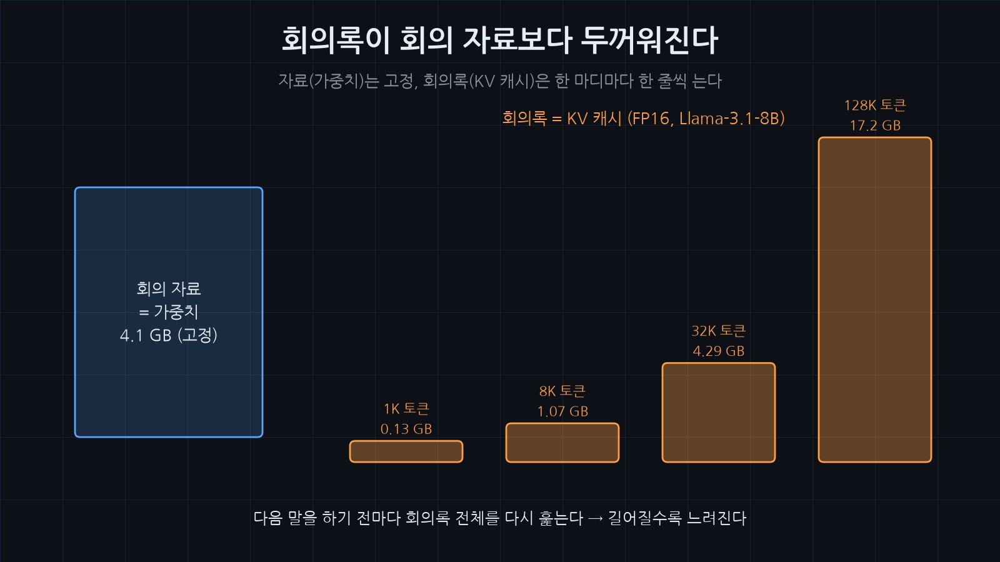

**그림 1.** 회의 자료(가중치)는 처음부터 크기가 정해져 있어요. 그런데 회의록(KV 캐시)은 한 마디(토큰)마다 한 줄씩 늘고, 다음 말을 하기 전에 **회의록 전체를 처음부터 다시 훑어봐야** 해요. 회의가 길어지면 회의록이 자료보다 두꺼워지고, 훑는 시간이 말하는 시간을 잡아먹어요.

### 0-2. 직접 계산해 보기

| Llama-3.1-8B (FP16 KV) | KV 크기 | 가중치(W4 g128) 대비 |
|---|---|---|
| 1 토큰 | 128 KiB | — |
| 8K 토큰 | 1.00 GiB | 0.26배 |
| 128K 토큰 | **16.0 GiB** | **4.1배** |
| (같은 모델이 GQA 없이 MHA였다면) 128K | 64 GiB | 16.6배 |

이제 정식 용어로 하나씩 자세히 볼게요.

## 1. KV 캐시 크기: 공식 하나로 끝난다

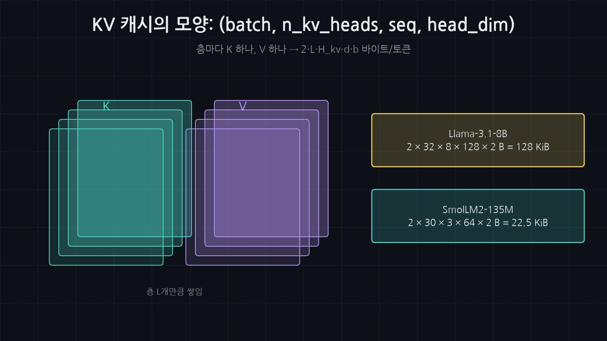

**그림 2.** 층마다 K와 V가 하나씩 있고, 각각의 모양은 `(batch, n_kv_heads, seq, head_dim)`이다.

> **유도 1 — 토큰당 KV 바이트**
> `KV/token = 2 (K와 V) × L (층) × H_kv (KV 헤드) × d (헤드 차원) × b (바이트)`
> Llama-3.1-8B: 2 × 32 × 8 × 128 × 2 B = **131,072 B = 128 KiB**
> 128K 토큰: 128 KiB × 131,072 = **16 GiB**. SmolLM2-135M(L=30, H_kv=3, d=64): 22.5 KiB/token

```python
def kv_bytes(cfg, ctx, bytes_per=2.0):
    """K와 V 두 개 × 층 × KV 헤드 × 헤드 차원 × 바이트 × 토큰 수."""
    return 2 * cfg["n_layers"] * cfg["n_kv_heads"] * cfg["head_dim"] * bytes_per * ctx
```

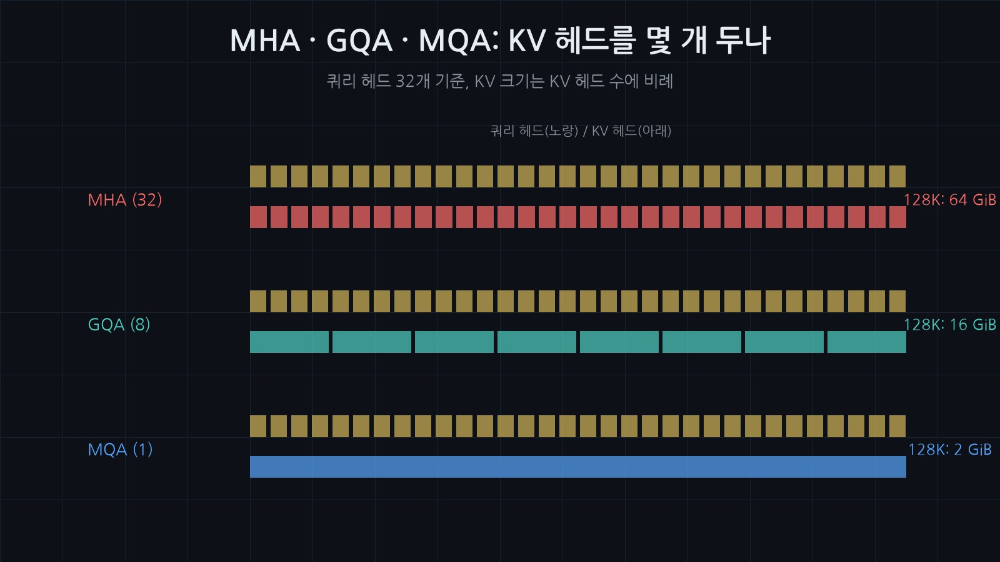

**그림 3.** 쿼리 헤드 32개가 KV 헤드를 얼마나 나눠 쓰나. MHA는 32개, GQA(Ainslie et al., 2023)는 8개(4개 쿼리가 1개 공유), MQA(Shazeer, 2019)는 1개. KV 크기는 KV 헤드 수에 정비례한다. Llama-3.1-8B는 GQA 8이라 MHA 대비 1/4이다.

## 2. 첫 번째 예산 — 용량: 몇 토큰까지 담을 수 있나

> **유도 2 — 최대 컨텍스트**
> `최대 토큰 = (메모리 − 가중치 − 예비) ÷ KV/token`
> 12 GB, 가중치 4.14 GB, 예비(OS·앱·활성값, **가정**) 4 GB → (12 − 4.14 − 4) × 10⁹ ÷ 131,072 ≈ **29,445 토큰**

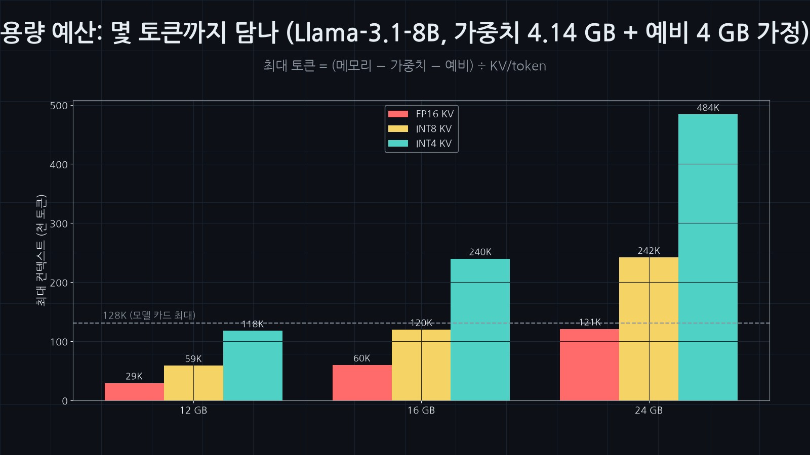

**그림 4.** 메모리 크기와 KV 정밀도별 최대 컨텍스트. 예비 4 GB는 가정이고, 실제 장치에서는 OS와 다른 앱이 쓰는 메모리에 따라 크게 달라진다.

| 장치 메모리 | FP16 KV | INT8 KV | INT4 KV |
|---|---|---|---|
| 12 GB | 29,445 | 58,891 | 117,783 |
| 16 GB | 59,963 | 119,926 | 239,853 |
| 24 GB | 120,998 | 241,997 | 483,994 |

"128K 컨텍스트 지원"이라는 모델 카드 문구와, 그 모델이 장치에서 실제로 담을 수 있는 길이는 다른 문제다. 12 GB 장치라면 FP16 KV로는 3만 토큰이 한계다.

## 3. 두 번째 예산 — 대역폭: 길어질수록 느려진다

> **유도 3 — KV를 포함한 decode 상한**
> `tok/s ≤ BW ÷ (가중치 바이트 + KV/token × ctx)`
> 8K: 153.6 GB/s ÷ (4.14 GB + 1.07 GB) = **29.5 tok/s**,  128K: 153.6 ÷ (4.14 + 17.18) = **7.2 tok/s**
> 가중치와 KV가 같아지는 길이: 4.14 × 10⁹ ÷ 131,072 ≈ **31.6K 토큰** — 여기서부터 KV가 속도를 주도한다.

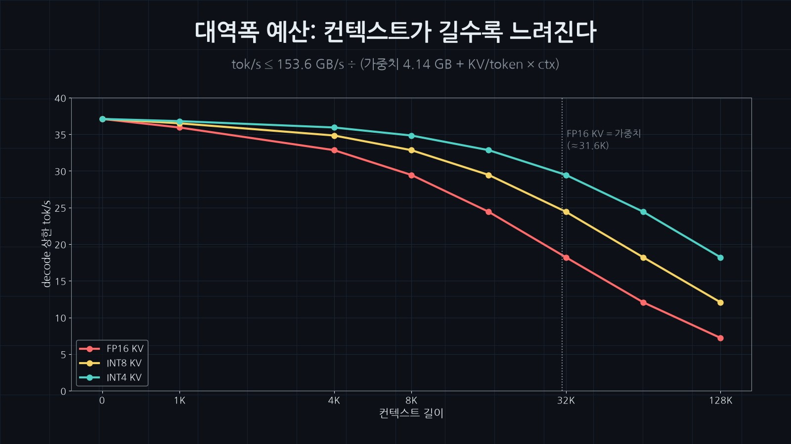

**그림 5.** 가상 엣지 NPU(153.6 GB/s, W4 g128)에서 컨텍스트 길이별 decode 상한. INT4 KV는 FP16 KV보다 같은 속도를 4배 긴 컨텍스트까지 유지한다.

| 컨텍스트 | FP16 KV | INT8 KV | INT4 KV |
|---|---|---|---|
| 0 | 37.1 | 37.1 | 37.1 |
| 8K | 29.5 | 32.8 | 34.8 |
| 32K | 18.2 | 24.4 | 29.5 |
| 128K | **7.2** | 12.1 | 18.2 |

## 4. 캐시의 모양: 정적 vs 동적, 그리고 예측 vs 실측

HuggingFace의 기본 `DynamicCache`는 새 K/V를 `torch.cat`으로 붙인다. 매 스텝 텐서 모양이 바뀐다. NPU 컴파일러는 고정된 모양을 미리 컴파일하므로(5장) 이것을 싫어한다. 그래서 엣지 배포에서는 **최대 길이만큼 미리 잡아 두는 정적 캐시**를 쓴다.

```python
class StaticCache:
    """MAXLEN 칸을 미리 잡아 두고 pos 위치에 써 넣는 캐시 → shape이 절대 안 바뀜."""
    def __init__(self, cfg, batch=1, dtype=torch.float32, sliced=False):
        shape = (batch, cfg.n_kv_heads, cfg.max_seq, cfg.head_dim)
        self.k = torch.zeros(shape, dtype=dtype); self.v = torch.zeros(shape, dtype=dtype)
        self.sliced = sliced        # True면 채워진 앞부분만 읽음

    def update(self, k, v, pos):
        T = k.shape[2]
        self.k[:, :, pos:pos + T] = k; self.v[:, :, pos:pos + T] = v
        if self.sliced:
            return self.k[:, :, :pos + T], self.v[:, :, :pos + T]
        return self.k, self.v            # 항상 MAXLEN 전체 + 마스크

class DynamicCache:
    def update(self, k, v, pos):
        self.k = k if self.k is None else torch.cat([self.k, k], 2)   # 매번 새 버퍼에 복사
        self.v = v if self.v is None else torch.cat([self.v, v], 2)
        return self.k, self.v
```

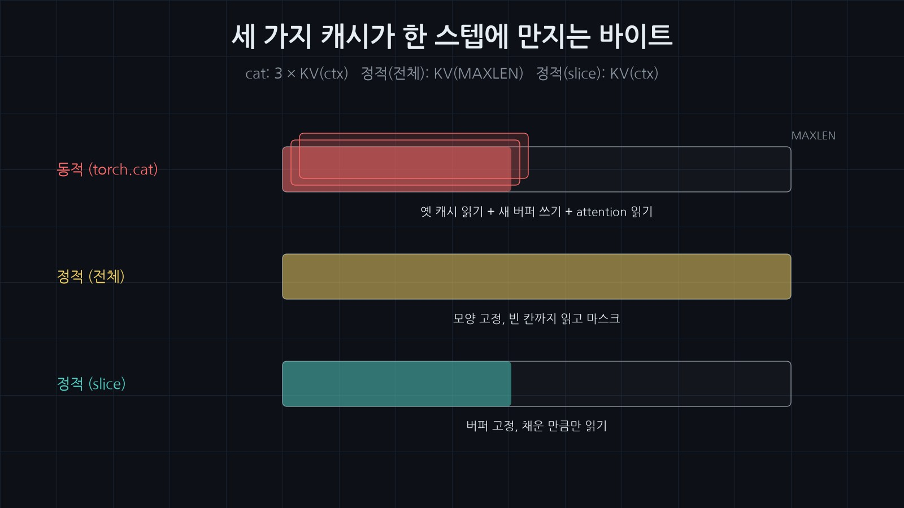

**그림 6.** 세 가지 캐시가 한 스텝에 읽고 쓰는 바이트. `cat`은 옛 캐시를 읽어 새 버퍼에 쓰고(2×) attention이 다시 읽는다(1×). 정적(전체)은 항상 MAXLEN을 읽는다. 정적(slice)은 채운 만큼만 읽는다.

> **유도 4 — 캐시별 스텝 시간 모델**
> `t ≈ (가중치 바이트 + f × KV(읽는 길이)) ÷ BW`
> cat: f = 3, 읽는 길이 = ctx  /  정적 전체: f = 1, 길이 = MAXLEN  /  정적 slice: f = 1, 길이 = ctx
> 기울기(1K 토큰당 추가 시간): cat = 3 × 32 KiB × 1024 ÷ BW, slice = 1 × 32 KiB × 1024 ÷ BW → **cat의 기울기가 3배**

미니 Llama(34.1M, MHA 8헤드라 KV가 일부러 큰 설정, FP32 KV 32 KiB/token, MAXLEN 4096)를 CPU 1스레드로 재 봤다. 측정 대역폭은 27.0 GB/s다.

| ctx | cat 예측 | cat 실측 | 정적(전체) 예측 | 정적(전체) 실측 | 정적(slice) 예측 | 정적(slice) 실측 |
|---|---|---|---|---|---|---|
| 256 | 5.99 | 7.79 | 10.04 | 22.62 | 5.37 | 6.88 |
| 1024 | 8.79 | 11.64 | 10.04 | 23.41 | 6.30 | 8.77 |
| 2048 | 12.53 | 17.85 | 10.04 | 22.73 | 7.55 | 13.03 |
| 3072 | 16.26 | 29.34 | 10.04 | 23.55 | 8.79 | 14.09 |
| 4000 | 19.64 | 34.36 | 10.04 | 23.78 | 9.92 | 24.31 |

(단위 ms/token, 측정은 decode 12스텝 중 처음 2스텝을 뺀 중앙값)

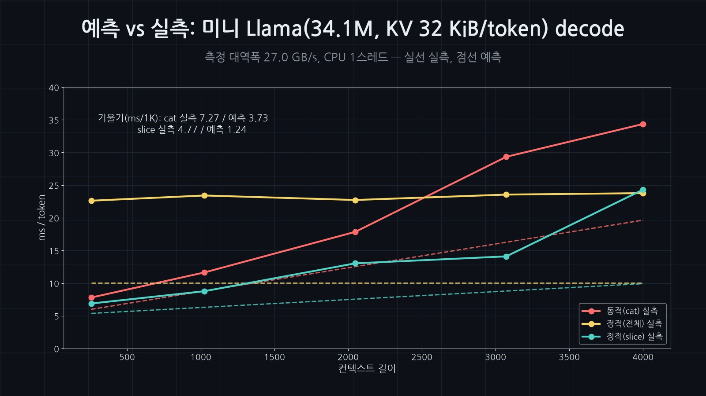

**그림 7.** 위 표를 그린 것. 맞는 것과 틀린 것이 분명하다.

- **모양은 맞았다.** 정적(전체)은 컨텍스트와 무관하게 평평하고(22.6–23.8 ms), cat이 가장 가파르다. 기울기 실측은 cat 7.27, slice 4.77 ms/1K로 cat이 1.5배 가파르다.
- **절대값은 틀렸다.** 실측 기울기가 예측(cat 3.73, slice 1.24)의 2–4배다. 모델은 바이트만 셌지만, 실제로는 `q·Kᵀ`와 softmax, 마스크 생성 같은 계산과 작은 커널의 고정 비용이 있다. 정적(전체)이 예측의 2.3배인 것도 4096칸 전체에 대한 attention 계산과 마스크 때문이다.
- 정적 캐시와 동적 캐시의 결과는 **완전히 같다.** 생성 40토큰이 일치했고 prefill logits 최대 차이는 0.0이다. 모양만 바뀌고 수학은 같다.

엣지에서의 결론: **정적 캐시는 컴파일러를 위해 필수이지만, MAXLEN 전체를 매번 읽으면 짧은 대화에서 손해**다. 그래서 실제 런타임은 길이 버킷(5장)이나 페이지 단위 관리(PagedAttention, Kwon et al., 2023)로 "고정된 모양 + 필요한 만큼만 읽기"를 함께 노린다.

## 5. KV 양자화: K와 V는 다른 축으로 잘라야 한다

KV도 2장처럼 줄일 수 있다. 다만 **어느 축으로 scale을 잡느냐**가 중요하다. KIVI(Liu et al., 2024)는 K는 채널 방향으로 큰 값이 몰리는 경향이 있어 **채널별**, V는 **토큰별**로 양자화하라고 제안했다.

```python
def fq(x, bits, dim):
    """dim 축을 따라 absmax 대칭 양자화. K/V shape (H, T, d): dim=-1 → 토큰별, dim=-2 → 채널별."""
    qmax = 2 ** (bits - 1) - 1
    s = x.abs().amax(dim, keepdim=True).clamp(min=1e-8) / qmax
    return (x / s).round().clamp(-qmax - 1, qmax) * s
```

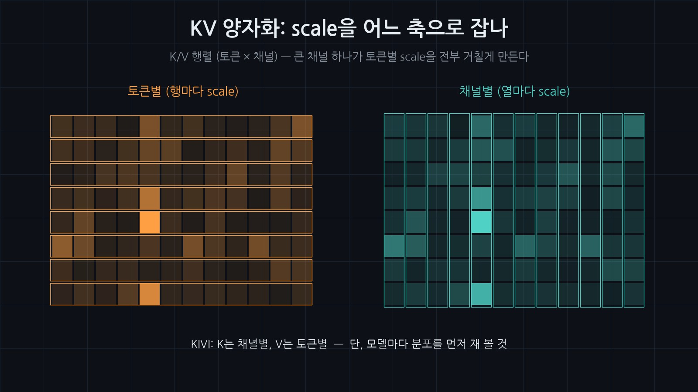

**그림 8.** 토큰별 scale(각 행에 하나)과 채널별 scale(각 열에 하나). 특정 채널이 크면 토큰별 scale은 그 채널 때문에 모든 행이 거칠어진다.

attention 출력의 상대오차(낮을수록 좋음)를 두 데이터로 쟀다.

| 설정 | 합성 K(채널 3개 ×15) | SmolLM2-135M 10층 실제 K/V |
|---|---|---|
| INT8 K토큰별 / V토큰별 | 0.0517 | **0.0174** |
| INT8 K채널별 / V토큰별 | **0.0173** | 0.0217 |
| INT4 K토큰별 / V토큰별 | 0.4506 | **0.2777** |
| INT4 K채널별 / V토큰별 | **0.2537** | 0.3332 |

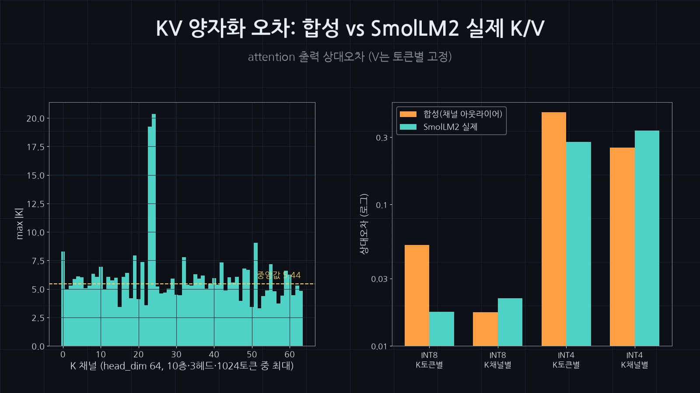

**그림 9.** 왼쪽: 실제 K의 채널별 최댓값(10층, 1024토큰). 중앙값 5.44, 최대 20.36. 오른쪽: 위 표.

합성 데이터(채널 아웃라이어를 일부러 넣음)에서는 KIVI의 처방대로 K채널별이 3배 좋았다. 그런데 **실제 SmolLM2에서는 반대**로 토큰별이 조금 더 좋았다. 이 모델의 K는 채널 최대/중앙값이 3.7배로 아웃라이어가 약하고, 대신 토큰마다 크기 차이가 있어서다. KIVI가 관찰한 모델들(Llama, Falcon, Mistral 계열)과 135M 모델의 분포가 다를 수 있다. 결론은 "논문 처방을 그대로 쓰지 말고 **자기 모델의 K/V 분포를 먼저 재라**"다. 또 이 실험은 쿼리를 최근 키로 근사했으므로 실제 디코딩 오차와는 다를 수 있다.

## 6. 오래된 토큰 버리기: sliding window와 attention sink

메모리가 부족하면 오래된 토큰을 버리는 방법이 있다. 최근 W개만 남기는 sliding window가 가장 단순하다. 그런데 StreamingLLM(Xiao et al., 2023)은 이렇게 하면 모델이 무너진다는 것을 보였다. 모델이 **맨 앞 몇 토큰에 attention을 몰아주는 습관**(attention sink)이 있어서, 그 토큰이 사라지면 softmax의 분포가 깨진다. 처방은 맨 앞 4토큰을 항상 남기는 것이다.

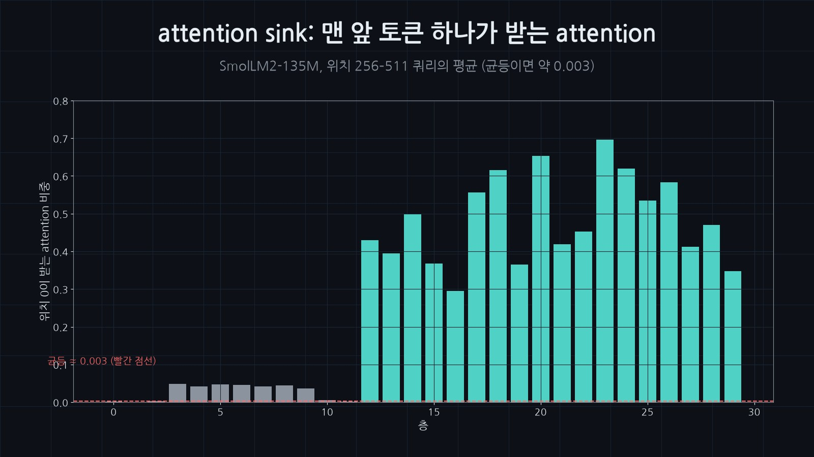

**그림 10.** SmolLM2-135M에서 위치 256–511의 쿼리들이 **위치 0 토큰 하나에** 주는 평균 attention(층별). 균등하게 나눈다면 약 0.003이어야 하지만, 12층 이후는 0.29–0.70을 맨 앞 토큰 하나에 준다. 앞쪽 12개 층은 0.05 이하다.

## 실패 장면: sink 없이 sliding window만 쓰면

같은 텍스트 2048토큰에서 마스크만 바꿔(RoPE 위치는 그대로) perplexity를 쟀다. 윈도우 256, sink 4토큰이다.

| attention 범위 | PPL(전체) | PPL(위치 320 이후) |
|---|---|---|
| 전체(기준) | **13.04** | 12.29 |
| 최근 256개만 | **56.14** | **64.55** |
| 앞 4개 + 최근 256개 | **13.95** | 13.33 |

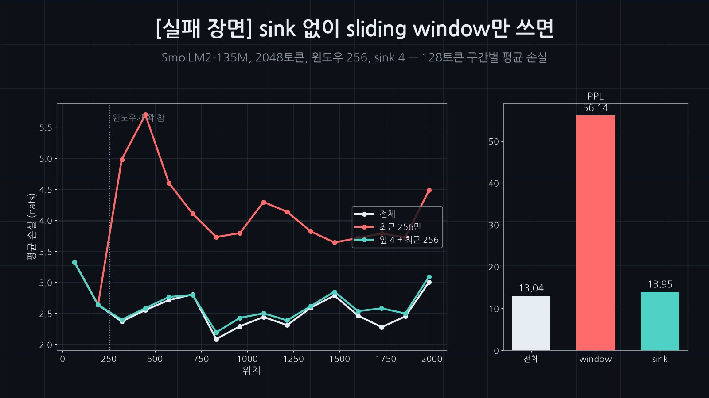

**그림 11.** 위치 구간(128토큰)별 평균 손실. 윈도우가 꽉 차서 위치 0이 빠지는 순간(256 이후)부터 window만 쓴 경우의 손실이 튀어 오르고, 앞 4토큰만 남겨도 전체 attention에 가깝게 돌아온다.

메모리 절약 효과는 같다(260개 vs 256개 토큰). 4토큰을 남기느냐 마느냐가 PPL 4배 차이를 만든다. 단, sink + window는 "윈도우 밖 내용을 기억"하게 해 주지는 않는다. 오래된 정보가 필요한 작업(긴 문서 질의응답)에는 별도 방법이 필요하다.

> **엣지 NPU에서는:** KV 캐시는 가중치와 같은 DRAM을 나눠 쓴다. 장치 메모리 크기, KV 정밀도(INT8/INT4 지원 여부), 최대 컨텍스트가 공개 자료에 없다면 위 표의 "가정" 칸을 채울 수 없다. 공개 자료를 읽을 때는 `메모리 용량 − 가중치 = KV 예산`부터 계산해 보자. 또 정적 캐시를 쓰는 컴파일러라면 MAXLEN을 얼마로 컴파일했는지가 짧은 대화의 속도를 정한다.

## 자주 묻는 질문

**Q. GQA는 품질이 떨어지지 않나요?**
GQA 논문은 MHA 대비 품질 손실이 작고 MQA보다 낫다고 보고했어요. 그래서 최근 공개 모델 대부분이 GQA예요(Llama-3.1-8B는 8, SmolLM2-135M은 3).

**Q. KV를 INT4로 줄이면 속도는 4배 빨라지나요?**
KV가 차지하는 바이트만 1/4이 돼요. 8K에서는 가중치가 대부분이라 29.5 → 34.8 tok/s(18%), 128K에서는 7.2 → 18.2 tok/s(2.5배)예요. 길수록 효과가 커요.

**Q. 정적 캐시면 MAXLEN을 크게 잡아 두면 되지 않나요?**
메모리를 처음부터 다 잡아요. 그리고 마스크로 가린 칸까지 읽는 구현이면 짧은 대화도 느려져요(4절 실측: 256토큰에서도 22.6 ms).

**Q. PagedAttention은 엣지에서도 쓰나요?**
원래는 서버에서 여러 요청의 메모리 조각화를 줄이려고 만든 방법이에요. 엣지에서 단일 사용자라면 필요성이 작지만, "블록 단위로 할당"하는 생각은 정적 캐시와 동적 길이를 섞는 데 유용해요.

## 퀴즈

1. L=30, H_kv=3, d=64, FP16인 모델의 토큰당 KV는? → 2 × 30 × 3 × 64 × 2 = 23,040 B = 22.5 KiB.
2. 가중치 4.14 GB, KV 128 KiB/token일 때 KV가 가중치와 같아지는 길이는? → 약 31.6K 토큰.
3. sink 4토큰 + 윈도우 256에서 KV 캐시에 남는 토큰 수는? → 260개(길이와 무관하게 고정).

## 정리

- KV/token = 2·L·H_kv·d·b. Llama-3.1-8B는 128 KiB, 128K면 16 GiB로 가중치의 4배다.
- 용량 예산: 12 GB 장치에서 FP16 KV는 약 3만 토큰. 대역폭 예산: 128K에서 37.1 → 7.2 tok/s.
- 정적 캐시는 결과가 같고 컴파일러가 좋아하지만, MAXLEN 전체를 읽으면 짧은 대화에서 손해다(실측 평평한 22.6–23.8 ms).
- KV 양자화 축은 모델 분포를 재고 정하자(합성은 K채널별, SmolLM2는 토큰별이 나음). 버릴 때는 sink를 남기자(PPL 56 → 14).

## 참고 (공개 자료)

- J. Ainslie et al., "GQA: Training Generalized Multi-Query Transformer Models from Multi-Head Checkpoints", arXiv:[2305.13245](https://arxiv.org/abs/2305.13245)
- N. Shazeer, "Fast Transformer Decoding: One Write-Head is All You Need", arXiv:[1911.02150](https://arxiv.org/abs/1911.02150)
- W. Kwon et al., "Efficient Memory Management for Large Language Model Serving with PagedAttention", arXiv:[2309.06180](https://arxiv.org/abs/2309.06180)
- Z. Liu et al., "KIVI: A Tuning-Free Asymmetric 2bit Quantization for KV Cache", arXiv:[2402.02750](https://arxiv.org/abs/2402.02750)
- C. Hooper et al., "KVQuant: Towards 10 Million Context Length LLM Inference with KV Cache Quantization", arXiv:[2401.18079](https://arxiv.org/abs/2401.18079)
- G. Xiao et al., "Efficient Streaming Language Models with Attention Sinks", arXiv:[2309.17453](https://arxiv.org/abs/2309.17453)
- S. Ge et al., "Model Tells You What to Discard: Adaptive KV Cache Compression for LLMs", arXiv:[2310.01801](https://arxiv.org/abs/2310.01801)
- A. Grattafiori et al., "The Llama 3 Herd of Models", arXiv:[2407.21783](https://arxiv.org/abs/2407.21783)
- Hugging Face Transformers 문서, "KV cache strategies": <https://huggingface.co/docs/transformers/kv_cache>
- SmolLM2-135M: <https://huggingface.co/HuggingFaceTB/SmolLM2-135M>

검증 환경: CPU 1스레드, PyTorch 2.15.0+cpu, transformers 5.23.0. 미니 Llama 측정은 실행마다 대역폭이 25–27 GB/s 사이에서 흔들렸고, 표는 같은 실행(27.0 GB/s)의 값만 썼다. 결과 원본은 `03-kv-cache/results/03.json`, `03_real.json`.

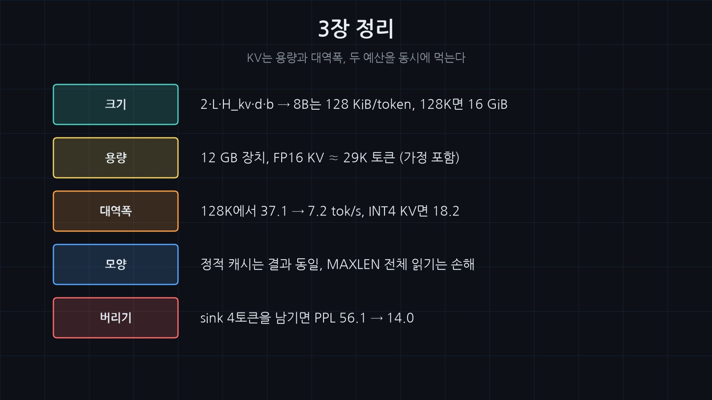

**그림 12.** 3장 정리.

---

> **온디바이스 LLM 시리즈** · [전체 목차](/blog/2026/11/16/ondevice-llm-series/)  
> ← 이전: [2. 4비트로 줄이고도 답을 지키는 법](/blog/2026/11/16/ondevice-llm-02-llm-quantization/)  
> → 다음: [4. 어떤 연산을 어디서 돌릴까](/blog/2026/11/16/ondevice-llm-04-npu-cpu-dsp-split/)
