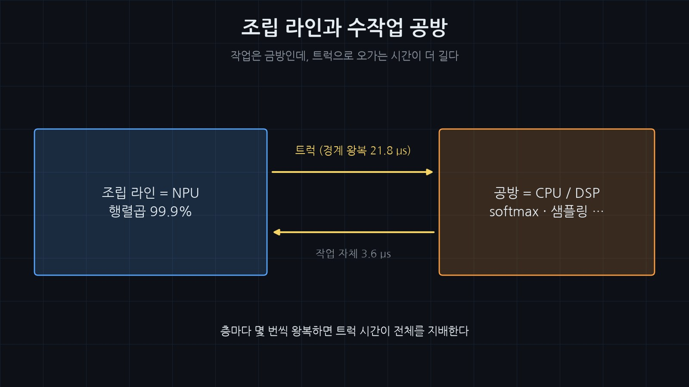
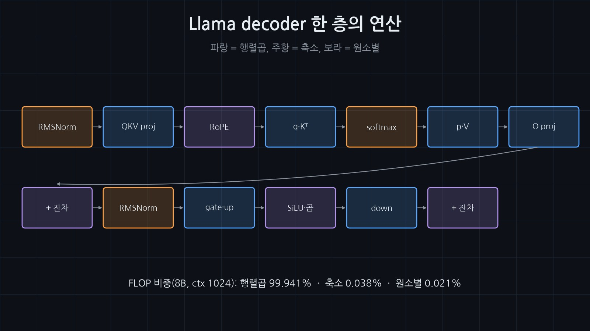
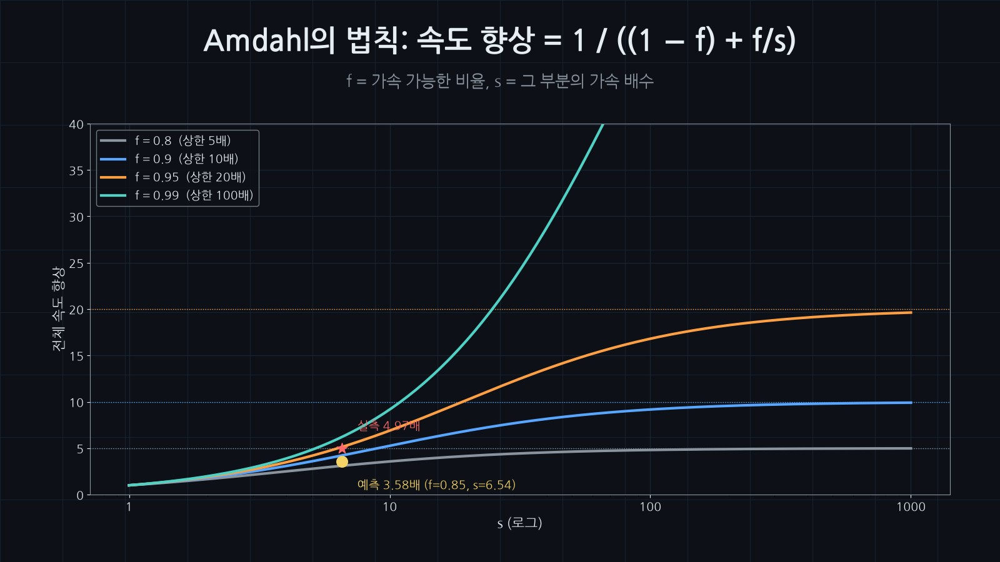
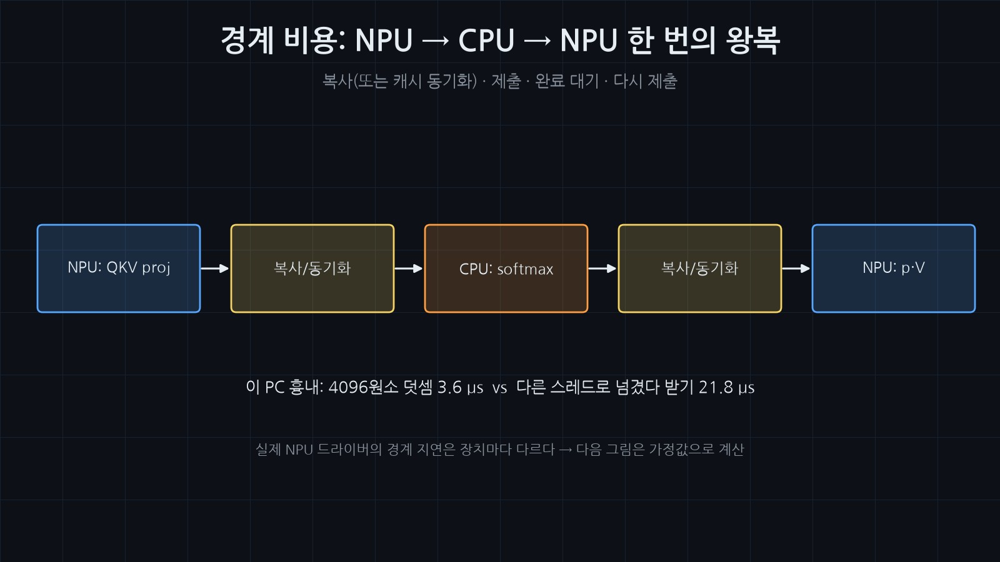
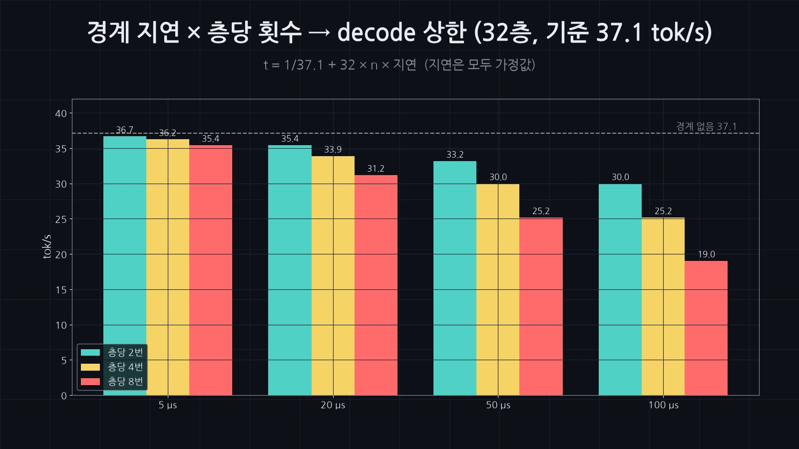
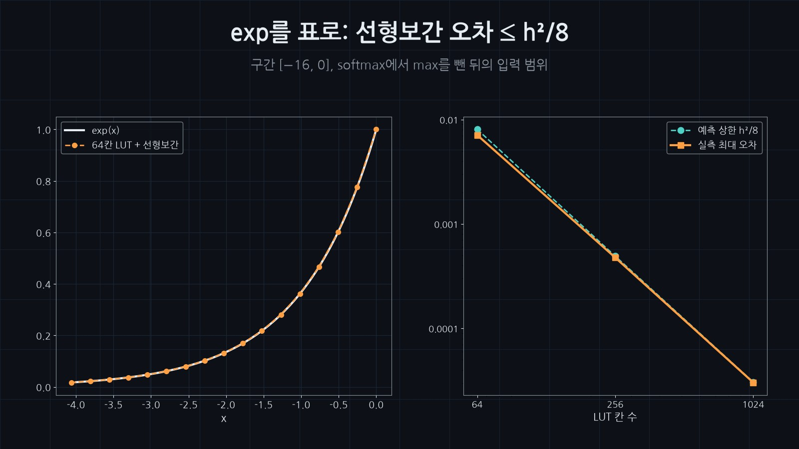
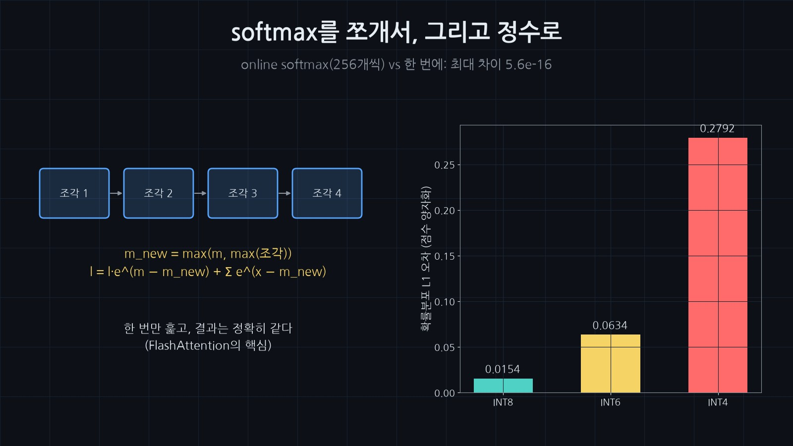
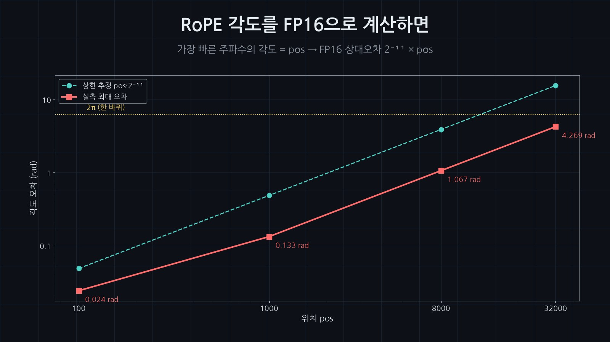
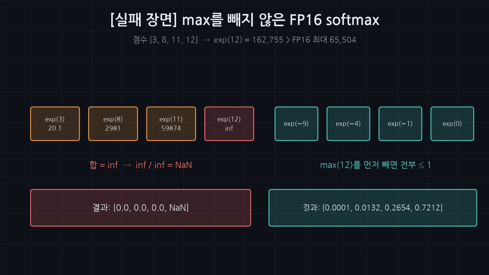
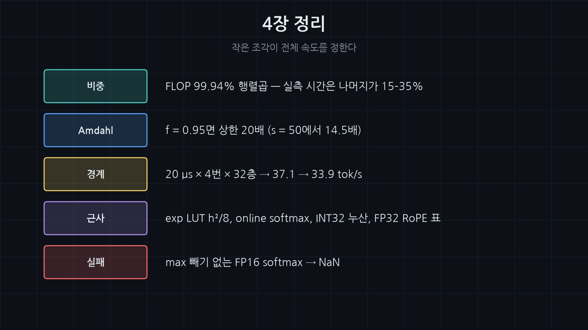

> **온디바이스 LLM 시리즈** · [전체 목차](/blog/2026/11/16/ondevice-llm-series/)  
> ← 이전: [3. 메모장이 가중치보다 커질 때](/blog/2026/11/16/ondevice-llm-03-kv-cache-design/)  
> → 다음: [5. PyTorch 모델을 NPU용 그래프로](/blog/2026/11/16/ondevice-llm-05-llm-graph-export/)

> 이 글의 예제 코드 전체: [kjoh94/ondevice-llm-examples/tree/main/04-op-split](https://github.com/kjoh94/ondevice-llm-examples/tree/main/04-op-split) (`python example.py`, 다운로드 없음)

> 이 글은 공개 자료만 사용했고, 어떤 회사의 공식 입장도 아닙니다. "가상 엣지 NPU"의 숫자는 공개된 일반 스펙 수준의 값에 가정을 더한 계산 예시입니다. 특정 제품의 연산 지원 목록이 아니라 일반적인 구조를 다룹니다.

> **처음이라면 이것만 기억하세요.** LLM 계산의 99.9%는 행렬곱이라 NPU에 맡기면 돼요. 문제는 나머지 0.1%예요. softmax·RMSNorm·RoPE 같은 연산을 NPU가 못 해서 CPU로 넘기면, **넘기는 왕복 시간(경계 비용)**과 **Amdahl의 법칙** 때문에 그 작은 조각이 전체 속도를 정해요.

선수 글: [PyTorch 9장 — 연산 융합](/blog/2026/10/25/pytorch-09-compiler-opt/), [1장 — Roofline](/blog/2026/11/16/ondevice-llm-01-roofline-bandwidth/), [tokens 10편 — 이기종 실행](/blog/2026/10/31/tokens-10-heterogeneous-execution/)

엣지 SoC에는 보통 CPU, GPU, DSP, NPU가 함께 들어 있어요. NPU는 정수 행렬곱을 아주 잘하지만, `exp`나 나눗셈, 제곱근처럼 비선형 연산은 못 하거나 근사로만 해요. 그래서 실제 배포에서는 "이 연산은 NPU, 저 연산은 CPU" 하고 그래프를 나눠요. 이 장은 그 분할을 **숫자로 판단하는 법**을 다뤄요. 프로파일로 비중을 재고, Amdahl로 상한을 계산하고, 경계 비용을 재고, 비선형 연산을 NPU에 남기는 근사의 오차를 예측하고 측정해요.

## 0. 비유로 먼저

### 0-1. 조립 라인과 수작업 공방



**그림 1.** 공장에 아주 빠른 조립 라인(NPU)과 손재주 좋은 공방(CPU)이 있어요. 부품 대부분은 조립 라인이 만들지만, 마감 작업 몇 개는 공방만 할 수 있어요. 마감 작업 자체는 금방 끝나요. 그런데 **물건을 트럭에 실어 공방까지 갔다가 돌아오는 시간**이 작업 시간보다 훨씬 길어요. 층마다 몇 번씩 왕복하면 트럭 시간이 전체를 지배해요.

### 0-2. 직접 재 보기: 행렬곱은 몇 %일까

미니 Llama(8층, hidden 1024, GQA 16/4, FFN 2816)로 decode 1토큰을 PyTorch 프로파일러로 쟀어요(ctx 512).

| 연산 종류 | 1스레드 | 8스레드 |
|---|---|---|
| matmul | 26.75 ms (85%) | 4.09 ms (65%) |
| 메모리·모양(copy, slice, cat…) | 3.36 ms (11%) | 1.21 ms (19%) |
| 원소별(mul, add, silu…) | 0.65 ms (2%) | 0.56 ms (9%) |
| 축소(softmax, mean, rsqrt…) | 0.37 ms (1%) | 0.27 ms (4%) |
| 전체(wall) | 33.16 ms | 6.91 ms |

행렬곱이 8스레드로 6.5배 빨라지자, 나머지의 비중이 15% → 35%로 늘었어요. 가속기가 빠를수록 "나머지"가 더 중요해져요.

이제 정식 용어로 하나씩 자세히 볼게요.

## 1. 연산 분류: LLM 한 층에 들어 있는 것



**그림 2.** Llama 계열 decoder 한 층의 연산. 파란색은 행렬곱(QKV·O·gate·up·down projection, `q·Kᵀ`, `p·V`), 주황색은 축소(RMSNorm의 제곱평균, softmax의 max·sum), 보라색은 원소별(RoPE, SiLU, 곱, 잔차 덧셈), 회색은 모양 바꾸기다.

| 연산 | 종류 | NPU 정수 MAC으로? | 흔한 처리 |
|---|---|---|---|
| Linear (QKV, O, MLP) | 행렬곱 | 예 | NPU |
| q·Kᵀ, p·V | 행렬곱(배치) | 예, 단 KV 길이가 가변 | NPU 또는 CPU |
| RMSNorm | 제곱합 + rsqrt | 제곱합은 가능, rsqrt는 근사 | 융합 또는 CPU |
| softmax | max, exp, 합, 나눗셈 | exp·나눗셈은 근사(LUT) | LUT 또는 CPU/DSP |
| RoPE | cos·sin 곱 | 테이블을 미리 만들면 곱셈만 | 테이블 + NPU |
| SiLU | x·sigmoid(x) | 근사(LUT, 구간 다항식) | LUT |
| 샘플링(top-k, top-p) | 정렬·난수 | 아니오 | CPU |

> **유도 1 — FLOP 비중 (Llama-3.1-8B, ctx 1024, 1토큰)**
> 행렬곱: 2 × 8.03 × 10⁹ (가중치) + 32층 × 2 × 2 × 32헤드 × 128 × 1024 (attention) ≈ 1.66 × 10¹⁰
> 축소: 32 × (2 × 4 × 4096 + 5 × 32 × 1024) ≈ 6.3 × 10⁶,  원소별: 32 × (6 × 40 × 128 + 5 × 14336 + 2 × 4096) ≈ 3.5 × 10⁶
> → 행렬곱 **99.941%**, 축소 0.038%, 원소별 0.021%. 바이트로도 행렬곱(가중치) 99.78%.

분석 비중은 0.06%인데 0-2절 실측에서는 15%였다. 차이는 **작은 연산마다 붙는 고정 비용**(커널 실행, 메모리 할당, 파이썬 디스패치)이다. 엣지 NPU에서는 이 고정 비용이 "다른 프로세서로 넘기는 비용"으로 바뀌고, 훨씬 커진다.

## 2. Amdahl의 법칙: 가속기가 아무리 빨라도

> **유도 2 — Amdahl 상한**
> 전체 시간 중 비율 f를 s배 가속하면 `속도 향상 = 1 / ((1 − f) + f/s)`
> s → ∞이면 상한은 `1 / (1 − f)`. f = 0.95면 아무리 빨라도 **20배**, s = 50이면 **14.5배**

```python
def amdahl(f, s):
    return 1 / ((1 - f) + f / s)

a1, a8 = prof[1]["agg"], prof[8]["agg"]                   # 1스레드, 8스레드 프로파일
f = a1["matmul"] / sum(a1.values()); s = a1["matmul"] / a8["matmul"]
pred = amdahl(f, s); meas = sum(a1.values()) / sum(a8.values())
```



**그림 3.** f(가속 가능한 비율)별 Amdahl 곡선. f = 0.99라도 s = 50에서 33.6배에 그친다.

| 측정 | 값 |
|---|---|
| f (1스레드 matmul 비중) | 0.85 |
| s (matmul 가속, 26.75 → 4.09 ms) | 6.54 |
| Amdahl 예측 (나머지는 그대로라고 가정) | **3.58배** |
| 실측 (op 합 31.43 → 6.32 ms) | **4.97배** |
| 실측 (wall 33.16 → 6.91 ms) | 4.80배 |

예측이 실측보다 작다. Amdahl은 "나머지는 전혀 빨라지지 않는다"고 가정했는데, 실제로는 메모리·모양 연산도 스레드를 써서 3.36 → 1.21 ms로 2.8배 빨라졌기 때문이다. 엣지 NPU에서는 반대로 나머지가 CPU에 남고 **경계 비용까지 더해지므로**, Amdahl 예측보다 나빠지는 쪽이 보통이다.

## 3. 경계 비용: 넘기는 것 자체가 비싸다



**그림 4.** NPU → CPU → NPU 왕복. 데이터 복사(또는 캐시 동기화), 작업 제출, 완료 대기, 다시 제출이 생긴다.

CPU 안에서도 흉내를 낼 수 있다. 원소 4096개 텐서에 덧셈 한 번은 **3.6 µs**인데, 같은 텐서를 다른 스레드에 큐로 넘기고 결과를 돌려받는 왕복은 **21.8 µs**였다. 연산보다 넘기는 데 6배가 걸린다.

```python
q_in, q_out = queue.Queue(), queue.Queue()
def worker():
    while (item := q_in.get()) is not None:
        q_out.put(item + 1.0)                        # "CPU에서 하는 작은 연산"
th = threading.Thread(target=worker); th.start()
t0 = time.perf_counter()
for _ in range(2000): q_in.put(x); q_out.get()       # 넘기고 → 기다리고 → 받기
t_hand = (time.perf_counter() - t0) / 2000
```

> **유도 3 — 경계가 decode 속도에 주는 영향**
> `t_token = t_NPU + L × n_cross × t_cross`
> 1장 상한 37.1 tok/s(27.0 ms) + 32층 × 층당 4번 × 20 µs(가정) = 27.0 + 2.56 ms → **33.9 tok/s** (−9%)
> 100 µs × 8번이면 27.0 + 25.6 ms → **19.0 tok/s** (−49%)



**그림 5.** 경계 지연(µs)과 층당 경계 횟수에 따른 decode 상한. 경계 지연은 장치·드라이버마다 크게 다르므로 모두 가정값이다.

| 층당 경계 \ 지연 | 5 µs | 20 µs | 50 µs | 100 µs |
|---|---|---|---|---|
| 2번 | 36.7 | 35.4 | 33.2 | 30.0 |
| 4번 | 36.2 | 33.9 | 30.0 | 25.2 |
| 8번 | 35.4 | 31.2 | 25.2 | **19.0** |

결론은 분명하다. **"이 연산은 NPU가 못 하니 CPU로"를 층마다 반복하면 안 된다.** 가능한 한 NPU 안에 남기고(근사), 못 남기는 것은 층 경계를 넘지 않게 묶어야 한다.

## 4. 비선형 연산을 NPU에 남기는 법 ① — exp는 표로

NPU는 `exp`를 직접 못 하더라도 **표 찾기(LUT) + 선형보간**은 할 수 있다. softmax에서는 max를 빼고 나면 입력이 항상 0 이하이므로, 구간 [−16, 0]만 표로 만들면 된다.

> **유도 4 — 선형보간 오차 상한**
> 간격 h로 선형보간하면 오차 ≤ `h²/8 × max|f''|`. exp는 구간 [−16, 0]에서 max|f''| = e⁰ = 1
> 64칸: h = 16/63 → h²/8 = **8.06 × 10⁻³**, 256칸: 4.92 × 10⁻⁴, 1024칸: 3.06 × 10⁻⁵ — 칸이 4배면 오차는 1/16

```python
grid = torch.linspace(-16, 0, n, dtype=torch.float64); tab = grid.exp(); h = 16 / (n - 1)
idx = ((xs + 16) / h).floor().clamp(max=n - 2).long(); fr = (xs + 16) / h - idx
approx = tab[idx] * (1 - fr) + tab[idx + 1] * fr          # 표 두 칸 + 곱셈 두 번
```

| LUT 크기 | 예측 상한 h²/8 | 실측 최대 오차 | 실측/예측 |
|---|---|---|---|
| 64칸 | 8.06e-3 | 7.11e-3 | 0.88 |
| 256칸 | 4.92e-4 | 4.77e-4 | 0.97 |
| 1024칸 | 3.06e-5 | 3.03e-5 | 0.99 |



**그림 6.** 왼쪽: 64칸 LUT와 실제 exp. 오른쪽: 칸 수별 예측 상한과 실측 최대 오차. 실측이 항상 상한 아래에 있고, 칸이 많을수록 상한에 붙는다(f''가 가장 큰 x=0 근처 칸에서 최대가 나오기 때문).

## 5. 비선형 연산을 NPU에 남기는 법 ② — softmax를 쪼개서

softmax는 전체의 max와 합이 필요해서, KV가 길면 한 번에 메모리에 못 올린다. **online softmax**(Milakov & Gimelshein, 2018)는 조각마다 "지금까지의 max와 합"을 고쳐 가며 한 번만 훑는다. FlashAttention(Dao et al., 2022)의 핵심이 이것이다.

```python
m, l = -float("inf"), 0.0
for chunk in s.split(256):
    m_new = max(m, chunk.max().item())
    l = l * np.exp(m - m_new) + (chunk - m_new).exp().sum().item()   # 이전 합을 새 max 기준으로 보정
    m = m_new
online = (s - m).exp() / l
```

4096개 점수를 256개씩 나눠 처리한 결과와 한 번에 한 softmax의 최대 차이는 **5.6 × 10⁻¹⁶**(FP64 반올림 수준)이었다. 근사가 아니라 정확히 같은 식이다.



**그림 7.** 왼쪽: online softmax의 조각별 갱신. 오른쪽: softmax 입력(점수)을 정수로 양자화했을 때 확률분포의 L1 오차. INT8 0.0154, INT6 0.0634, INT4 0.2792. 점수 입력은 INT8 이상이 필요하다.

## 6. 정수로 하면 넘치는 것들: RMSNorm과 RoPE

### 6-1. RMSNorm의 제곱합은 INT16에 안 들어간다

> **유도 5 — 누산기 폭**
> INT8 입력 x의 제곱 최대 127² = 16,129. d = 4096개 합의 최대 = 4096 × 16,129 = **66,064,384** (26 bit)
> INT16 최대 32,767 → 원소 3개 이상이면 넘칠 수 있다. 필요 폭 ⌈log₂(66,064,384)⌉ + 1 = 27 bit → **INT32**

실측: 랜덤 INT8 벡터(d=4096)의 정답 제곱합은 **22,221,488**인데, INT16 누산기로 더하면 **4,784**가 나온다(넘침이 반복돼 의미 없는 값). 2장 W8A8에서 INT32 누산이 필요했던 것과 같은 이유다.

### 6-2. RoPE 각도를 FP16으로 계산하면 위치가 틀린다

RoPE(Su et al., 2021)는 위치 pos와 주파수 θᵢ의 곱 `pos × θᵢ`를 각도로 쓴다. 가장 빠른 주파수 θ₀ = 1이므로 각도는 pos 그 자체다.

> **유도 6 — FP16 각도 오차**
> FP16은 가수 10비트라 상대 오차 ≈ 2⁻¹¹. 각도 오차 ≲ pos × 2⁻¹¹
> pos = 1000 → 0.49 rad,  pos = 32,000 → 15.6 rad (2π의 2.5배). 회전이 완전히 틀린다.

| 위치 | 예측 상한 pos·2⁻¹¹ (rad) | 실측 최대 오차 (rad) |
|---|---|---|
| 100 | 0.049 | 0.024 |
| 1,000 | 0.488 | 0.133 |
| 8,000 | 3.906 | 1.067 |
| 32,000 | 15.625 | **4.269** |



**그림 8.** 위치별 RoPE 각도 오차(Llama-3.1의 θ 기반 500,000, 64쌍 중 최대). 실측은 상한 아래지만, 8K에서 이미 1 rad을 넘는다.

처방은 각도를 FP32로 미리 계산한 **cos·sin 테이블**을 만들어 두고 NPU는 곱셈만 하는 것이다. 8K 위치 × 64쌍 × (cos, sin) × FP32 = **4 MiB**로, 가중치에 비하면 작다.

> **엣지 NPU에서는:** 공개 자료의 "지원 연산 목록"에 softmax·LayerNorm·GELU 같은 이름이 있어도, 내부가 LUT 근사인지, 정밀도가 몇 비트인지, 입력 범위가 어디까지인지는 보통 적혀 있지 않다. 이 장의 오차 식(h²/8, 누산 폭, pos·2⁻¹¹)으로 "어느 정도 정밀도가 필요한지"를 먼저 계산하고, 그다음 공개 자료와 비교하자. 또 마지막 lm_head 출력(128,256 단어 × FP16 = 250 KiB/토큰)과 샘플링은 보통 CPU 몫이므로, 그 경계 한 번은 피할 수 없다.

## 실패 장면: max를 빼지 않은 FP16 softmax



**그림 9.** 점수 [3, 8, 11, 12]를 FP16으로 그냥 softmax하면 `exp(12) = 162,755`가 FP16 최대값 65,504를 넘어 `inf`가 되고, `inf / inf = NaN`이 된다.

```python
logits = torch.tensor([3.0, 8.0, 11.0, 12.0], dtype=torch.float16)
naive = logits.exp() / logits.exp().sum()                       # [0, 0, 0, nan]
safe = (logits - logits.max()).exp() / (logits - logits.max()).exp().sum()   # [0.0001, 0.0132, 0.2654, 0.7212]
```

| 방법 | 결과 |
|---|---|
| 그냥 exp / 합 (FP16) | [0.0, 0.0, 0.0, **NaN**] |
| max를 빼고 exp / 합 (FP16) | [0.0001, 0.0132, 0.2654, 0.7212] |

점수 12는 LLM에서 흔한 크기다. 연산을 CPU에서 NPU로 옮기며 정밀도를 FP32 → FP16으로 낮출 때, "max 빼기"처럼 FP32에서는 생략해도 괜찮던 안정화 단계가 빠져 있으면 이렇게 된다. 결과가 NaN이면 그다음 모든 토큰이 깨지므로 찾기는 쉽지만, 어느 연산인지 찾는 데는 시간이 걸린다. NPU 이식 전후로 **층별 출력을 비교하는 테스트**를 먼저 만들어 두자(5장).

## 자주 묻는 질문

**Q. DSP는 어디에 쓰나요?**
DSP는 벡터 연산과 비선형 함수(exp, 나눗셈)를 CPU보다 효율적으로 하는 경우가 많아요. 그래서 softmax나 샘플링 전처리를 DSP에 두는 구성도 있어요. 다만 NPU·DSP 사이에도 경계 비용이 있으니 3절 계산이 그대로 적용돼요.

**Q. 행렬곱이 99.9%인데 왜 실측 비중은 85%인가요?**
작은 연산마다 붙는 고정 비용 때문이에요(1절). 그래서 연산 융합(RMSNorm을 다음 행렬곱 앞에 붙이기, SiLU와 곱을 한 커널로)이 중요해요.

**Q. 샘플링도 NPU에서 할 수 있나요?**
greedy(argmax)는 비교적 쉽지만, top-p는 정렬과 누적합이 필요해 보통 CPU에서 해요. logits 250 KiB를 CPU로 넘기는 경계 한 번이 생겨요.

## 퀴즈

1. f = 0.9, s = 10이면 속도 향상은? → 1 / (0.1 + 0.09) = 5.26배.
2. exp LUT를 [−16, 0]에서 오차 10⁻⁴ 이하로 만들려면 몇 칸? → h²/8 ≤ 10⁻⁴ → h ≤ 0.028 → 16/0.028 + 1 ≈ 567칸 이상.
3. 32층, 층당 경계 2번, 경계 50 µs, NPU 시간 27.0 ms면 tok/s는? → 27.0 + 3.2 = 30.2 ms → 33.2 tok/s.

## 정리

- FLOP으로는 행렬곱이 99.94%지만, 실측 시간으로는 나머지가 15%(1스레드) → 35%(8스레드)로 커진다.
- Amdahl: f = 0.95면 상한 20배. 경계 비용 20 µs × 4 × 32층이면 37.1 → 33.9 tok/s.
- exp는 LUT(오차 h²/8), softmax는 online으로 쪼개기, RMSNorm은 INT32 누산, RoPE는 FP32 테이블.
- 정밀도를 낮출 때는 "max 빼기" 같은 안정화가 빠지면 NaN이 난다.

## 참고 (공개 자료)

- G. M. Amdahl, "Validity of the single processor approach to achieving large scale computing capabilities", AFIPS 1967, DOI: [10.1145/1465482.1465560](https://doi.org/10.1145/1465482.1465560)
- M. Milakov, N. Gimelshein, "Online normalizer calculation for softmax", arXiv:[1805.02867](https://arxiv.org/abs/1805.02867)
- T. Dao et al., "FlashAttention: Fast and Memory-Efficient Exact Attention with IO-Awareness", arXiv:[2205.14135](https://arxiv.org/abs/2205.14135)
- J. Su et al., "RoFormer: Enhanced Transformer with Rotary Position Embedding", arXiv:[2104.09864](https://arxiv.org/abs/2104.09864)
- B. Zhang, R. Sennrich, "Root Mean Square Layer Normalization", arXiv:[1910.07467](https://arxiv.org/abs/1910.07467)
- PyTorch Profiler 문서: <https://docs.pytorch.org/docs/stable/profiler.html>
- ONNX Operators: <https://onnx.ai/onnx/operators/>
- IEEE 754 binary16(FP16) 형식: 가수 10비트, 최대값 65,504

검증 환경: CPU(1스레드와 8스레드), PyTorch 2.15.0+cpu. 경계 비용은 같은 CPU 안의 스레드 간 큐로 흉내 낸 것이고, 실제 NPU 드라이버의 값이 아니다. 결과 원본은 `04-op-split/results/04.json`.



**그림 10.** 4장 정리.

---

> **온디바이스 LLM 시리즈** · [전체 목차](/blog/2026/11/16/ondevice-llm-series/)  
> ← 이전: [3. 메모장이 가중치보다 커질 때](/blog/2026/11/16/ondevice-llm-03-kv-cache-design/)  
> → 다음: [5. PyTorch 모델을 NPU용 그래프로](/blog/2026/11/16/ondevice-llm-05-llm-graph-export/)
