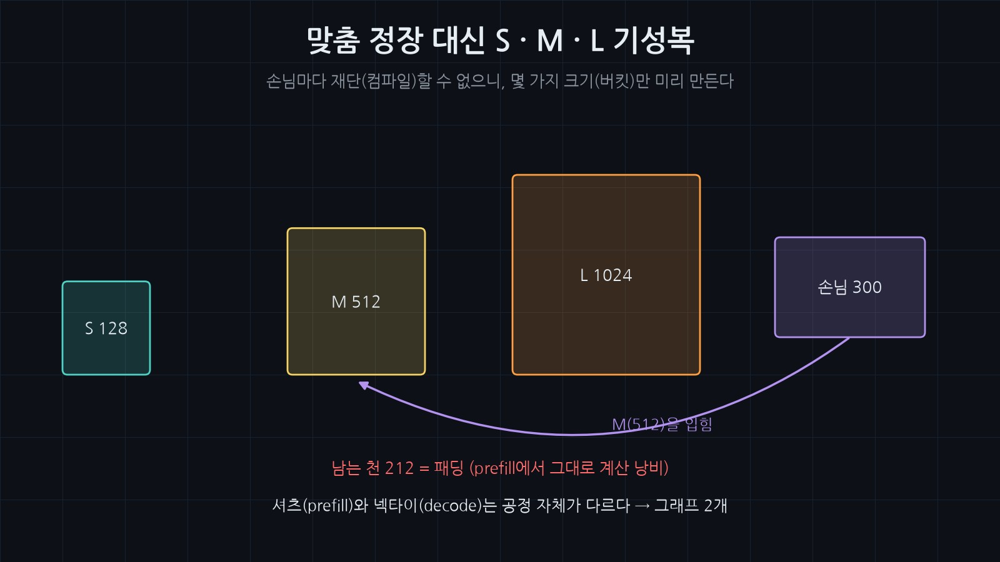
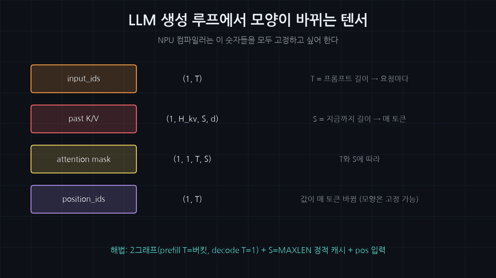
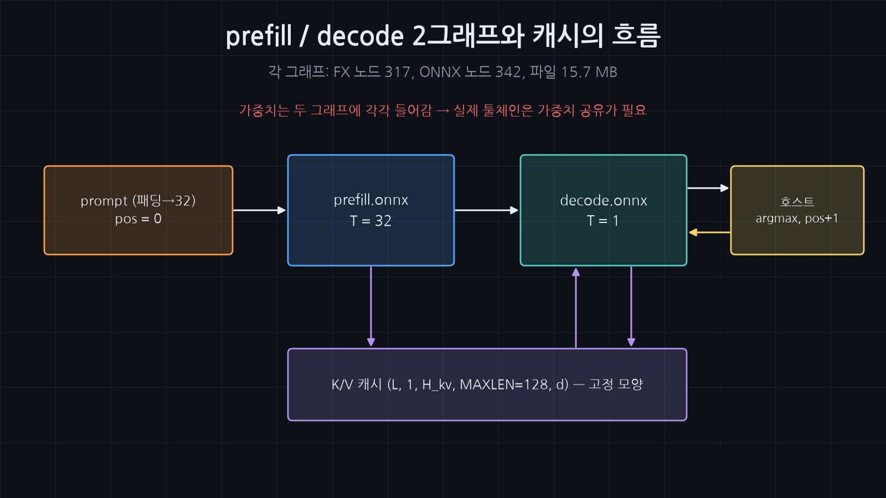
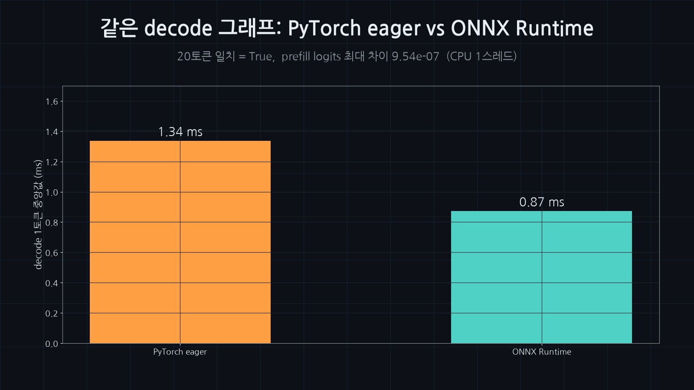
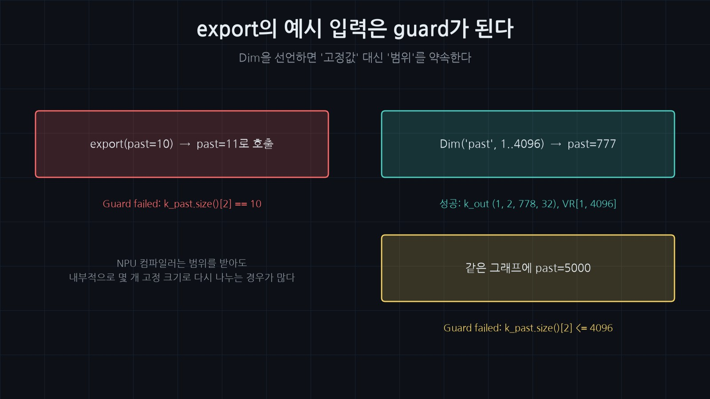
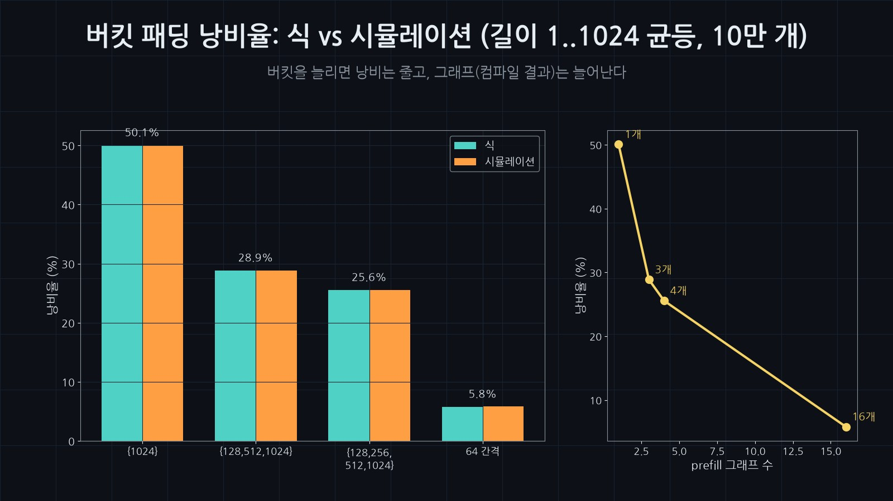
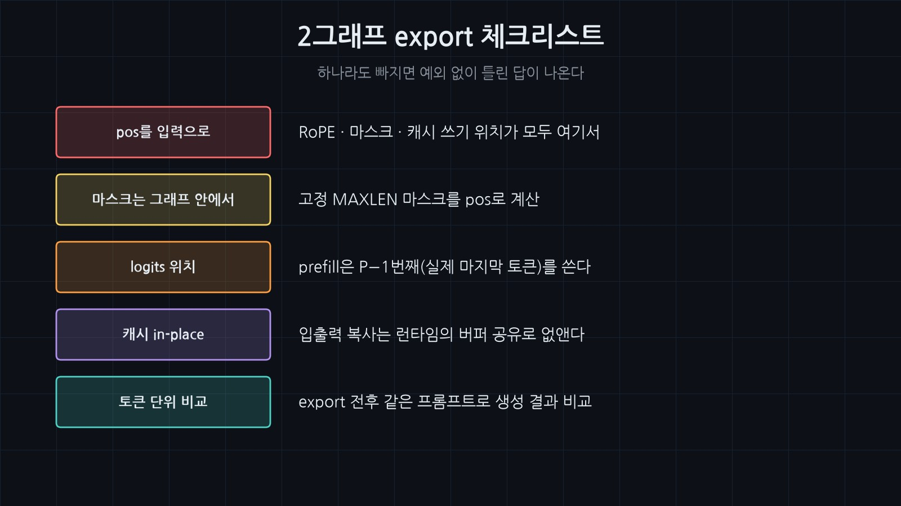
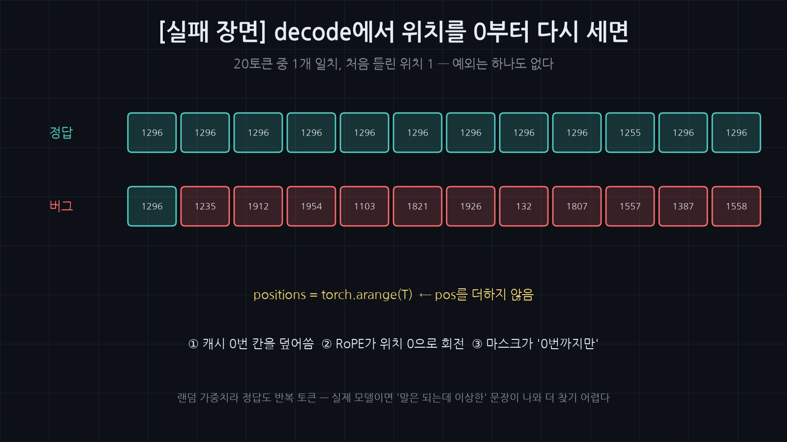
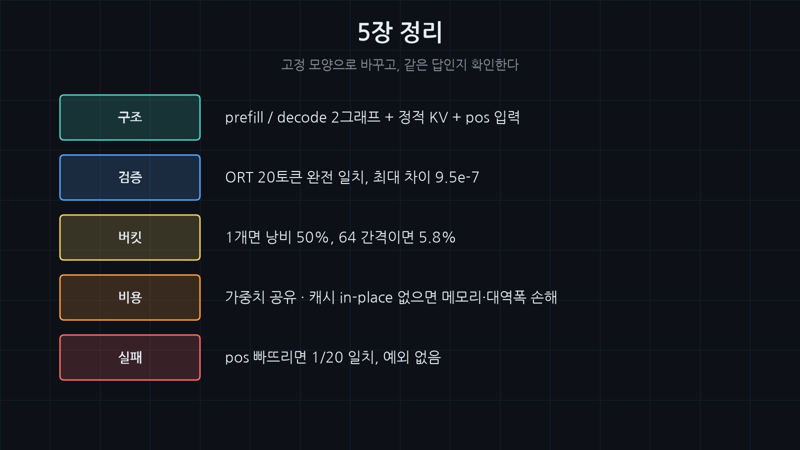

> **온디바이스 LLM 시리즈** · [전체 목차](/blog/2026/11/16/ondevice-llm-series/)  
> ← 이전: [4. 어떤 연산을 어디서 돌릴까](/blog/2026/11/16/ondevice-llm-04-npu-cpu-dsp-split/)  
> → 다음: [6. llama.cpp와 GGUF 해부](/blog/2026/11/16/ondevice-llm-06-llamacpp-gguf/)

> 이 글의 예제 코드 전체: [kjoh94/ondevice-llm-examples/tree/main/05-graph-export](https://github.com/kjoh94/ondevice-llm-examples/tree/main/05-graph-export) (`python example.py`, 다운로드 없음)

> 이 글은 공개 자료만 사용했고, 어떤 회사의 공식 입장도 아닙니다. "가상 엣지 NPU"의 숫자는 공개된 일반 스펙 수준의 값에 가정을 더한 계산 예시입니다.

> **처음이라면 이것만 기억하세요.** NPU 컴파일러는 보통 **모양이 고정된 그래프**를 미리 컴파일해요. 그런데 LLM은 프롬프트 길이도, KV 캐시 길이도 매번 달라요. 해법은 ① 그래프를 **prefill용과 decode용 두 개**로 나누고, ② KV 캐시를 **최대 길이로 고정**하고, ③ 프롬프트는 **몇 가지 길이(버킷)로 패딩**하는 거예요. 그리고 decode에서 **위치(position)를 넘기는 것을 잊으면** 두 번째 토큰부터 전부 틀려요.

선수 글: [PyTorch 7장 — torch.export](/blog/2026/10/25/pytorch-07-torch-export/), [PyTorch 8장 — ONNX](/blog/2026/10/25/pytorch-08-onnx/), [3장 — 정적 캐시](/blog/2026/11/16/ondevice-llm-03-kv-cache-design/), [tokens 2편 — AOT 컴파일](/blog/2026/10/30/tokens-02-aot-compilation/)

[PyTorch 7장](/blog/2026/10/25/pytorch-07-torch-export/)과 [8장](/blog/2026/10/25/pytorch-08-onnx/)에서 `torch.export`와 ONNX로 모델을 내보내는 기본을 봤어요. 이미지 분류 모델은 입력 모양이 하나라 쉽지만, LLM은 한 번의 호출 안에서도 모양이 계속 바뀌어요. 이 장에서는 작은 Llama를 직접 **두 개의 고정 모양 그래프로 내보내고**, ONNX Runtime(ORT)에서 돌려 **PyTorch와 토큰이 정확히 같은지** 확인해요. NPU 툴체인 대부분이 ONNX나 비슷한 그래프를 입력으로 받으니, 여기까지가 "NPU에 넣기 직전"이에요.

## 0. 비유로 먼저

### 0-1. 맞춤 정장 대신 S·M·L 기성복



**그림 1.** 손님(입력)마다 정장을 맞추면(동적 shape) 완벽하게 맞지만 매번 재단(컴파일)이 필요해요. 공장(NPU)은 S·M·L 기성복(버킷)만 미리 잔뜩 만들어 두고, 손님에게 가장 가까운 큰 사이즈를 줘요. 남는 천(패딩)은 버리는 셈이에요. 그리고 셔츠(prefill)와 넥타이(decode)는 아예 다른 공정이에요.

### 0-2. 직접 해 보기: 두 그래프로 나눠도 같은 답이 나오나

작은 Llama(4층, hidden 256, GQA 8/2, 최대 길이 128)를 prefill 그래프(입력 32토큰 버킷)와 decode 그래프(입력 1토큰)로 나눠 export하고, 같은 프롬프트로 20토큰을 생성했어요.

| 실행 | 원래 모델과 20토큰 일치 | 메모 |
|---|---|---|
| PyTorch, 2그래프 방식(패딩 + 정적 캐시) | **True** | |
| ONNX Runtime, 2그래프 | **True** | prefill logits 최대 차이 9.54 × 10⁻⁷ |
| decode에서 위치를 0부터 다시 셈(버그) | **1/20** | 두 번째 토큰부터 틀림 |

이제 정식 용어로 하나씩 자세히 볼게요.

## 1. 왜 모양이 문제인가



**그림 2.** HuggingFace 기본 생성 루프에서 모양이 바뀌는 텐서들. 프롬프트 길이 T(요청마다), KV 길이 S(매 토큰마다), attention 마스크(S에 따라). NPU 컴파일러는 이 각각을 고정 숫자로 원한다.

NPU 컴파일러는 모양이 정해져야 메모리 배치, 타일 크기, DMA 스케줄을 미리 정할 수 있다. 모양이 바뀔 때마다 다시 컴파일하면 몇 초에서 몇 분이 걸리므로, decode 토큰마다 컴파일하는 것은 불가능하다. 그래서 공개된 엣지 LLM 툴체인들(ExecuTorch, ONNX Runtime GenAI 등)은 모두 비슷한 구조를 쓴다.

| 그래프 | 입력 모양 | 하는 일 |
|---|---|---|
| prefill | ids (1, 버킷), pos (1,), K/V (L, 1, H_kv, MAXLEN, d) | 프롬프트 전체를 한 번에, 캐시 채우기 |
| decode | ids (1, 1), pos (1,), K/V 같음 | 토큰 하나, 캐시 한 칸 쓰기 |

## 2. KV 캐시를 그래프의 입력·출력으로 드러내기

그래프 안에 상태(캐시)를 숨기면 export가 어렵다. 그래서 캐시를 **입력으로 받고, 갱신된 캐시를 출력으로 돌려주는** 순수 함수로 만든다.

```python
class StepGraph(nn.Module):
    """KV 캐시를 그래프 입력·출력으로 드러낸 한 스텝. ids (1,T), pos (1,), K/V (L,1,Hkv,S,hd)."""
    def forward(self, ids, pos, k_cache, v_cache):
        m, c = self.m, self.m.cfg; T = ids.shape[1]; hd = c.head_dim
        positions = pos + torch.arange(T)                      # ★ 위치는 반드시 입력으로
        cos, sin = m.cos[positions], m.sin[positions]
        kpos = torch.arange(c.max_seq).unsqueeze(0)
        mask = torch.where(kpos <= positions.unsqueeze(1), 0.0, float("-inf"))   # 고정 크기 마스크
        x = m.emb(ids); ks, vs = [], []
        for l, blk in enumerate(m.layers):
            ...
            kc = k_cache[l].index_copy(2, positions, k)         # 캐시의 positions 칸에 쓰기
            vc = v_cache[l].index_copy(2, positions, v)
            ...
        return m.head(m.norm(x)), torch.stack(ks), torch.stack(vs)
```

```python
ep = torch.export.export(g, args)                                   # FX 그래프 (ExportedProgram)
onnx_prog = torch.onnx.export(g, args, dynamo=True, optimize=True,
                              input_names=["input_ids", "pos", "k_cache", "v_cache"],
                              output_names=["logits", "k_out", "v_out"])
onnx_prog.save("prefill.onnx")
```



**그림 3.** prefill 그래프가 채운 K/V를 decode 그래프가 받아서 한 칸씩 쓰고 다시 내보낸다. 호스트(CPU)는 토큰 선택과 pos 증가만 한다.

| 결과 | prefill | decode |
|---|---|---|
| ExportedProgram 노드 | 317 | 317 |
| ONNX 노드 | 342 | 342 |
| ONNX 파일 | 15.74 MB | 15.73 MB |
| ONNX op 상위 | Mul 58, Transpose 40, MatMul 37, Unsqueeze 34, Reshape 32 | 같음 |

> **유도 1 — 그래프 두 개면 가중치도 두 벌?**
> 가중치(파라미터 약 3.9M, FP32) ≈ 15.5 MB가 두 파일에 각각 들어 있다 → 합 31.5 MB
> 8B W4라면 4.1 GB × 2 = 8.3 GB. 엣지에서는 불가능하므로, 실제 툴체인은 **가중치 공유**(외부 데이터 파일 하나를 두 그래프가 참조, 또는 한 바이너리에 그래프 여러 개)를 쓴다.

## 3. ORT에서 돌려 보기: 같은 답이 나오는가

```python
so = ort.SessionOptions(); so.intra_op_num_threads = 1
sess = ort.InferenceSession("decode.onnx", so, providers=["CPUExecutionProvider"])
lo, k2, v2 = sess.run(None, {"input_ids": ids, "pos": pos, "k_cache": K, "v_cache": V})
```

| 비교 | 값 |
|---|---|
| ORT 20토큰 == 원래 PyTorch greedy | True |
| prefill logits 최대 차이 | 9.54 × 10⁻⁷ (FP32 반올림 수준) |
| decode 1토큰 중앙값, PyTorch eager | 1.34 ms |
| decode 1토큰 중앙값, ORT (1스레드) | 0.87 ms |



**그림 4.** 같은 decode 그래프를 PyTorch eager와 ORT로 돌린 시간. ORT는 그래프 최적화(상수 접기, 연산 융합)와 파이썬 디스패치 제거로 1.5배 빠르다. NPU 컴파일러는 같은 그래프에서 훨씬 공격적인 최적화를 한다.

> **유도 2 — 고정 캐시를 매 스텝 입출력하면 몇 바이트?**
> K/V 한 벌 = L × H_kv × MAXLEN × d × 4 B = 4 × 2 × 128 × 32 × 4 = 131 KB, K와 V 두 개 → 262 KB 입력 + 262 KB 출력
> Llama-3.1-8B, MAXLEN 8K, FP16: 32 × 8 × 8192 × 128 × 2 B × 2(K, V) = 1 GiB. 이것을 매 토큰 읽어 들이고(입력) 다시 써 내면(출력) attention이 원래 읽는 1 GiB에 **2 GiB가 더해진다**
> 1장 상한 식: 153.6 ÷ (4.14 + 1.07) = 29.5 tok/s → 153.6 ÷ (4.14 + 1.07 + 2.15) = **20.9 tok/s (−29%)**
> 그래서 실제 런타임은 캐시를 **제자리(in-place) 버퍼**로 묶는다(ORT GenAI의 past-present 버퍼 공유, ExecuTorch의 mutable buffer).

이 예제의 `index_copy`는 새 텐서를 만드는 out-of-place 연산이라 정확성 검증용이다. 성능을 노린다면 위 런타임 기능을 써야 한다.

## 4. 동적 차원: Dim으로 "범위"를 약속한다

모양을 완전히 고정하지 않고 범위로 약속하는 방법도 있다. `torch.export.Dim`이다. KV 길이를 동적으로 둔 `torch.cat` 버전으로 실험했다.

```python
ep_static = torch.export.export(ca, mk(1, 10))          # past=10으로만 export
ep_static.module()(*mk(1, 11))                           # → Guard failed: k_past.size()[2] == 10

past = torch.export.Dim("past", min=1, max=4096)
ep_dyn = torch.export.export(ca, mk(1, 10), dynamic_shapes=({}, {}, {}, {2: past}, {2: past}))
ep_dyn.module()(*mk(1, 777))                             # 성공: k_out (1, 2, 778, 32)
ep_dyn.module()(*mk(1, 5000))                            # → Guard failed: k_past.size()[2] <= 4096
```



**그림 5.** export할 때 쓴 예시 입력의 모양은 "guard(조건)"로 그래프에 박힌다. Dim을 선언하면 guard가 범위로 바뀐다(`VR[1, 4096]`). 범위를 벗어나면 실행 시점에 바로 실패한다.

동적 차원은 CPU·GPU 런타임에는 편하지만, NPU 컴파일러가 이 범위를 받아도 내부적으로는 몇 개의 고정 크기로 다시 나눠 컴파일하는 경우가 많다. 결국 다음 절의 버킷과 같은 문제가 된다.

## 5. 버킷 패딩: 얼마나 버리나

> **유도 3 — 버킷 낭비율**
> 프롬프트 길이 L이 1..1024에서 균등하다고 하자. 버킷 경계 (a, b]에 떨어질 확률 = (b − a)/1024, 평균 패딩 ≈ (b − a − 1)/2
> `낭비율 = Σ 확률 × 평균 패딩 ÷ Σ 확률 × b`
> 버킷 {1024} 하나: (1023/2) ÷ 1024 ≈ **50%**. 64 간격 16개: (63/2) ÷ (평균 b ≈ 544) ≈ **5.8%**

```python
for L in lens:                                           # 길이 10만 개 시뮬레이션
    b = next(x for x in buckets if x >= L); pad += b - L; tot += b
```

| 버킷 | 식 | 시뮬레이션(10만 개) | 그래프 수 |
|---|---|---|---|
| {1024} | 50.0% | 50.1% | 1 |
| {128, 512, 1024} | 28.8% | 28.9% | 3 |
| {128, 256, 512, 1024} | 25.5% | 25.6% | 4 |
| 64 간격 (64, 128, …, 1024) | 5.8% | 5.8% | 16 |



**그림 6.** 버킷 개수와 낭비율의 교환. prefill은 계산 병목(1장)이라 패딩 토큰도 그대로 계산 시간이 된다. 버킷을 늘리면 낭비는 줄지만 그래프(컴파일 결과)가 늘어 저장 공간과 로딩 시간이 든다. 실제 길이 분포가 짧은 쪽에 몰려 있다면 작은 버킷을 촘촘히 두는 게 낫다.

## 6. export 전에 확인할 목록



**그림 7.** 2그래프 export에서 자주 놓치는 것들.

1. **위치(pos)를 입력으로**: RoPE와 마스크, 캐시 쓰기 위치가 모두 여기서 나온다(실패 장면).
2. **마스크를 그래프 안에서 만들기**: 고정 크기 MAXLEN 마스크를 pos로 계산하면 입력이 하나 준다.
3. **패딩 위치의 logits 버리기**: prefill 출력에서 `P − 1`번째(실제 마지막 토큰)를 써야 한다. 버킷 끝(31번째)을 쓰면 틀린다.
4. **캐시 in-place**: 성능은 런타임의 버퍼 공유 기능에 맡긴다(유도 2).
5. **층별 출력 비교 테스트**: 4장의 NaN처럼, NPU 변환 후 문제가 생기면 층별로 비교해야 어디서 틀렸는지 안다.

> **엣지 NPU에서는:** 공개 자료가 "ONNX 입력 지원"이라고만 할 때, 확인할 질문은 세 가지다. 동적 차원을 받는가(아니면 버킷을 몇 개까지 넣을 수 있나), 그래프 여러 개가 가중치를 공유할 수 있는가, KV 캐시를 장치 메모리에 상주시키는(in-place) 방법이 있는가. 셋 중 하나라도 안 되면 위 유도 1·2의 비용을 그대로 낸다.

## 실패 장면: decode에서 위치를 0부터 다시 세면



**그림 8.** prefill은 올바르게 export하고, decode 그래프만 `positions = torch.arange(T)`(항상 0)로 만들었다. 20토큰 중 1개만 맞고, 처음 틀린 위치는 1(두 번째 토큰)이다.

```python
positions = (pos + torch.arange(T)) if self.use_pos else torch.arange(T)   # use_pos=False → 버그
```

| | 처음 12토큰 |
|---|---|
| 정답 | 1296, 1296, 1296, 1296, 1296, 1296, 1296, 1296, 1296, 1255, 1296, 1296 |
| 버그 | 1296, 1235, 1912, 1954, 1103, 1821, 1926, 132, 1807, 1557, 1387, 1558 |

첫 토큰은 prefill이 만들어서 맞는다. 두 번째부터는 decode 그래프가 새 토큰의 K/V를 **캐시 0번 칸에 덮어쓰고**(첫 프롬프트 토큰을 지움), RoPE도 위치 0으로 회전하고, 마스크도 "0번까지만 보라"가 된다. 세 가지가 한꺼번에 틀린다. 그런데 **예외는 하나도 나지 않는다.** 모양은 전부 맞기 때문이다. 이 예제는 학습되지 않은 랜덤 가중치라 정답도 반복 토큰이지만, 실제 모델이라면 "말은 되는데 이상한" 문장이 나와 더 찾기 어렵다. export 후에는 반드시 **원래 모델과 토큰 단위로 비교**하자.

## 자주 묻는 질문

**Q. torch.onnx.export의 `dynamo=True`는 뭔가요?**
PyTorch 2.x의 새 ONNX exporter예요. 내부적으로 `torch.export`로 FX 그래프를 만든 다음 ONNX로 번역해요. 예전 TorchScript 기반 exporter보다 파이썬 제어 흐름을 더 정확히 잡아요.

**Q. prefill과 decode를 한 그래프로 만들 수는 없나요?**
T를 동적 차원으로 두면 가능하지만, NPU 컴파일러는 보통 T=1과 T=버킷을 다르게 최적화하고 싶어 해요. decode는 GEMV(메모리 병목), prefill은 GEMM(계산 병목)이라 타일 전략이 다르기 때문이에요(1장).

**Q. ExecuTorch와 ONNX Runtime GenAI 중 무엇을 쓰나요?**
둘 다 "export된 그래프 + 생성 루프 + KV 관리"를 제공해요. 대상 장치의 NPU 백엔드가 어느 쪽을 지원하는지가 보통 결정 요인이에요.

## 퀴즈

1. 버킷 {256, 1024}, 길이 균등(1..1024)이면 낭비율은? → 확률 0.25 × 패딩 127.5 + 0.75 × 383.5 = 319.5 / (0.25 × 256 + 0.75 × 1024 = 832) ≈ 38%.
2. 4층, H_kv 2, MAXLEN 128, d 32, FP32 K/V 캐시의 크기는(K와 V 합)? → 2 × 4 × 2 × 128 × 32 × 4 = 262 KB.
3. prefill 출력 logits에서 다음 토큰을 고를 때 어느 위치를 써야 하나요? → 실제 마지막 프롬프트 토큰 위치(P − 1). 버킷 끝이 아니다.

## 정리

- NPU는 고정 모양을 원한다 → prefill/decode 2그래프 + 정적 KV 캐시 + 프롬프트 버킷.
- 캐시를 그래프 입출력으로 드러내면 export와 검증이 쉽다. ORT에서도 20토큰 완전 일치, 최대 차이 9.5 × 10⁻⁷.
- 버킷 하나면 prefill 계산의 50%가 패딩. 64 간격이면 5.8%. 그래프 수와 교환이다.
- 그래프 두 개는 가중치 공유, 캐시는 in-place가 필요하다. 위치를 빼먹으면 예외 없이 1/20만 맞는다.

## 참고 (공개 자료)

- PyTorch, "torch.export": <https://docs.pytorch.org/docs/stable/export.html>
- PyTorch, "torch.onnx": <https://docs.pytorch.org/docs/stable/onnx.html>
- ONNX Operators: <https://onnx.ai/onnx/operators/>
- ONNX Runtime GenAI 문서: <https://onnxruntime.ai/docs/genai/> · 저장소: <https://github.com/microsoft/onnxruntime-genai>
- ExecuTorch, "LLMs on device": <https://docs.pytorch.org/executorch/stable/llm/getting-started.html>
- Hugging Face Transformers, "KV cache strategies"(정적 캐시): <https://huggingface.co/docs/transformers/kv_cache>
- Hugging Face Transformers, "Optimizing inference"(torch.compile과 정적 캐시): <https://huggingface.co/docs/transformers/llm_optims>
- J. Su et al., "RoFormer: Enhanced Transformer with Rotary Position Embedding", arXiv:[2104.09864](https://arxiv.org/abs/2104.09864)

검증 환경: CPU 1스레드, PyTorch 2.15.0+cpu, onnx 1.23.2, onnxscript 0.7.2, onnxruntime 1.32.0. 결과 원본은 `05-graph-export/results/05.json`. 생성된 `.onnx` 파일은 저장소에 넣지 않았다(`python example.py`로 다시 만든다).



**그림 9.** 5장 정리.

---

> **온디바이스 LLM 시리즈** · [전체 목차](/blog/2026/11/16/ondevice-llm-series/)  
> ← 이전: [4. 어떤 연산을 어디서 돌릴까](/blog/2026/11/16/ondevice-llm-04-npu-cpu-dsp-split/)  
> → 다음: [6. llama.cpp와 GGUF 해부](/blog/2026/11/16/ondevice-llm-06-llamacpp-gguf/)
