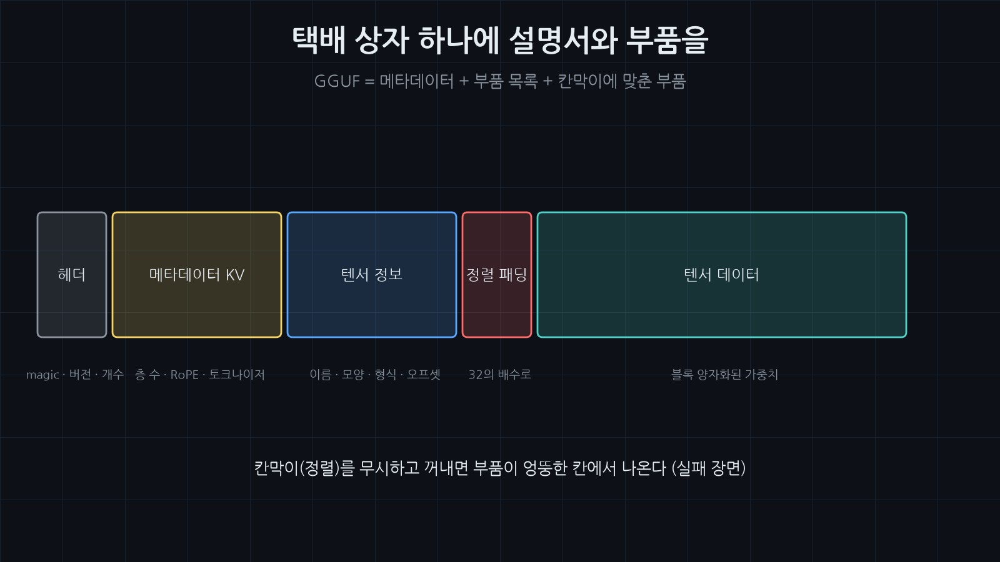
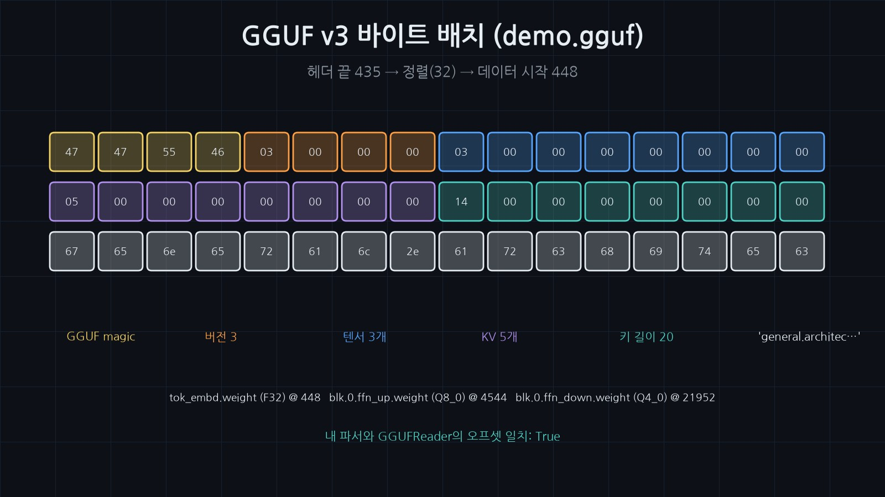
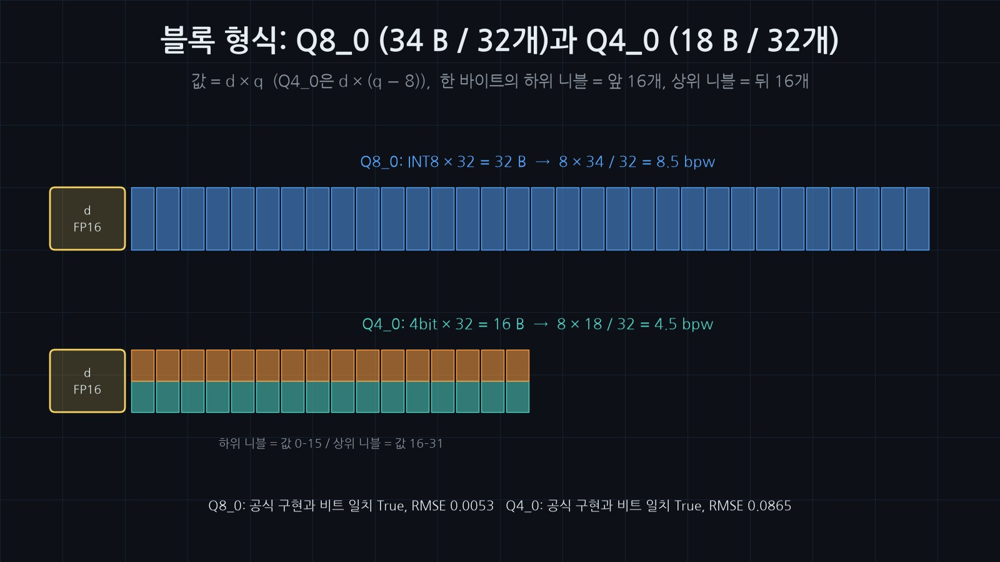
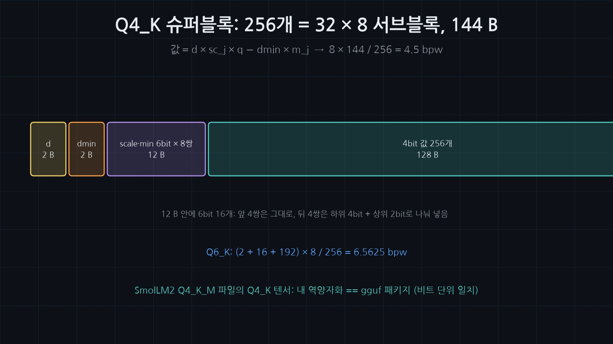
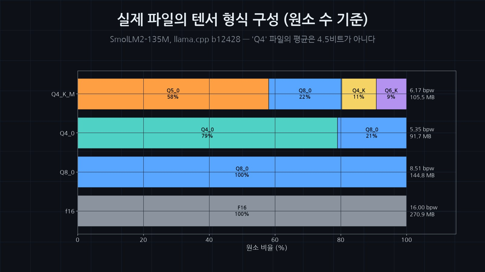
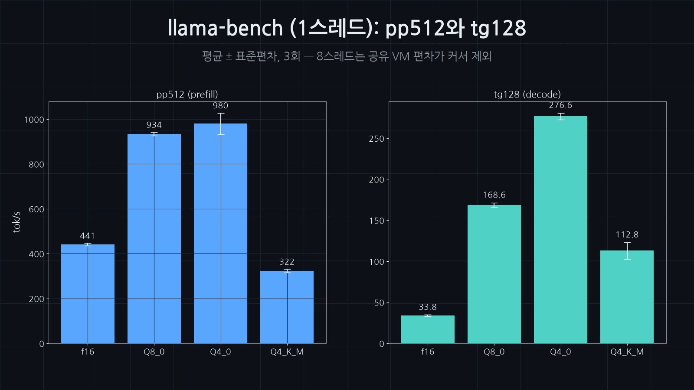
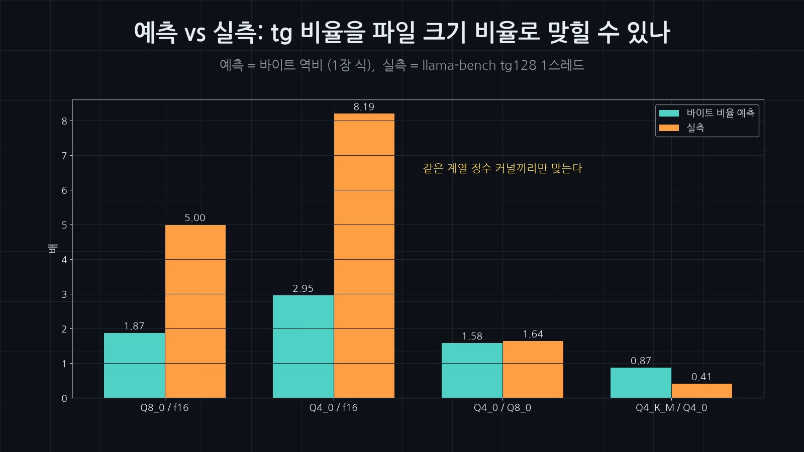
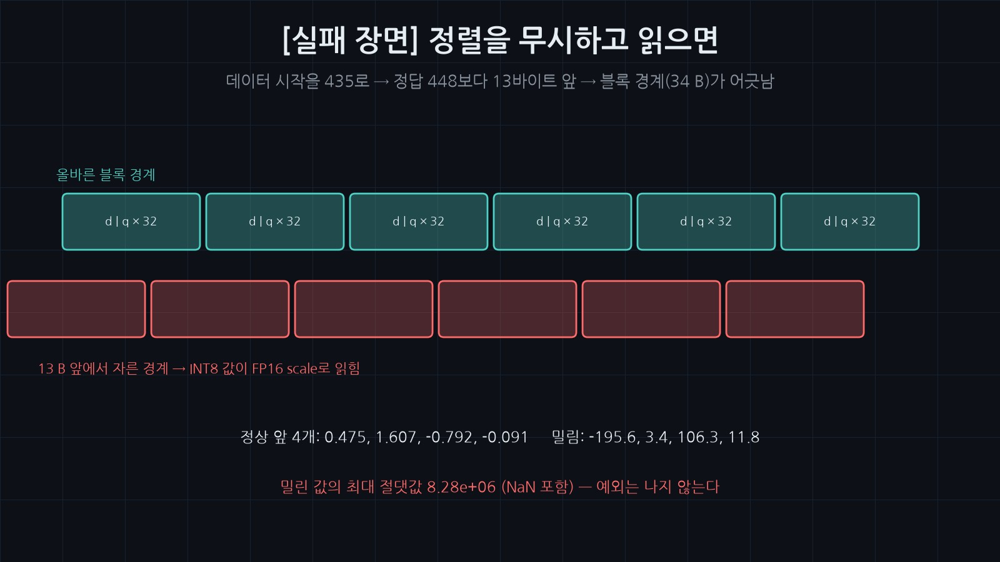
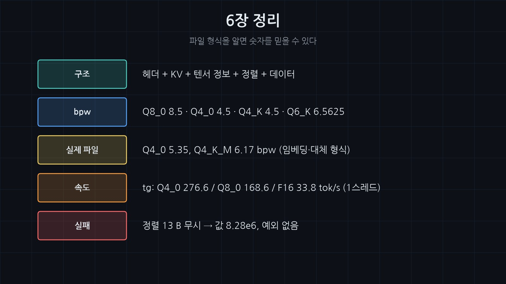

> **온디바이스 LLM 시리즈** · [전체 목차](/blog/2026/11/16/ondevice-llm-series/)  
> ← 이전: [5. PyTorch 모델을 NPU용 그래프로](/blog/2026/11/16/ondevice-llm-05-llm-graph-export/)  
> → 다음: [7. TTFT·TPS를 제대로 재는 법](/blog/2026/11/16/ondevice-llm-07-ttft-tps-benchmark/)

> 이 글의 예제 코드 전체: [kjoh94/ondevice-llm-examples/tree/main/06-gguf](https://github.com/kjoh94/ondevice-llm-examples/tree/main/06-gguf) (`python example.py`, 실제 GGUF는 `python example.py --gguf 파일.gguf`)

> 이 글은 공개 자료만 사용했고, 어떤 회사의 공식 입장도 아닙니다.

> **처음이라면 이것만 기억하세요.** GGUF는 llama.cpp가 쓰는 **모델 파일 한 개 형식**이에요. 앞부분에 "이 모델은 몇 층이고 토크나이저는 이것"이라는 메타데이터가 있고, 뒤에 양자화된 가중치가 **블록 단위**(32개나 256개씩, scale과 함께)로 들어 있어요. "Q4"라고 해도 실제 파일은 **4.5–6.2비트**예요.

선수 글: [tokens 1편 — GGUF Q4_K_M](/blog/2026/10/30/tokens-01-quantization/), [2장 — 그룹 양자화](/blog/2026/11/16/ondevice-llm-02-llm-quantization/)

llama.cpp는 CPU·GPU·모바일에서 LLM을 돌리는 사실상의 표준 오픈소스 런타임이에요. NPU 배포를 하더라도 "같은 모델이 CPU에서 llama.cpp로는 얼마나 나오나"는 거의 항상 비교 기준이 돼요. 이 장에서는 GGUF 파일을 **파이썬 60줄로 직접 파싱**하고, Q8_0·Q4_0·Q4_K 블록을 **직접 역양자화해서 공식 구현과 비트 단위로 일치**하는지 확인해요. 그리고 SmolLM2-135M을 네 가지 형식으로 변환해 `llama-bench`로 재요.

## 0. 비유로 먼저

### 0-1. 택배 상자 하나에 설명서와 부품을



**그림 1.** 예전에는 모델을 받으면 가중치 파일, 설정 파일, 토크나이저 파일이 따로 왔어요. GGUF는 **상자 하나**예요. 상자를 열면 맨 위에 설명서(메타데이터: 층 수, RoPE 주파수, 토크나이저 어휘), 그다음 부품 목록(텐서 이름·모양·형식·위치), 그리고 **칸막이 선에 맞춰 정렬된** 부품들(가중치)이 있어요. 칸막이(정렬)를 무시하고 꺼내면 부품이 엉뚱한 칸에서 나와요(실패 장면).

### 0-2. 직접 재 보기: "Q4" 파일은 실제로 몇 비트?

SmolLM2-135M(파라미터 134.5M)을 llama.cpp b12428로 변환했어요.

| 형식 | 파일 크기 | 평균 비트(bpw) | 1스레드 tg128 (tok/s) |
|---|---|---|---|
| F16 | 270.9 MB | 16.00 | 33.8 |
| Q8_0 | 144.8 MB | 8.51 | 168.6 |
| Q4_0 | 91.7 MB | **5.35** | **276.6** |
| Q4_K_M | 105.5 MB | **6.17** | 112.8 |

"4비트"인 Q4_0이 5.35비트이고, Q4_K_M은 6.17비트에 Q4_0보다 2.5배 느려요. 이유는 4절과 실패 장면 근처에서 볼게요.

이제 정식 용어로 하나씩 자세히 볼게요.

## 1. GGUF 파일 구조



**그림 2.** GGUF v3 구조(ggml `docs/gguf.md`). 헤더(magic `GGUF`, 버전, 텐서 수, KV 수) → KV 메타데이터 → 텐서 정보(이름, 차원, 형식, 데이터 영역 안의 오프셋) → 정렬 패딩 → 텐서 데이터. 모든 정수는 리틀 엔디언이다.

`gguf` 파이썬 패키지로 작은 파일(텐서 3개, KV 5개)을 만들고 앞 48바이트를 봤다.

```
00000000  47 47 55 46 03 00 00 00 03 00 00 00 00 00 00 00  GGUF............
00000010  05 00 00 00 00 00 00 00 14 00 00 00 00 00 00 00  ................
00000020  67 65 6e 65 72 61 6c 2e 61 72 63 68 69 74 65 63  general.architec
```

`47 47 55 46` = "GGUF", `03 00 00 00` = 버전 3, 그다음 8바이트 = 텐서 3개, 8바이트 = KV 5개, 8바이트 = 첫 키 길이 20(0x14), 그리고 키 문자열 `general.architecture`가 이어진다.

```python
def parse(buf, respect_alignment=True):
    off = 0
    def rd(fmt):
        nonlocal off; v = struct.unpack_from(fmt, buf, off); off += struct.calcsize(fmt); return v[0]
    def rstr():
        nonlocal off; n = rd("<Q"); s = buf[off:off + n].decode(); off += n; return s
    ...
    magic = buf[:4]; off = 4
    ver = rd("<I"); n_t = rd("<Q"); n_kv = rd("<Q")
    for _ in range(n_kv):
        k = rstr(); t = rd("<I"); kv[k] = rval(t)            # 값 타입: 정수·실수·문자열·배열
    for _ in range(n_t):
        name = rstr(); nd = rd("<I"); dims = [rd("<Q") for _ in range(nd)]; typ = rd("<I"); o = rd("<Q")
        tinfo.append(dict(name=name, dims=dims, type=QT(typ).name, offset=o))
    align = kv.get("general.alignment", 32)
    data_start = (off + align - 1) // align * align         # ★ 정렬
```

| 확인 | 결과 |
|---|---|
| 헤더(메타데이터 + 텐서 정보) 끝 | 435 바이트 |
| 정렬(32) 후 데이터 시작 | **448** = ⌈435/32⌉ × 32 |
| 텐서 3개 오프셋: 내 파서 vs 공식 `GGUFReader` | 448/448, 4544/4544, 21952/21952 — 전부 일치 |

> **유도 1 — 텐서 데이터 위치**
> `절대 위치 = ⌈헤더 끝 / align⌉ × align + 텐서 오프셋`
> tok_embd(F32, 64×16): 448 + 0 = 448, 크기 1024 × 4 = 4096 B → 다음 텐서 오프셋 4096 → 448 + 4096 = **4544** ✓
> ffn_up(Q8_0, 256×64 = 16,384개): 512블록 × 34 B = 17,408 B → 4544 + 17,408 = **21,952** ✓ (각 텐서도 32의 배수로 정렬)

## 2. 블록 양자화 형식: Q8_0과 Q4_0



**그림 3.** `ggml-common.h`의 블록 구조. Q8_0: FP16 scale `d` 하나 + INT8 32개 = 34 B. Q4_0: FP16 `d` + 4비트 32개(16 B) = 18 B, 값은 `d × (q − 8)`. 한 바이트의 하위 니블이 앞쪽 16개, 상위 니블이 뒤쪽 16개다.

> **유도 2 — 블록 형식의 bpw**
> Q8_0: 34 B × 8 / 32 = **8.5 bpw**, Q4_0: 18 × 8 / 32 = **4.5**, Q5_0: (2 + 4 + 16) × 8 / 32 = **5.5**
> 2장 식 `4 + 16/g`(g = 32)와 Q4_0이 정확히 같다.

```python
def deq_q4_0(raw):
    b = raw.reshape(-1, 18)
    d = b[:, :2].copy().view(np.float16).astype(np.float32)
    qs = b[:, 2:]
    lo = (qs & 0x0F).astype(np.int8) - 8; hi = (qs >> 4).astype(np.int8) - 8   # 앞 16개 = 하위 니블
    return (d * np.concatenate([lo, hi], 1).astype(np.float32)).reshape(-1)
```

| 형식 | 내 역양자화 == `gguf.quants.dequantize` | 원본 대비 RMSE (표준정규 가중치) |
|---|---|---|
| Q8_0 | **비트 단위 일치** | 0.0053 |
| Q4_0 | **비트 단위 일치** | 0.0865 |

## 3. K-quants: 256개 슈퍼블록과 6비트 scale



**그림 4.** Q4_K 슈퍼블록 = 256개 = 32개짜리 서브블록 8개. FP16 `d`·`dmin` 두 개(4 B), 서브블록마다 6비트 scale과 6비트 min 8쌍을 12 B에 압축, 4비트 값 256개(128 B). 값은 `d × sc_j × q − dmin × m_j`(비대칭).

> **유도 3 — Q4_K와 Q6_K의 bpw**
> Q4_K: (2 + 2 + 12 + 128) B × 8 / 256 = 144 × 8 / 256 = **4.5 bpw** — Q4_0과 같은 크기인데 zero-point(min)가 있고 scale도 2단계
> Q6_K: (2 + 16 + 192) × 8 / 256 = 210 × 8 / 256 = **6.5625 bpw**

```python
for j in range(8):                                    # 6비트 scale/min 8쌍을 12바이트에서 꺼내기
    if j < 4:
        sc[:, j] = sc_raw[:, j] & 63; mn[:, j] = sc_raw[:, j + 4] & 63
    else:
        sc[:, j] = (sc_raw[:, j + 4] & 0xF) | ((sc_raw[:, j - 4] >> 6) << 4)
        mn[:, j] = (sc_raw[:, j + 4] >> 4) | ((sc_raw[:, j] >> 6) << 4)
```

실제 SmolLM2 Q4_K_M 파일의 Q4_K 텐서를 이 코드로 풀었더니 `gguf` 패키지와 **비트 단위로 일치**했다. 12바이트 압축이 이 형식에서 가장 헷갈리는 부분이다. 앞 4쌍은 하위 6비트에 그대로, 뒤 4쌍은 하위 4비트를 8–11번 바이트에, 상위 2비트를 0–7번 바이트의 남는 2비트에 나눠 넣는다.

## 4. 실제 파일: "Q4_K_M"은 무엇이 섞여 있나

| 파일 | 텐서 형식 (개수, 원소) | 평균 bpw |
|---|---|---|
| Q8_0 | Q8_0 211개(134.48M), F32 61개(norm) | 8.51 |
| Q4_0 | Q4_0 210개(106.17M), **Q8_0 1개(28.31M, 임베딩)**, F32 61개 | 5.35 |
| Q4_K_M | **Q5_0 166개(78.08M)**, Q8_0 15개(29.86M), Q4_K 16개(14.16M), Q6_K 14개(12.39M), F32 61개 | 6.17 |



**그림 5.** 파일별 원소 수 기준 형식 구성. Q4_K_M인데 Q4_K는 원소의 10.5%뿐이다.

> **유도 4 — 파일 평균 bpw**
> Q4_0 파일: (106.17M × 4.5 + 28.31M × 8.5 + 0.04M × 32) / 134.52M = (477.8 + 240.6 + 1.3) / 134.52 = **5.35**
> SmolLM2-135M은 임베딩(49,152 × 576 = 28.31M)이 전체의 21%이고 출력층과 공유되어, 여기를 8비트로 두는 것만으로 평균이 0.85비트 오른다.

Q4_K_M에 Q5_0이 많은 이유는 SmolLM2의 hidden 크기 576이 **256으로 나누어지지 않기** 때문이다. K-quant는 행 길이가 256의 배수여야 하므로, llama.cpp의 quantize 도구는 그런 텐서에 대체 형식(Q4_K → Q5_0, Q6_K → Q8_0)을 쓴다(`src/llama-quant.cpp`의 `tensor_type_fallback`). 변환 로그에도 `WARNING: 180 of 272 tensor(s) required fallback quantization`이 찍혔다. 576 = 32 × 18이라 32개 블록 형식은 들어간다. 반면 FFN의 down projection(입력 1536 = 256 × 6)은 Q4_K·Q6_K가 될 수 있다. 큰 모델(hidden 4096 등)에서는 이런 대체가 거의 없다.

## 5. llama-bench: pp와 tg

`llama-bench`는 prefill 처리량(pp, 프롬프트 512토큰)과 생성 처리량(tg, 128토큰)을 따로 잰다. 각 3회 반복이다.

| 형식 | pp512, 1스레드 | tg128, 1스레드 | pp512, 8스레드 | tg128, 8스레드 |
|---|---|---|---|---|
| F16 | 441.0 ± 5.6 | 33.8 ± 0.9 | 1732.6 ± 745.0 | 280.6 ± 42.7 |
| Q8_0 | 933.6 ± 7.8 | 168.6 ± 2.6 | 1655.2 ± 40.9 | 183.7 ± 25.7 |
| Q4_0 | 979.9 ± 47.6 | **276.6 ± 4.1** | 2781.8 ± 1047.4 | 600.7 ± 120.0 |
| Q4_K_M | 322.3 ± 8.1 | 112.8 ± 10.1 | 862.0 ± 53.5 | 205.4 ± 73.0 |

(단위 tok/s, 평균 ± 표준편차. CPU: 공유 VM의 Intel Xeon, llama.cpp b12428 릴리스 바이너리)



**그림 6.** 1스레드 pp512와 tg128. 8스레드는 표준편차가 평균의 최대 40%라(공유 VM) 그림에서는 뺐다.

### 예측 vs 실측: 바이트 비율로 tg를 맞힐 수 있나

1장 식대로라면 tg는 `대역폭 ÷ 토큰당 바이트`이고, 형식 간 tg 비율은 **파일 크기의 역비**여야 한다.

| 비교 | 바이트 비율로 예측 | 실측 tg 비율 (1스레드) |
|---|---|---|
| Q8_0 / F16 | 270.9 / 144.8 = 1.87배 | 168.6 / 33.8 = **5.00배** |
| Q4_0 / F16 | 270.9 / 91.7 = 2.95배 | 276.6 / 33.8 = **8.19배** |
| Q4_0 / Q8_0 | 144.8 / 91.7 = 1.58배 | 276.6 / 168.6 = **1.64배** |
| Q4_K_M / Q4_0 | 91.7 / 105.5 = 0.87배 | 112.8 / 276.6 = **0.41배** |



**그림 7.** 바이트 비율 예측과 실측의 비교. Q4_0 / Q8_0만 예측에 맞는다.

맞는 것과 틀린 것을 나눠 보면 이렇다.

- **Q4_0 vs Q8_0은 맞는다(1.58 vs 1.64).** 둘 다 정수 내적 커널(활성값을 Q8로 바꿔 정수로 곱함)을 쓰고, 이 경우는 바이트가 속도를 정한다.
- **F16은 훨씬 느리다.** 1스레드에서 F16 행렬-벡터 곱은 F16 → F32 변환과 FP 곱셈이 바이트보다 먼저 한계에 닿는다. 계산 병목이다.
- **Q4_K_M은 예측의 절반이다.** 섞인 Q5_0(5비트 값의 상위 1비트를 따로 모아 두는 형식)과 K-quant의 2단계 scale 풀기가 이 CPU에서 비싸다. 같은 크기라도 **커널이 얼마나 단순한가**가 속도를 정한다. 큰 모델의 Q4_K_M은 보통 이렇게까지 느리지 않다(대체 형식이 거의 없으므로).
- 또 이 모델은 Q4_0이 92 MB라 이 VM의 L3 캐시(320 MiB)에 **통째로 들어간다**. DRAM 대역폭 상한(1장 실측 26–39 GB/s ÷ 92 MB ≈ 290–425 tok/s)과 실측 276.6이 비슷한 범위인 것은 우연에 가깝고, 큰 모델에서는 DRAM이 한계가 된다.

> **엣지 NPU에서는:** GGUF의 블록 형식(Q4_0, Q4_K)은 CPU SIMD 커널에 맞춰 설계됐다. NPU가 이 형식을 직접 먹지 못하면, 2장에서 본 것처럼 **배포 전에 NPU 형식으로 재양자화**해야 하고 그 과정에서 오차가 한 번 더 생긴다. 공개 자료를 읽을 때 "GGUF 지원"이 "GGUF 파일을 읽어서 변환"인지 "블록 형식 그대로 실행"인지를 구분해서 보자. 비교 기준으로 llama.cpp 숫자를 쓸 때는 **같은 모델·같은 형식·같은 pp/tg 길이**인지 확인해야 한다(7장).

## 실패 장면: 정렬을 무시하고 읽으면



**그림 8.** 같은 파서에서 `data_start = 헤더 끝`(435)으로 두고 읽었다. 정답(448)보다 13바이트 앞에서 읽기 시작한다.

```python
pb = parse(buf, respect_alignment=False)          # data_start = 435
bad = deq_q8_0(np.frombuffer(buf, np.uint8, tensor_bytes(ti), pb["data_start"] + ti["offset"]))
```

| | ffn_up 앞 4개 값 | 최대 절댓값 |
|---|---|---|
| 정상(448부터) | 0.475, 1.607, −0.792, −0.091 | 정상 범위 |
| 정렬 무시(435부터) | −195.6, 3.4, 106.3, 11.8 | **8.28 × 10⁶** (NaN 포함) |

13바이트 밀리면 블록 경계(34 B)가 어긋나서, INT8 값 바이트가 FP16 scale로 읽힌다. 그래서 값이 수백만이 되거나 NaN이 된다. 예외는 나지 않는다. 파일 크기는 충분하므로 읽기 자체는 성공한다. 이런 버그는 "모델이 이상한 말을 한다"로만 나타나므로, 직접 파서를 짰다면 **공식 리더와 오프셋을 비교하는 테스트**를 먼저 두자(이 장의 예제처럼).

## 자주 묻는 질문

**Q. Q4_K_M의 M은 무엇인가요?**
"medium"이에요. 텐서마다 형식을 섞는 레시피 이름이에요. 예를 들어 attention의 V projection이나 FFN down 일부는 한 단계 높은 형식(Q6_K 등)으로 둬요. S(small)·M·L 순으로 높은 형식의 비율이 늘어요.

**Q. GGUF에는 토크나이저도 들어 있나요?**
네. `tokenizer.ggml.*` 키 아래에 어휘, 병합 규칙, 특수 토큰이 들어 있어서 파일 하나로 실행돼요.

**Q. imatrix는 무엇인가요?**
보정 데이터로 잰 "입력 채널 중요도"(2장 AWQ의 활성값 크기와 같은 아이디어)를 양자화할 때 반영하는 llama.cpp 기능이에요. 이 장의 실험에서는 쓰지 않았어요.

## 퀴즈

1. Q4_1(FP16 d, FP16 m, 4비트 32개)의 bpw는? → (2 + 2 + 16) × 8 / 32 = 5.0.
2. 헤더가 1000바이트에서 끝나고 정렬이 32면 데이터는 어디서 시작하나요? → ⌈1000/32⌉ × 32 = 1024.
3. hidden 4096 모델에서 Q4_K가 들어가지 못하는 행 길이가 있을까요? → 4096 = 256 × 16이라 대부분 들어간다. 576처럼 256의 배수가 아닌 경우에만 대체 형식이 쓰인다.

## 정리

- GGUF = 헤더 + KV 메타데이터 + 텐서 정보 + **정렬** + 데이터. 60줄 파서로 공식 리더와 오프셋이 일치했다.
- Q8_0 8.5, Q4_0 4.5, Q4_K 4.5, Q6_K 6.5625 bpw. 직접 구현한 역양자화가 전부 비트 단위로 일치.
- "Q4" 파일의 실제 평균은 5.35(Q4_0)–6.17(Q4_K_M) bpw. 임베딩과 대체 형식 때문이다.
- tg는 같은 계열 커널끼리만 바이트 비율로 맞는다(Q4_0/Q8_0 1.58 vs 1.64). 커널이 복잡하면 바이트가 같아도 느리다.

## 참고 (공개 자료)

- ggml, "GGUF" 명세: <https://github.com/ggml-org/ggml/blob/master/docs/gguf.md>
- llama.cpp 저장소: <https://github.com/ggml-org/llama.cpp> · `llama-bench`: <https://github.com/ggml-org/llama.cpp/tree/master/tools/llama-bench>
- 블록 구조 정의 `ggml-common.h`: <https://github.com/ggml-org/llama.cpp/blob/master/ggml/src/ggml-common.h>
- `gguf` 파이썬 패키지: <https://pypi.org/project/gguf/>
- SmolLM2-135M: <https://huggingface.co/HuggingFaceTB/SmolLM2-135M>
- L. Ben Allal et al., "SmolLM2: When Smol Goes Big", arXiv:[2502.02737](https://arxiv.org/abs/2502.02737)

검증 환경: gguf 0.19.0, llama.cpp b12428 릴리스 바이너리(Linux x86_64), 변환은 같은 태그 소스의 `convert_hf_to_gguf.py`. 변환·벤치 스크립트는 저장소의 `tools/make_gguf_and_bench.sh`. GGUF 파일 자체는 저장소에 넣지 않았다.



**그림 9.** 6장 정리.

---

> **온디바이스 LLM 시리즈** · [전체 목차](/blog/2026/11/16/ondevice-llm-series/)  
> ← 이전: [5. PyTorch 모델을 NPU용 그래프로](/blog/2026/11/16/ondevice-llm-05-llm-graph-export/)  
> → 다음: [7. TTFT·TPS를 제대로 재는 법](/blog/2026/11/16/ondevice-llm-07-ttft-tps-benchmark/)
