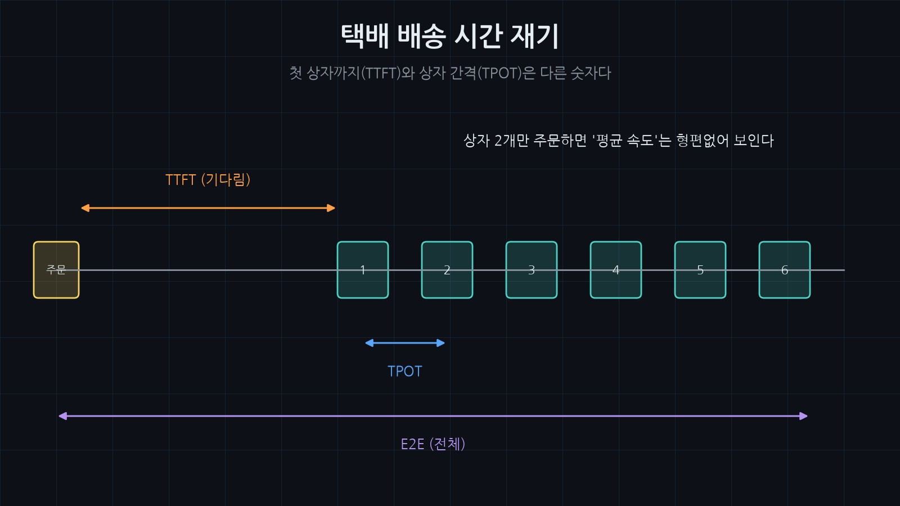
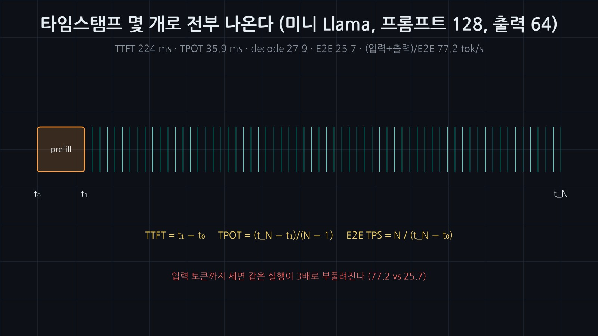
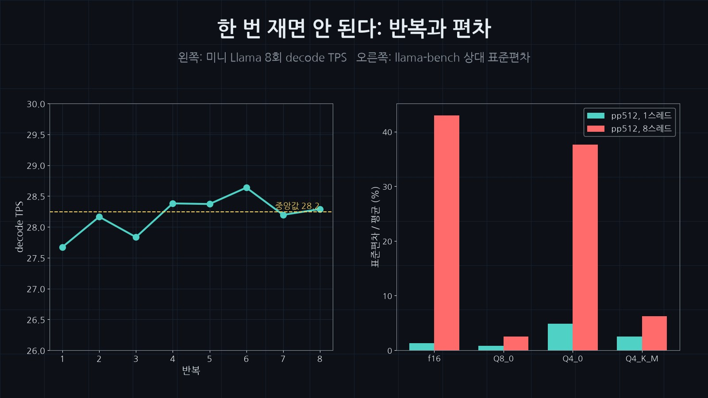
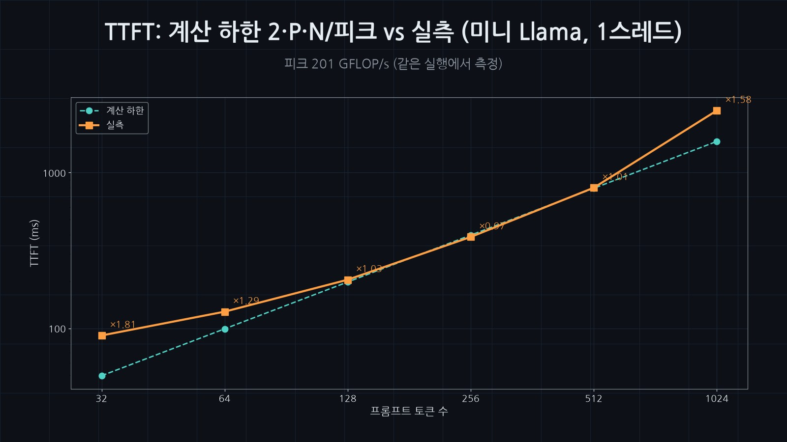
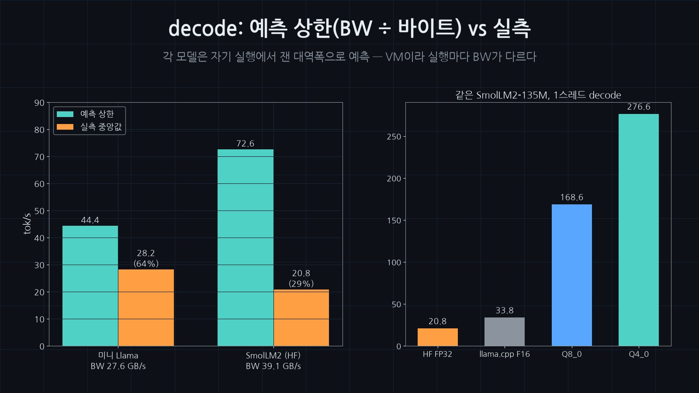
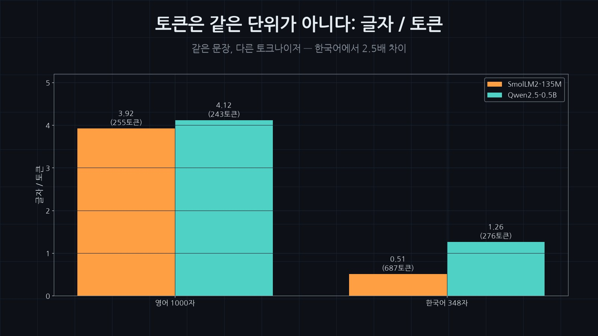
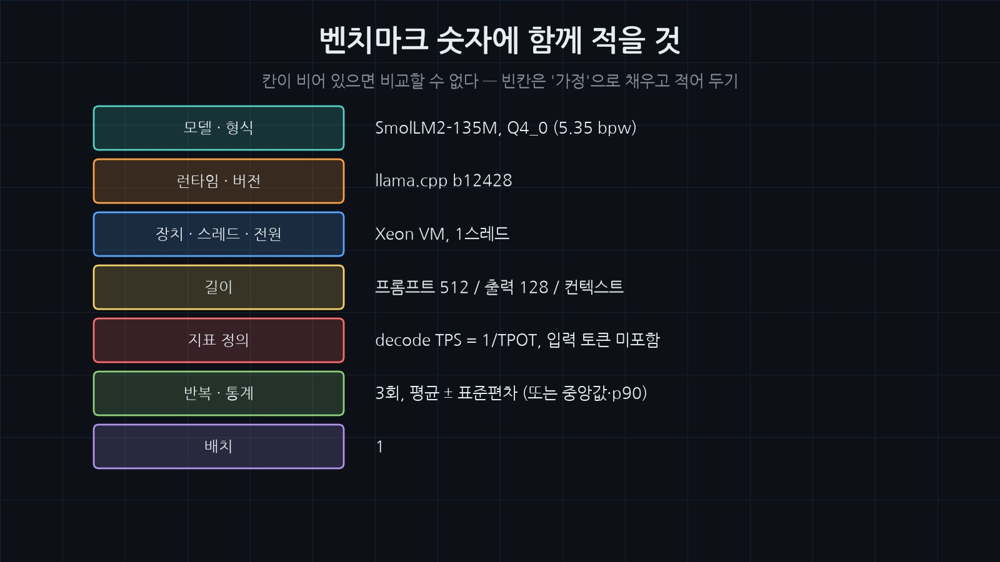
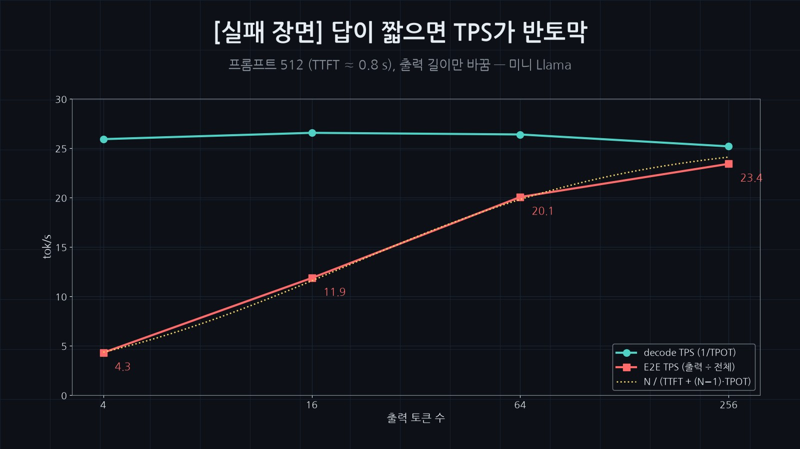
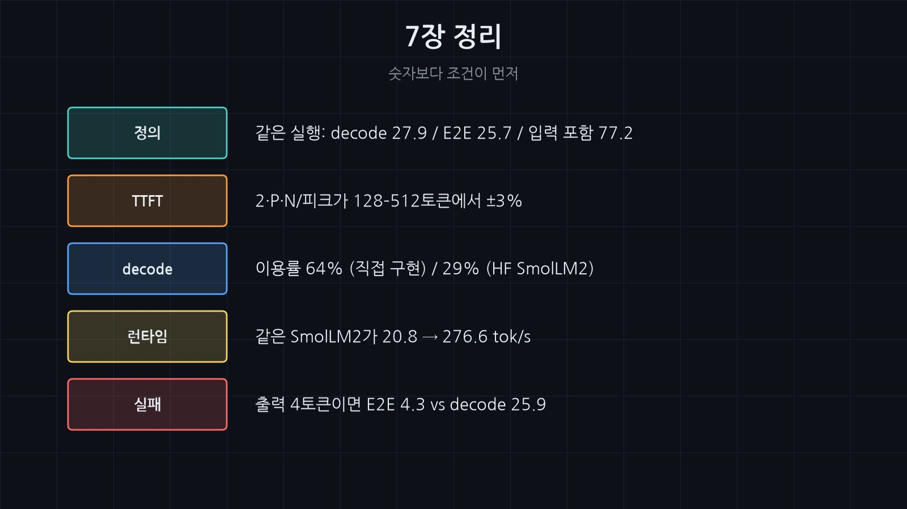

> **온디바이스 LLM 시리즈** · [전체 목차](/blog/2026/11/16/ondevice-llm-series/)  
> ← 이전: [6. llama.cpp와 GGUF 해부](/blog/2026/11/16/ondevice-llm-06-llamacpp-gguf/)  
> → 다음: [8. Speculative decoding](/blog/2026/11/16/ondevice-llm-08-speculative-decoding/)

> 이 글의 예제 코드 전체: [kjoh94/ondevice-llm-examples/tree/main/07-bench](https://github.com/kjoh94/ondevice-llm-examples/tree/main/07-bench) (`python example.py`, 실제 모델은 `python example.py --real`)

> 이 글은 공개 자료만 사용했고, 어떤 회사의 공식 입장도 아닙니다. "가상 엣지 NPU"의 숫자는 공개된 일반 스펙 수준의 값에 가정을 더한 계산 예시입니다.

> **처음이라면 이것만 기억하세요.** "초당 몇 토큰"이라는 숫자 하나에는 최소 네 가지 정의가 숨어 있어요. **TTFT**(첫 토큰까지 시간), **TPOT**(그다음 토큰 하나당 시간), **decode TPS**(= 1/TPOT), **E2E TPS**(출력 토큰 ÷ 전체 시간). 그리고 같은 모델이라도 런타임·형식·스레드·토크나이저가 다르면 숫자가 10배 넘게 달라져요. 발표된 숫자를 볼 때는 **조건부터** 확인하세요.

선수 글: [tokens 0편 — TTFT/TPS](/blog/2026/10/30/tokens-00-prologue-prefill-decode/), [tokens 9편 — 스트리밍](/blog/2026/10/31/tokens-09-streaming/), [1장 — Roofline](/blog/2026/11/16/ondevice-llm-01-roofline-bandwidth/)

[tokens 0편](/blog/2026/10/30/tokens-00-prologue-prefill-decode/)에서 TTFT와 TPS라는 말을 소개했어요. 이 장에서는 **어떤 생성 함수에도 붙일 수 있는 20줄짜리 측정 하네스**를 만들고, 미니 Llama와 SmolLM2-135M으로 직접 재요. 그리고 1장의 상한 식(예측)과 실측을 비교하고, 숫자를 부풀리거나 깎는 흔한 실수들을 재현해요.

## 0. 비유로 먼저

### 0-1. 택배 배송 시간 재기



**그림 1.** 주문하고 첫 상자가 도착하기까지(TTFT)와, 그다음 상자들이 몇 분 간격으로 오는지(TPOT)는 다른 숫자예요. "하루 100상자 배송"(TPS)이라고만 하면 첫 상자를 3시간 기다린 건지, 상자가 몇 개였는지 알 수 없어요. 상자 2개만 주문하면 평균 속도는 형편없어 보여요(실패 장면).

### 0-2. 직접 재 보기: 같은 SmolLM2-135M, 다른 숫자

| 조건 | decode tok/s |
|---|---|
| PyTorch FP32, 1스레드, HF `model()` 루프 | 20.8 (8회 중앙값) |
| llama.cpp F16, 1스레드 (tg128) | 33.8 |
| llama.cpp Q8_0, 1스레드 | 168.6 |
| llama.cpp Q4_0, 1스레드 | **276.6** |
| llama.cpp Q4_0, 8스레드 | 600.7 ± 120.0 |

같은 모델, 같은 CPU에서 **29배** 차이예요. 숫자만 보고 "이 장치는 X tok/s"라고 말할 수 없는 이유예요.

이제 정식 용어로 하나씩 자세히 볼게요.

## 1. 정의: 타임스탬프 몇 개로 전부 나온다



**그림 2.** 요청 시작 t₀, 첫 토큰 t₁, 마지막 토큰 t_N. TTFT = t₁ − t₀(대부분 prefill), TPOT = (t_N − t₁)/(N − 1), E2E = t_N − t₀.

```python
class Recorder:
    def start(self): self.t0 = time.perf_counter()
    def on_token(self, _tok): self.ts.append(time.perf_counter())      # 토큰이 나올 때마다
    def metrics(self):
        N = len(self.ts); e2e = self.ts[-1] - self.t0; ttft = self.ts[0] - self.t0
        tpot = (e2e - ttft) / (N - 1)
        return dict(ttft_s=ttft, tpot_s=tpot, decode_tps=1 / tpot,
                    e2e_tps=N / e2e, total_tps=(self.n_prompt + N) / e2e)
```

> **유도 1 — E2E TPS와 decode TPS의 관계**
> `E2E TPS = N / (TTFT + (N − 1) × TPOT)`
> N → ∞이면 decode TPS(= 1/TPOT)에 가까워지고, N이 작으면 TTFT가 지배한다.
> 미니 Llama, 프롬프트 128, 출력 64: 64 / (0.224 + 63 × 0.0359) = **25.7** (실측 25.7) vs decode TPS **27.9**

| 지표 (미니 Llama 155.7M, FP32, 1스레드, 측정 BW 27.6 GB/s) | 값 |
|---|---|
| TTFT (프롬프트 128) | 224.0 ms |
| TPOT | 35.90 ms |
| decode TPS | 27.9 |
| E2E TPS (출력 64) | 25.7 |
| (입력 + 출력) / E2E | **77.2** ← 입력 토큰까지 세면 3배로 부풀려진다 |

마지막 줄은 실제로 쓰이는 정의다. "throughput"을 입력+출력 토큰으로 세면 같은 실행이 77 tok/s가 된다. 어느 정의인지 안 적힌 숫자는 비교할 수 없다.

## 2. 반복과 분포: 한 번 재면 안 된다

같은 설정을 8번 반복했다. decode TPS 중앙값 28.2, 최소 27.7, 최대 28.6이다. 이 정도면 안정적인 편이다. 그런데 6장의 llama-bench 8스레드는 표준편차가 평균의 40%였다(Q4_0 pp512 2781.8 ± 1047.4). 공유 VM이나 열 관리(thermal throttling)가 있는 모바일 장치에서는 흔한 일이다.



**그림 3.** 왼쪽: 8회 반복 decode TPS. 오른쪽: llama-bench 1스레드와 8스레드의 상대 표준편차. 스레드를 늘리면 평균은 오르지만 편차도 커진다.

권장 절차는 간단하다. **웜업 1회 → 같은 조건 N회 → 중앙값과 범위(또는 p90)를 같이 보고**. 모바일이라면 연속 실행 중 온도에 따른 하락까지 따로 잰다.

## 3. TTFT: 계산 하한과 실측

TTFT는 대부분 prefill이고, prefill은 계산 병목이다(1장).

> **유도 2 — TTFT 하한**
> `TTFT ≥ 2 × P × N_prompt / 피크 FLOP/s`
> 미니 Llama(P = 155.7M), 이 PC의 matmul 피크 201 GFLOP/s(1스레드 실측), 프롬프트 512: 2 × 155.7M × 512 / 201G ≈ **794 ms**
> 가상 엣지 NPU, 8B, 1000토큰, 이용률 40%: 2 × 8.03G × 1000 / (80T × 0.4) = **0.50 s** (1장)

| 프롬프트 길이 | 계산 하한 (ms) | 실측 TTFT (ms) | 실측/하한 |
|---|---|---|---|
| 32 | 49.6 | 90.0 | 1.81 |
| 128 | 198.5 | 205.2 | 1.03 |
| 256 | 396.9 | 386.4 | 0.97 |
| 512 | 793.9 | 800.1 | 1.01 |
| 1024 | 1587.7 | **2506.2** | **1.58** |



**그림 4.** 프롬프트 길이별 TTFT. 128–512에서는 식이 거의 정확하다(0.97–1.03, 하한보다 작은 것은 피크 측정의 오차 범위). 짧으면 고정 비용(32토큰에서 1.81배), 길면 식에 없는 attention의 `N²` 항과 캐시 효율 저하가 드러난다(1024에서 1.58배).

## 4. decode TPS: 컨텍스트와 예측

| 컨텍스트 길이 | 64 | 512 | 1024 | 1536 |
|---|---|---|---|---|
| decode TPS (미니 Llama) | 28.7 | 26.4 | 24.0 | 22.5 |

3장에서 본 대로 KV를 더 읽으니 길수록 느려진다. "decode TPS"를 말할 때는 **어느 컨텍스트 길이에서** 쟀는지도 같이 적어야 한다.

> **유도 3 — 대역폭 이용률**
> `예측 상한 = 측정 BW ÷ 가중치 바이트`, `이용률 = 실측 ÷ 예측`
> 미니 Llama: 27.6 GB/s ÷ 623 MB = **44.4 tok/s**, 실측 중앙값 28.2 → **64%**
> SmolLM2-135M(FP32 538 MB, 별도 실행 BW 39.1 GB/s): 72.6 tok/s 예측, 실측 20.8 → **29%**



**그림 5.** 두 모델의 예측 상한과 실측. 직접 짠 미니 Llama는 64%, HF transformers의 SmolLM2는 29%다.

SmolLM2가 이용률이 낮은 이유는 모델이 작고 층이 많아서(30층, hidden 576) 행렬곱 하나하나가 작고, HF `model()` 호출의 파이썬·캐시 관리 오버헤드가 상대적으로 크기 때문이다. 같은 모델을 llama.cpp F16(바이트는 절반)으로 돌리면 33.8, Q4_0이면 276.6이다(0-2절). **런타임 오버헤드는 작은 모델일수록 크게 보인다.** 엣지 NPU에서 1–3B 모델을 돌릴 때 이 효과를 꼭 따로 재야 하는 이유다.

## 5. 토큰은 같은 단위가 아니다

tok/s는 토큰 단위다. 그런데 토크나이저마다 한 토큰에 들어가는 글자 수가 다르다.

| 토크나이저 | 영어(앨리스 1문단, 1000자) | 한국어(348자) |
|---|---|---|
| SmolLM2-135M | 255토큰, **3.92자/토큰** | 687토큰, **0.51자/토큰** |
| Qwen2.5-0.5B | 243토큰, 4.12자/토큰 | 276토큰, **1.26자/토큰** |



**그림 6.** 같은 문장의 토큰 수. SmolLM2는 영어 중심 어휘라 한국어 한 글자가 2토큰 가까이로 쪼개진다.

> **유도 4 — 글자/초로 바꾸기**
> `글자/초 = tok/s × 글자/토큰`
> 같은 30 tok/s라도 한국어에서 SmolLM2는 30 × 0.51 = **15자/초**, Qwen2.5는 30 × 1.26 = **38자/초** — 2.5배 차이

한국어 서비스를 비교한다면 tok/s보다 **글자/초**나 "같은 답변을 끝내는 시간"이 공정하다.

## 6. 보고 양식



**그림 7.** 벤치마크 숫자에 함께 적을 것들.

| 항목 | 예 |
|---|---|
| 모델과 형식 | SmolLM2-135M, Q4_0 (평균 5.35 bpw) |
| 런타임과 버전 | llama.cpp b12428 |
| 장치·스레드·전원 상태 | Xeon VM, 1스레드 |
| 프롬프트 길이 / 출력 길이 / 컨텍스트 | pp512 / tg128 |
| 지표 정의 | decode TPS = 1/TPOT (입력 토큰 미포함) |
| 반복과 통계 | 3회, 평균 ± 표준편차 |
| 배치 크기 | 1 |

> **엣지 NPU에서는:** 공개 자료의 "X tok/s"는 위 표의 칸 대부분이 비어 있는 경우가 많다. 특히 **모델 크기, 양자화 형식, 프롬프트·출력 길이, decode TPS인지 E2E인지**가 없으면 1장의 상한 식(BW ÷ 바이트)과 비교할 수조차 없다. 비교할 때는 빈칸을 "가정"으로 채우고, 그 가정을 숫자 옆에 적어 두자.

## 실패 장면: 답이 짧으면 TPS가 반토막



**그림 8.** 프롬프트 512토큰(TTFT 약 0.8초)에 출력 길이만 바꿔 E2E TPS와 decode TPS를 비교했다(미니 Llama).

| 출력 토큰 | E2E TPS | decode TPS | 유도 1로 계산 (같은 실행의 TTFT·TPOT) |
|---|---|---|---|
| 4 | **4.3** | 25.9 | 4 / (0.815 + 3 × 0.0386) = 4.3 |
| 16 | 11.9 | 26.6 | 16 / (0.785 + 15 × 0.0377) = 11.9 |
| 64 | 20.1 | 26.4 | 64 / (0.803 + 63 × 0.0379) = 20.1 |
| 256 | 23.4 | 25.2 | 256 / (0.806 + 255 × 0.0397) = 23.4 |

같은 장치·같은 모델인데 "4.3 tok/s"와 "25.9 tok/s"가 둘 다 맞는 숫자다. 짧은 답(분류, 예/아니오)이 많은 서비스라면 사용자가 느끼는 것은 E2E이고, 사실상 TTFT다. 긴 글을 쓰는 서비스라면 decode TPS가 중요하다. **어느 쪽인지 정하지 않고 하나의 숫자로 비교하면 결론이 뒤집힌다.**

## 자주 묻는 질문

**Q. ITL(inter-token latency)은 TPOT와 다른가요?**
ITL은 토큰 간격 하나하나이고, TPOT는 그 평균이에요. 스트리밍 사용감은 ITL의 p90·p99(가끔 생기는 긴 멈춤)가 더 잘 나타내요. 하네스는 ITL 중앙값과 p90도 같이 저장해요.

**Q. 배치를 키우면 TPS가 오르지 않나요?**
서버에서는 그래요(여러 요청이 같은 가중치 읽기를 나눠 씀). 하지만 엣지는 보통 사용자 한 명, 배치 1이라 decode는 1장의 상한 그대로예요. 배치를 키운 숫자를 엣지 숫자와 비교하면 안 돼요.

**Q. llama-bench의 pp와 tg는 TTFT·TPOT와 같은가요?**
pp512는 "512토큰 prefill 처리량", tg128은 "빈 컨텍스트에서 128토큰 생성 처리량"이에요. TTFT ≈ 512 / pp, TPOT ≈ 1 / tg로 근사할 수 있지만, tg는 프롬프트 없이 재므로 긴 컨텍스트의 decode보다 빠르게 나와요.

## 퀴즈

1. TTFT 0.5 s, TPOT 40 ms, 출력 100토큰이면 E2E TPS는? → 100 / (0.5 + 99 × 0.04) = 22.4 tok/s.
2. 25 tok/s, 한국어 0.51자/토큰이면 1000자 답변에 몇 초? → 1000 / (25 × 0.51) = 78초.
3. "입력+출력 토큰 ÷ 전체 시간"으로 보고된 77 tok/s를 decode TPS와 비교해도 되나요? → 안 된다. 입력 토큰을 셌기 때문에 같은 실행의 decode TPS(27.9)보다 2.8배 크다.

## 정리

- TTFT, TPOT, decode TPS, E2E TPS는 다른 숫자다. 같은 실행이 25.7 / 27.9 / 77.2 tok/s로 보고될 수 있다.
- TTFT는 2·P·N/피크로 128–512토큰에서 ±3% 안으로 맞았다. 짧으면 고정비, 길면 attention이 더해진다.
- decode 이용률은 직접 짠 모델 64%, HF SmolLM2 29%. 같은 모델이 런타임·형식에 따라 20.8–276.6 tok/s.
- 토크나이저가 다르면 tok/s를 글자/초로 바꿔 비교하자. 답이 짧으면 E2E TPS는 TTFT가 정한다.

## 참고 (공개 자료)

- llama.cpp `llama-bench`: <https://github.com/ggml-org/llama.cpp/tree/master/tools/llama-bench>
- Hugging Face Transformers, "Optimizing inference": <https://huggingface.co/docs/transformers/llm_optims>
- ONNX Runtime GenAI 문서: <https://onnxruntime.ai/docs/genai/>
- ExecuTorch, "LLMs on device": <https://docs.pytorch.org/executorch/stable/llm/getting-started.html>
- SmolLM2-135M: <https://huggingface.co/HuggingFaceTB/SmolLM2-135M> · Qwen2.5-0.5B: <https://huggingface.co/Qwen/Qwen2.5-0.5B>
- MLCommons, MLPerf Inference 벤치마크(LLM 시나리오의 TTFT/TPOT 지표): <https://mlcommons.org/benchmarks/inference-datacenter/>
- S. Williams, A. Waterman, D. Patterson, "Roofline: An Insightful Visual Performance Model for Multicore Architectures", CACM 2009, DOI: [10.1145/1498765.1498785](https://doi.org/10.1145/1498765.1498785)

검증 환경: CPU 1스레드, PyTorch 2.15.0+cpu, transformers 5.23.0, llama.cpp b12428. 미니 Llama 숫자는 `07.json`(측정 BW 27.6 GB/s 실행), SmolLM2 숫자는 `07_real.json`(측정 BW 39.1 GB/s 실행)에서 왔다. VM이라 실행마다 대역폭이 26–39 GB/s로 흔들리므로, 이용률은 같은 실행의 BW로만 계산했다.



**그림 9.** 7장 정리.

---

> **온디바이스 LLM 시리즈** · [전체 목차](/blog/2026/11/16/ondevice-llm-series/)  
> ← 이전: [6. llama.cpp와 GGUF 해부](/blog/2026/11/16/ondevice-llm-06-llamacpp-gguf/)  
> → 다음: [8. Speculative decoding](/blog/2026/11/16/ondevice-llm-08-speculative-decoding/)
