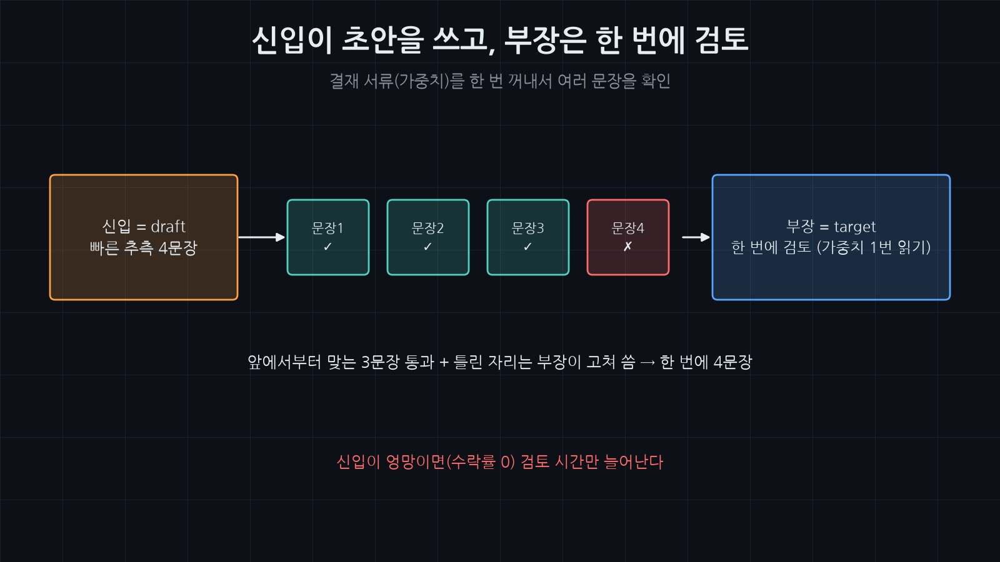
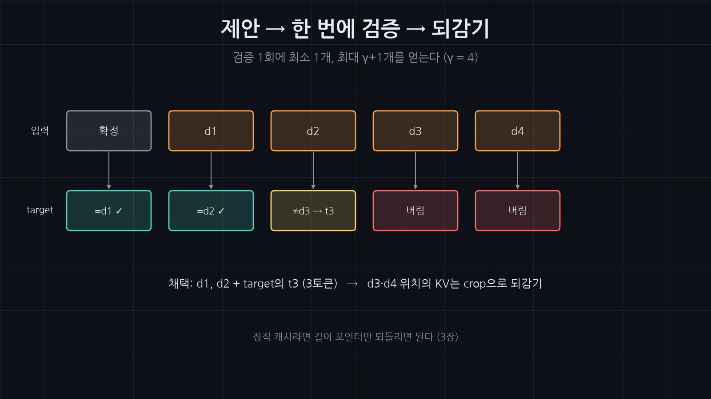
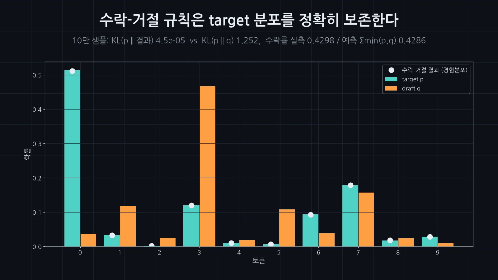
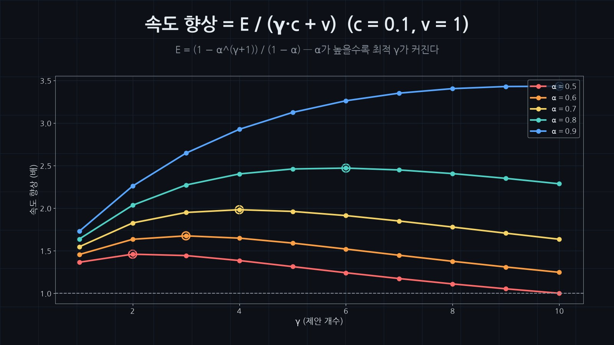
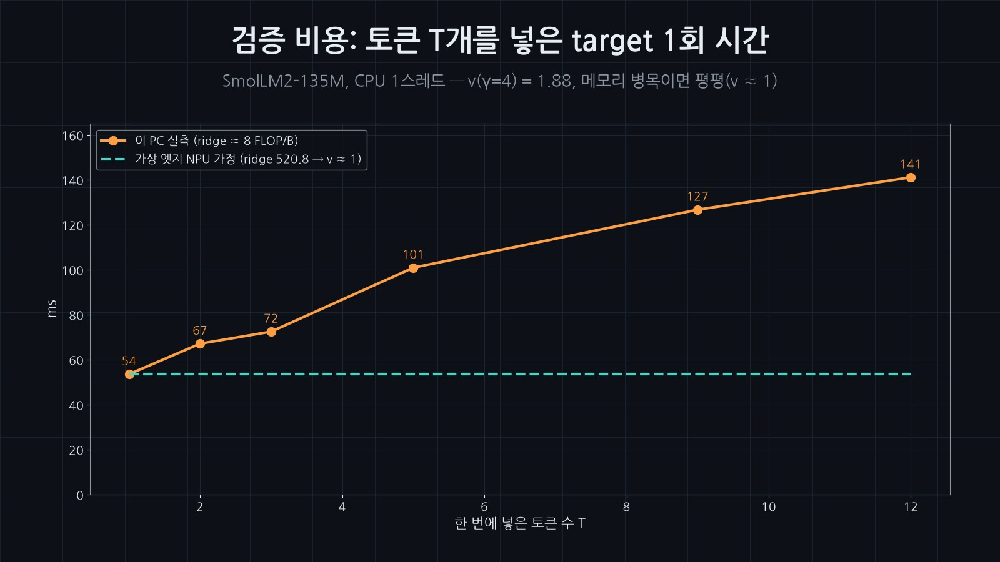
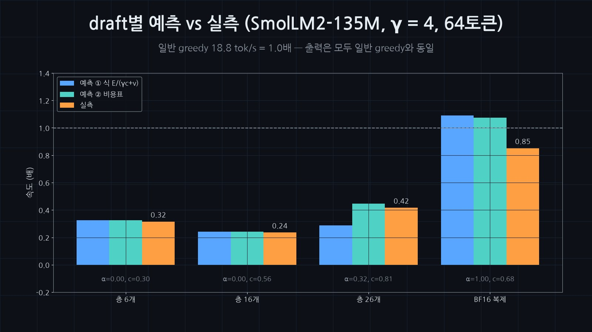
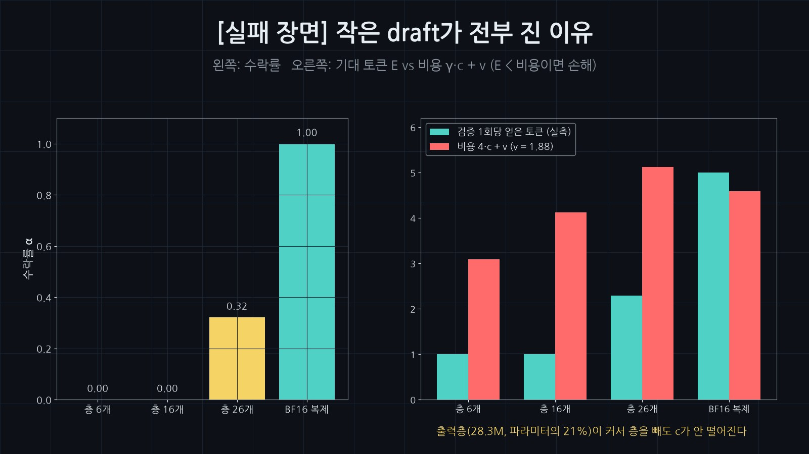
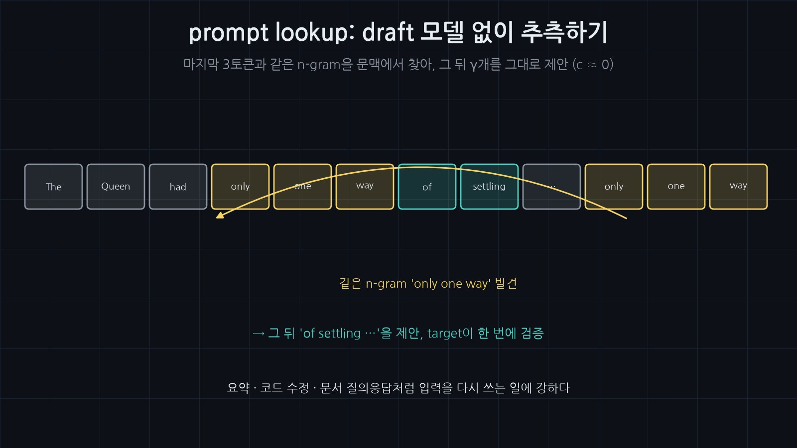
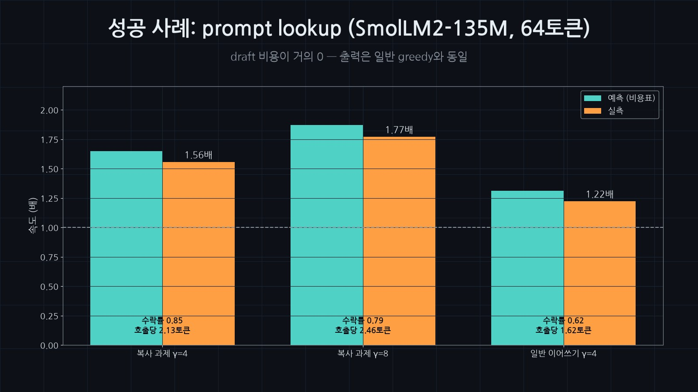
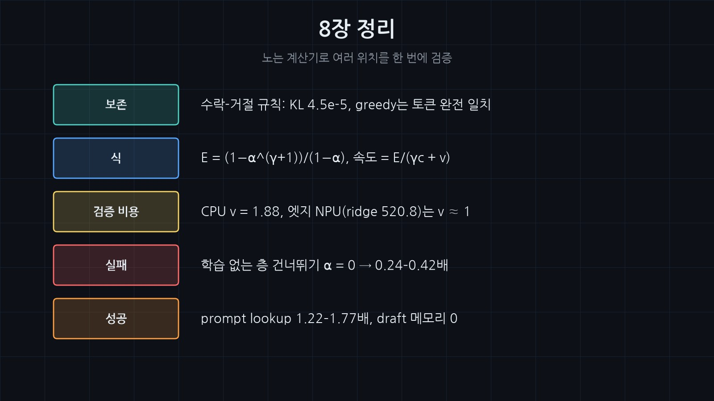

> **온디바이스 LLM 시리즈** · [전체 목차](/blog/2026/11/16/ondevice-llm-series/)  
> ← 이전: [7. TTFT·TPS를 제대로 재는 법](/blog/2026/11/16/ondevice-llm-07-ttft-tps-benchmark/)  
> → 다음: [9. MoE와 PIM](/blog/2026/11/16/ondevice-llm-09-moe-pim/)

> 이 글의 예제 코드 전체: [kjoh94/ondevice-llm-examples/tree/main/08-speculative](https://github.com/kjoh94/ondevice-llm-examples/tree/main/08-speculative) (`python example.py`, 실제 모델은 `python example.py --real`)

> 이 글은 공개 자료만 사용했고, 어떤 회사의 공식 입장도 아닙니다. "가상 엣지 NPU"의 숫자는 공개된 일반 스펙 수준의 값에 가정을 더한 계산 예시입니다.

> **처음이라면 이것만 기억하세요.** decode는 메모리 병목이라 토큰 1개를 계산하나 5개를 한꺼번에 계산하나 **가중치를 한 번 읽는 시간은 같아요**(1장). 그래서 작은 모델(draft)이나 간단한 규칙으로 다음 몇 토큰을 **추측**하고, 큰 모델(target)은 **한 번에 검증**만 해요. 맞은 만큼 공짜로 얻어요. 단, 추측이 자주 틀리거나 추측 자체가 비싸면 **오히려 느려져요**(실측 0.24–0.85배).

선수 글: [1장 — decode는 메모리 병목](/blog/2026/11/16/ondevice-llm-01-roofline-bandwidth/), [3장 — KV 캐시](/blog/2026/11/16/ondevice-llm-03-kv-cache-design/), [tokens 3편 — 샘플링](/blog/2026/10/30/tokens-03-sampling/)

1장에서 decode의 연산 강도가 3.88 FLOP/B로, 가상 엣지 NPU의 ridge(520.8)보다 100배 넘게 작다는 것을 봤어요. 다시 말해 계산기는 99% 놀고 있어요. speculative decoding(추측 디코딩)은 그 노는 계산기로 **여러 위치를 한 번에 검증**해서, 가중치 읽기 한 번에 토큰을 여러 개 얻는 방법이에요. 이 장에서는 수락 규칙이 **분포를 정확히 보존**한다는 것을 10만 샘플로 확인하고, 기대 속도 식을 유도해 몬테카를로와 비교하고, SmolLM2-135M에서 실제로 돌려서 **어떤 draft가 실패하고 어떤 방법이 성공하는지** 재요.

## 0. 비유로 먼저

### 0-1. 신입이 초안을 쓰고, 부장은 도장만



**그림 1.** 부장(target)이 보고서를 한 문장씩 직접 쓰면 문장마다 결재 서류를 꺼내야(가중치 읽기) 해요. 대신 신입(draft)이 다음 4문장 초안을 빠르게 쓰고, 부장은 서류를 **한 번만 꺼내서** 4문장을 한꺼번에 검토해요. 앞에서부터 맞는 데까지 통과시키고, 처음 틀린 문장은 부장이 고쳐 써요. 신입이 잘 맞히면 빨라지고, 엉망이면 검토 시간만 늘어요.

### 0-2. 직접 재 보기: SmolLM2-135M, 64토큰, greedy

| 방법 | 수락률 | 검증 1회당 토큰 | 실측 속도 |
|---|---|---|---|
| 일반 greedy | — | 1 | 1.00배 (18.8 tok/s) |
| draft = 자기 층 6개만 | **0.00** | 1.00 | **0.32배** |
| draft = 자기 층 26개 | 0.32 | 2.29 | 0.42배 |
| draft = 자기 복제 BF16 | **1.00** | 5.00 | **0.85배** |
| prompt lookup (복사 과제, γ=8) | 0.79 | 2.46 | **1.77배** |

모든 경우에 출력 토큰은 일반 greedy와 **완전히 같았어요**(검증이 결과를 보장). 그런데 "작은 draft 모델"로 하면 다 느려졌고, 모델이 필요 없는 prompt lookup만 빨라졌어요. 이유를 하나씩 볼게요.

이제 정식 용어로 하나씩 자세히 볼게요.

## 1. 알고리즘: 제안 → 한 번에 검증 → 되감기



**그림 2.** draft가 γ개 토큰을 제안한다. target은 `[마지막 확정 토큰] + 제안 γ개`(γ+1개)를 한 번에 넣고, 각 위치에서 자기 정답을 낸다. 앞에서부터 일치하는 k개를 채택하고, k+1번째 위치의 target 정답 하나를 덤으로 얻는다. 그래서 검증 1회에 항상 1개 이상, 최대 γ+1개를 얻는다.

```python
inp = torch.tensor([[seq[-1]] + prop])                   # 마지막 확정 토큰 + 제안 γ개
o = target(inp, past_key_values=tpast, use_cache=True)   # target 1회 = 가중치 읽기 1번
pred = o.logits[0].argmax(-1).tolist()                   # 위치마다 target의 정답
k = 0
while k < len(prop) and prop[k] == pred[k]: k += 1
new = prop[:k] + [pred[k]]                                # 맞은 k개 + 덤 1개
seq += new
crop_to(tpast, len(seq) - 1)                              # ★ 틀린 제안의 KV는 되감기
```

**KV 되감기**가 핵심 구현 포인트다. target은 γ+1개 위치의 K/V를 캐시에 써 넣었는데, 틀린 제안 뒤쪽은 버려야 한다. 3장의 정적 캐시라면 "길이 포인터만 되돌리기"로 끝나고, HF `DynamicCache`는 `crop()`을 쓴다. 참고로 transformers 5에서 `crop(n)`은 음수를 주면 "뒤에서 n개 지우기"로 동작해서, 길이를 맞추는 작은 함수를 따로 뒀다.

```python
def crop_to(cache, L):
    n = cache.get_seq_length()
    if n > L:
        cache.crop(-(n - L))
```

## 2. 샘플링에서도 분포가 그대로인가: 수락-거절 규칙

greedy가 아니라 확률로 뽑을 때도 결과 분포를 target과 **정확히** 같게 만들 수 있다(Leviathan et al., 2023; Chen et al., 2023). draft 분포 q에서 x를 뽑고, 확률 `min(1, p(x)/q(x))`로 수락하고, 거절하면 `(p − q)₊`를 정규화한 분포에서 다시 뽑는다.

```python
if u < min(1.0, p[x] / q[x]):
    out = x                                   # 수락
else:
    out = sample((p - q).clamp(min=0) / norm) # 남는 확률만큼 다시
```

> **유도 1 — 수락률 α와 분포 보존**
> 수락 확률 = Σₓ q(x) · min(1, p(x)/q(x)) = **Σₓ min(p(x), q(x))** = α
> 최종 확률 = min(p, q) + (1 − α) · (p − q)₊ / Σ(p − q)₊ = min(p, q) + (p − q)₊ = **p** (Σ(p − q)₊ = 1 − α이므로)

10개짜리 장난감 분포로 10만 번 뽑았다.

| 확인 | 값 |
|---|---|
| 예측 수락률 Σ min(p, q) | 0.4286 |
| 실측 수락률 | 0.4298 |
| KL(p ‖ 수락-거절로 얻은 경험분포) | **4.47 × 10⁻⁵** (표본 잡음 수준) |
| 비교: KL(p ‖ q) (draft를 그냥 썼다면) | 1.252 |



**그림 3.** target p(민트), draft q(주황), 수락-거절 결과의 경험분포(점). draft가 크게 다른데도 결과는 p와 겹친다.

## 3. 기대 속도: 몇 개를 제안해야 하나

> **유도 2 — 검증 1회당 기대 토큰 E**
> 각 제안이 독립적으로 확률 α로 수락된다고 하자. k개가 연속 수락될 확률은 α^k(1 − α)(k < γ), 전부 수락은 α^γ
> E = Σ (수락 개수 + 1) = 1 + α + α² + … + α^γ = **(1 − α^(γ+1)) / (1 − α)**
> α = 0.7, γ = 4: (1 − 0.7⁵)/0.3 = **2.77**

| α / γ | 식 | 몬테카를로(2만 회) |
|---|---|---|
| 0.5 / 4 | 1.938 | 1.942 |
| 0.7 / 4 | 2.773 | 2.762 |
| 0.9 / 4 | 4.095 | 4.103 |
| 0.9 / 8 | 6.126 | 6.165 |

> **유도 3 — 속도 향상**
> draft 1스텝 비용 = c (target 1스텝 = 1 기준), γ+1개 검증 비용 = v
> `속도 향상 = E / (γ·c + v)`
> 메모리 병목이면 v ≈ 1: α = 0.7, γ = 4, c = 0.1 → 2.77 / 1.4 = **1.98배**
> 손해 보는 조건: E < γ·c + v. α = 0이면 E = 1이므로 **draft 비용만큼 무조건 손해**



**그림 4.** c = 0.1, v = 1일 때 α와 γ에 따른 속도 향상. α가 낮으면 γ를 늘려도 이득이 없고, 높을수록 최적 γ가 커진다(α = 0.7이면 γ = 4에서 1.98배, α = 0.9면 γ = 10).

| 최적 γ | c = 0.05 | c = 0.1 | c = 0.2 | c = 0.4 |
|---|---|---|---|---|
| α = 0.6 | 4 | 3 | 2 | 1 |
| α = 0.7 | 6 | 4 | 3 | 2 |
| α = 0.8 | 8 | 6 | 4 | 2 |
| α = 0.9 | 13 | 10 | 7 | 4 |

## 4. 검증 비용 v: CPU와 엣지 NPU는 다르다

유도 3에서 v ≈ 1은 "γ+1개를 검증해도 1개와 시간이 같다"는 가정이다. 1장의 ridge 관점에서, 토큰 N개를 한 번에 넣으면 연산 강도가 N배가 되므로 **ridge에 닿을 때까지는 거의 공짜**다.

| target에 넣은 토큰 수 T | 1 | 2 | 3 | 5 | 9 | 12 |
|---|---|---|---|---|---|---|
| SmolLM2, CPU 1스레드 (ms) | 53.6 | 67.1 | 72.5 | 100.9 | 126.7 | 141.1 |

> **유도 4 — 검증 비용**
> 이 PC: v(γ = 4) = 100.9 / 53.6 = **1.88**. ridge가 8 FLOP/B(1장 실측)라 T = 5에서 이미 계산 병목에 가깝다.
> 가상 엣지 NPU: ridge 520.8, W4 decode의 AI 3.88 → T = 5에서도 AI 19.4로 ridge의 4% → **v ≈ 1**
> 같은 알고리즘이 CPU보다 엣지 NPU에서 더 잘 맞는다.



**그림 5.** 토큰 수별 target 1회 시간(실측)과 "메모리 병목이면 평평" 가정. CPU에서는 T에 따라 꽤 올라간다.

## 5. 실제 모델에서: 예측 vs 실측

SmolLM2-135M(30층)을 target으로, 64토큰 greedy 생성(앨리스 본문 128토큰 이어쓰기), γ = 4. 예측은 두 가지로 했다. ① 유도 3의 식(측정한 α, c, v를 대입), ② 비용표 계산(측정한 draft 시간 + 실제 검증 길이마다 위 표의 비용을 더함).

| draft | α | 호출당 토큰 | c | 예측 ① 식 | 예측 ② 비용표 | 실측 |
|---|---|---|---|---|---|---|
| 자기 층 6개 | 0.00 | 1.00 | 0.30 | 0.32 | 0.32 | **0.32** |
| 자기 층 16개 | 0.00 | 1.00 | 0.56 | 0.24 | 0.24 | **0.24** |
| 자기 층 26개 | 0.32 | 2.29 | 0.81 | 0.29 | 0.45 | **0.42** |
| 자기 복제 BF16 | 1.00 | 5.00 | 0.68 | 1.09 | 1.07 | **0.85** |



**그림 6.** draft별 예측과 실측. α = 0인 두 경우는 예측과 실측이 소수점 둘째 자리까지 같다. 26층은 식 ①이 독립 수락 가정 때문에 과소 예측했고(실제로는 맞을 때 연달아 맞음), 비용표 ②가 실측에 가깝다. BF16은 비용표가 1.07을 예측했지만 실측 0.85로, 생성 중 BF16 행렬곱 시간이 측정보다 흔들렸다.

## 실패 장면: 작은 draft가 왜 전부 졌나



**그림 7.** 실패한 draft 네 개의 비용 분해. 왼쪽: 수락률. 오른쪽: draft 비용 γ·c와 검증 비용 v의 합(빨강)이 기대 토큰 E(민트)보다 크면 손해다.

세 가지 이유가 겹쳤다.

1. **층을 빼면 전혀 맞지 않는다(α = 0.00).** 학습 없이 중간 층만 빼낸 모델은 다른 모델이 된다. 6층·16층 draft는 64토큰 동안 단 하나도 맞히지 못했다. 층 건너뛰기를 draft로 쓰려면 LayerSkip(Elhoushi et al., 2024)처럼 **그렇게 쓰도록 학습**해야 한다.
2. **draft가 생각보다 비싸다(c = 0.30).** 6/30층이면 c ≈ 0.2여야 하지만, SmolLM2는 출력층(49,152 × 576 = 28.3M, 파라미터의 21%)이 커서 층을 아무리 빼도 그만큼은 남는다. 작은 모델일수록 임베딩·출력층 비중이 커서 c가 안 떨어진다.
3. **CPU에서는 검증이 공짜가 아니다(v = 1.88).** α = 1인 BF16 복제조차, 가중치 바이트는 절반이지만 이 CPU의 BF16 연산이 느려 c = 0.68이었다. E = 5 / (4 × 0.68 + 1.88) = 1.09배가 상한이었다.

**별도의 작은 draft 모델**(같은 토크나이저의 더 작은 모델, 예: 같은 계열 0.1B를 1B의 draft로)이나 Medusa(Cai et al., 2024)·EAGLE(Li et al., 2024)처럼 target 위에 **학습한 예측 헤드**를 붙이는 방법이 이 문제를 푼다. 이 장에서는 학습이 필요한 이 방법들을 구현하지 않았다.

## 6. 성공 사례: prompt lookup — draft 모델 없이 추측하기



**그림 8.** prompt lookup decoding(Saxena, 2023): 지금까지의 마지막 3토큰(n-gram)이 앞쪽 문맥 어디에 있었는지 찾아서, 그 뒤 γ개를 그대로 제안한다. draft 비용이 거의 0(c ≈ 0)이다.

```python
key = seq[-ngram:]
for s in range(len(seq) - ngram - 1, -1, -1):          # 뒤에서부터 같은 n-gram 찾기
    if seq[s:s + ngram] == key:
        prop = seq[s + ngram:s + ngram + gamma]; break
```

| 과제 | γ | 수락률 | 호출당 토큰 | 예측(비용표) | 실측 |
|---|---|---|---|---|---|
| 본문 복사 ("같은 문단을 그대로 써라") | 4 | 0.85 | 2.13 | 1.65배 | **1.56배** |
| 본문 복사 | 8 | 0.79 | 2.46 | 1.87배 | **1.77배** |
| 일반 이어쓰기 | 4 | 0.62 | 1.62 | 1.31배 | **1.22배** |



**그림 9.** prompt lookup의 예측과 실측. 실측이 예측보다 5% 정도 낮은데, 비용표에 없는 캐시 되감기·n-gram 탐색 시간 때문이다.

요약, 코드 수정, 문서 질의응답처럼 **입력을 다시 쓰는 일이 많은 작업**에서 효과가 크다. 엣지에서는 draft 모델의 메모리(가중치 + KV)가 따로 들지 않는다는 것도 큰 장점이다.

> **엣지 NPU에서는:** 유도 4대로 엣지 NPU는 v ≈ 1에 가까워 추측 디코딩에 유리하다. 다만 ① 5장의 고정 모양 그래프에 "γ+1 토큰 검증용" decode 그래프가 하나 더 필요하고, ② 3장의 정적 캐시에서 되감기는 포인터만 되돌리면 되지만, 검증 그래프가 캐시에 쓴 틀린 칸이 다음 쓰기 때 덮이도록 위치 관리를 정확히 해야 하며(5장 실패 장면과 같은 종류의 버그), ③ draft 모델을 쓰면 그 가중치도 같은 DRAM 대역폭을 나눠 쓴다. 공개 자료에 추측 디코딩 숫자가 있다면 **α(과제)와 γ, draft 종류**를 함께 확인하자.

## 자주 묻는 질문

**Q. 결과가 정말 target과 똑같나요?**
greedy에서는 토큰 단위로 완전히 같아요(이 장의 모든 실험에서 `same=True`). 샘플링에서는 분포가 같아요(2절). 다만 부동소수점 계산 순서가 바뀌어(1토큰 vs 여러 토큰 배치) 아주 드물게 동점 근처에서 argmax가 달라질 수 있어요.

**Q. α는 어떻게 미리 알 수 있나요?**
과제와 draft에 따라 크게 달라요. 같은 계열의 작은 모델이면 보통 0.6–0.8대가 보고되고, 코드·요약처럼 반복이 많은 과제에서 높아요. 직접 대표 프롬프트로 재는 게 가장 정확해요.

**Q. 배치가 커지면요?**
서버처럼 배치가 크면 이미 계산기가 바쁘므로(ridge에 가까움) v가 커져 이득이 줄어요. 배치 1인 엣지가 추측 디코딩에 가장 유리한 환경이에요.

## 퀴즈

1. α = 0.8, γ = 3, c = 0.05, v = 1이면 속도 향상은? → E = (1 − 0.8⁴)/0.2 = 2.952, 2.952 / (0.15 + 1) = **2.57배**.
2. α = 0이면 γ = 4, c = 0.3, v = 1에서 속도는? → 1 / (1.2 + 1) = 0.45배 (실측 6층 draft는 v = 1.88이라 0.32배).
3. 엣지 NPU에서 v ≈ 1이 되는 이유는? → γ+1개를 검증해도 연산 강도가 ridge보다 훨씬 작아 여전히 메모리 병목이기 때문.

## 정리

- 추측 디코딩 = draft 제안 + target 1회 검증 + KV 되감기. 결과는 target과 같다(분포 보존: KL 4.5 × 10⁻⁵).
- E = (1 − α^(γ+1))/(1 − α), 속도 = E/(γc + v). 식과 몬테카를로가 1% 안으로 맞았다.
- 실측 실패: 학습 없는 층 건너뛰기 draft는 α = 0, CPU는 v = 1.88 → 0.24–0.85배. 비용표 예측은 층 건너뛰기 draft에서 실측과 ±0.03배, prompt lookup에서는 실측이 5–6% 낮았다(BF16은 1.07 예측 vs 0.85 실측).
- 성공: prompt lookup 1.22–1.77배. 엣지 NPU는 v ≈ 1이라 더 유리하다.

## 참고 (공개 자료)

- Y. Leviathan, M. Kalman, Y. Matias, "Fast Inference from Transformers via Speculative Decoding", arXiv:[2211.17192](https://arxiv.org/abs/2211.17192)
- C. Chen et al., "Accelerating Large Language Model Decoding with Speculative Sampling", arXiv:[2302.01318](https://arxiv.org/abs/2302.01318)
- T. Cai et al., "Medusa: Simple LLM Inference Acceleration Framework with Multiple Decoding Heads", arXiv:[2401.10774](https://arxiv.org/abs/2401.10774)
- Y. Li et al., "EAGLE: Speculative Sampling Requires Rethinking Feature Uncertainty", arXiv:[2401.15077](https://arxiv.org/abs/2401.15077)
- M. Elhoushi et al., "LayerSkip: Enabling Early Exit Inference and Self-Speculative Decoding", arXiv:[2404.16710](https://arxiv.org/abs/2404.16710)
- A. Saxena, "Prompt Lookup Decoding", GitHub: <https://github.com/apoorvumang/prompt-lookup-decoding>
- Hugging Face Transformers, "Optimizing inference"(assisted generation, prompt lookup): <https://huggingface.co/docs/transformers/llm_optims>
- SmolLM2-135M: <https://huggingface.co/HuggingFaceTB/SmolLM2-135M>

검증 환경: CPU 1스레드, PyTorch 2.15.0+cpu, transformers 5.23.0. 시간은 일반 greedy 3회·추측 디코딩 2회의 중앙값, 검증 비용표는 6회 중 4번째 값. 결과 원본은 `08-speculative/results/08.json`(장난감), `08_real.json`(실제 모델).



**그림 10.** 8장 정리.

---

> **온디바이스 LLM 시리즈** · [전체 목차](/blog/2026/11/16/ondevice-llm-series/)  
> ← 이전: [7. TTFT·TPS를 제대로 재는 법](/blog/2026/11/16/ondevice-llm-07-ttft-tps-benchmark/)  
> → 다음: [9. MoE와 PIM](/blog/2026/11/16/ondevice-llm-09-moe-pim/)
