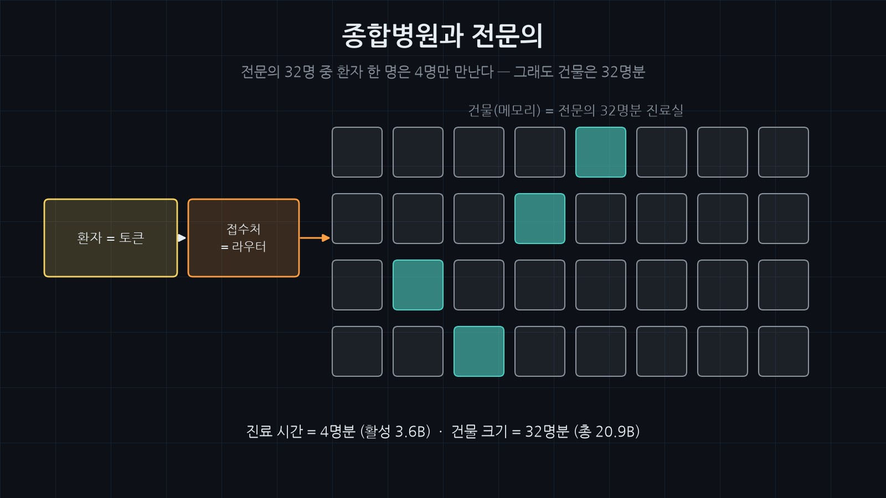
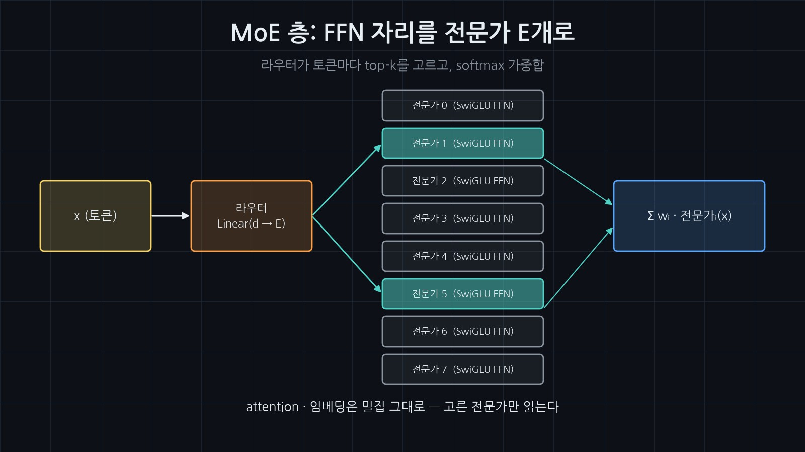
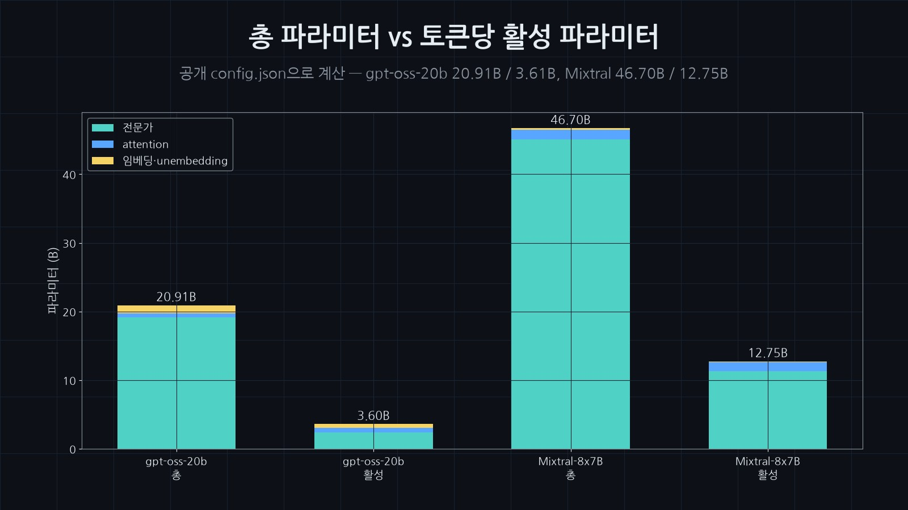
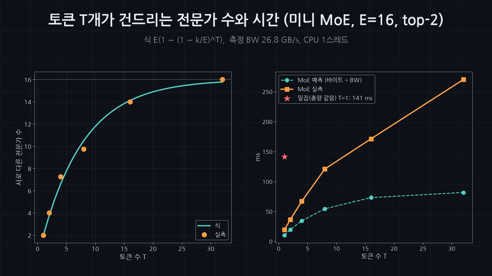
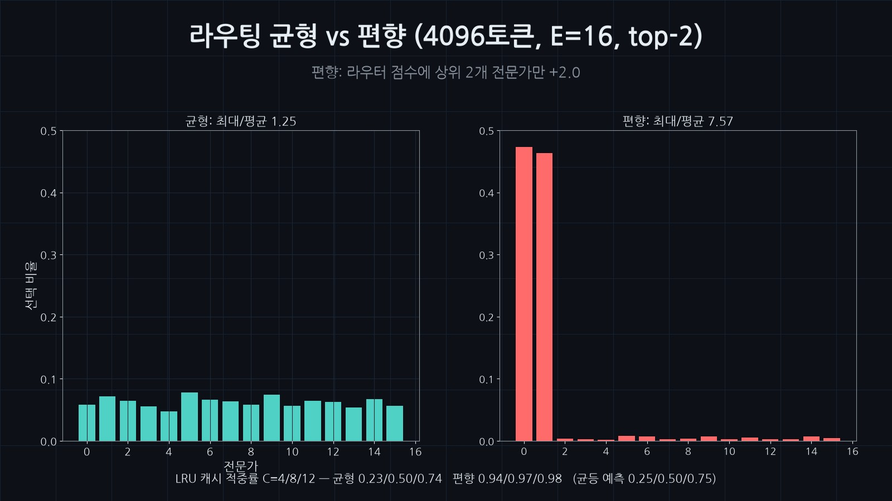
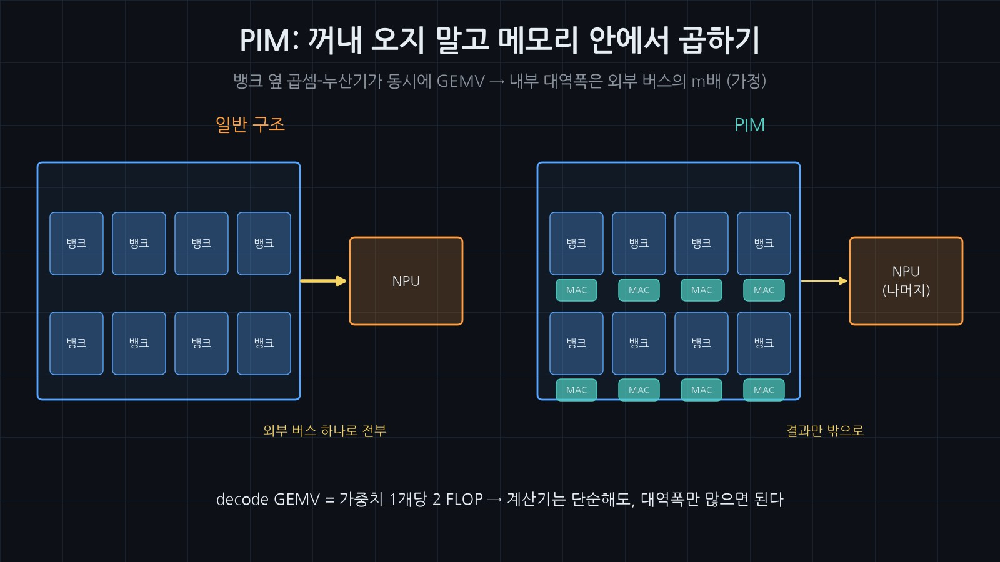
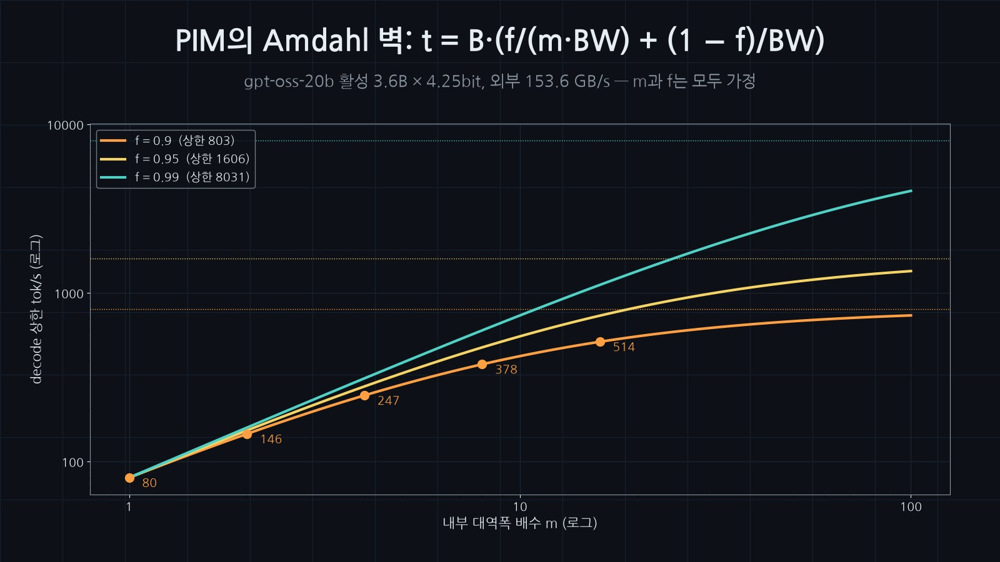
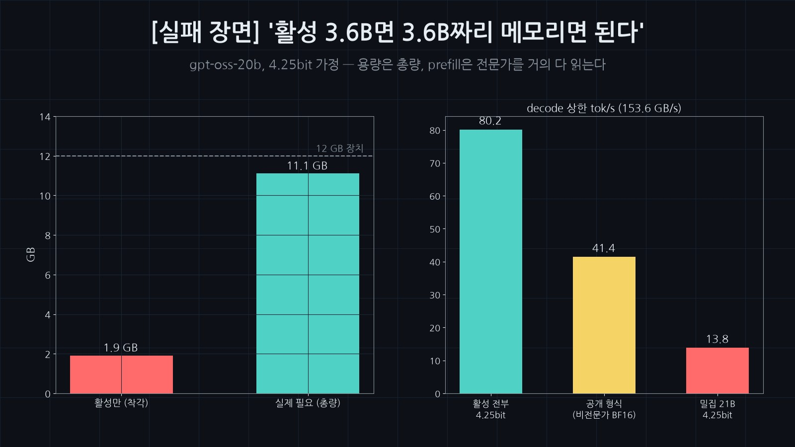
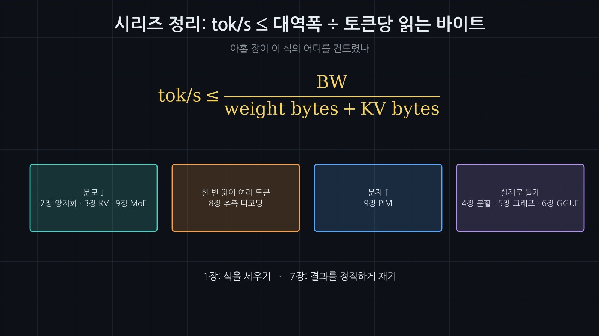
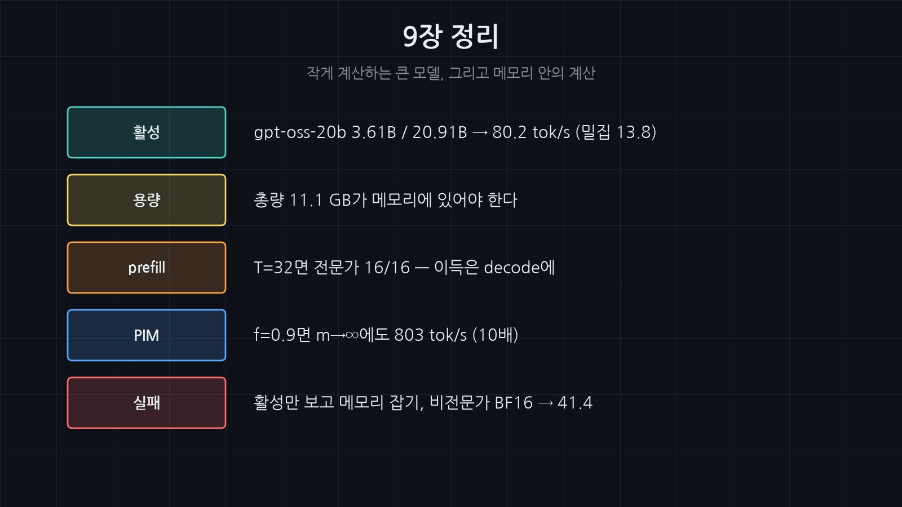

> **온디바이스 LLM 시리즈** · [전체 목차](/blog/2026/11/16/ondevice-llm-series/)  
> ← 이전: [8. Speculative decoding](/blog/2026/11/16/ondevice-llm-08-speculative-decoding/)

> 이 글의 예제 코드 전체: [kjoh94/ondevice-llm-examples/tree/main/09-moe-pim](https://github.com/kjoh94/ondevice-llm-examples/tree/main/09-moe-pim) (`python example.py`, 다운로드 없음, 메모리 약 3 GB)

> 이 글은 공개 자료만 사용했고, 어떤 회사의 공식 입장도 아닙니다. "가상 엣지 NPU"와 PIM 대역폭 배수는 공개된 일반 스펙 수준의 값에 가정을 더한 계산 예시이며, 특정 제품의 성능이 아닙니다.

> **처음이라면 이것만 기억하세요.** MoE(Mixture of Experts)는 토큰마다 **전문가 몇 개만** 골라 계산해서, 21B 모델이 토큰당 3.6B만 읽어요. 그래서 decode 속도는 작은 모델처럼 나와요. 하지만 **메모리 용량은 21B 전체**가 필요하고, 여러 토큰을 한꺼번에 처리하면(prefill) 결국 거의 모든 전문가를 읽어요. PIM은 "메모리 밖으로 꺼내 오는 길(대역폭)"이 병목이니 **메모리 안에서 곱셈을 하자**는 접근이고, 남은 몇 %가 다시 벽이 돼요(4장 Amdahl).

선수 글: [1장 — 대역폭 상한](/blog/2026/11/16/ondevice-llm-01-roofline-bandwidth/), [4장 — Amdahl](/blog/2026/11/16/ondevice-llm-04-npu-cpu-dsp-split/)

이 시리즈는 1장의 한 줄, `tok/s ≤ 대역폭 ÷ 토큰당 읽는 바이트`에서 시작했어요. 2장(양자화)과 3장(KV 캐시)은 **분모(바이트)**를 줄였고, 8장(추측 디코딩)은 **읽기 한 번에 토큰을 여러 개** 얻었어요. 마지막 장은 남은 두 방향이에요. MoE는 분모를 "모델 전체"에서 "고른 일부"로 바꾸고, PIM은 **분자(대역폭)** 자체를 키워요. 둘 다 숫자로 계산하고, 작은 MoE를 직접 만들어 재요.

## 0. 비유로 먼저

### 0-1. 종합병원과 전문의



**그림 1.** 종합병원(MoE)에는 전문의가 32명 있지만, 환자 한 명(토큰)은 접수처(라우터)가 정한 **4명만** 만나요. 그래서 진료 시간은 작은 의원 수준이에요. 하지만 병원 건물(메모리)은 32명 모두의 진료실이 들어갈 만큼 커야 해요. 그리고 환자가 한꺼번에 몰리면(prefill) 결국 모든 진료실이 열려요.

### 0-2. 직접 계산해 보기: gpt-oss-20b

공개 `config.json` 값(24층, hidden 2880, 전문가 32개 중 top-4)으로 파라미터를 셌어요.

| | 총 파라미터 | 토큰당 활성 | 가상 엣지 NPU 상한 (153.6 GB/s) |
|---|---|---|---|
| gpt-oss-20b (전부 4.25비트 가정) | 20.91B | **3.61B** | **80.2 tok/s** |
| 같은 21B가 밀집 모델이었다면 | 20.91B | 20.91B | 13.8 tok/s |
| 공개 체크포인트 형식 그대로 (전문가 MXFP4, 나머지 BF16) | — | 3.61B | 41.4 tok/s |

모델 카드의 "3.6B active"와 계산이 맞아요. 같은 총량이면 MoE가 밀집 모델보다 5.8배 빠를 수 있어요.

이제 정식 용어로 하나씩 자세히 볼게요.

## 1. MoE 층: 라우터가 전문가를 고른다



**그림 2.** Transformer의 FFN 자리를 전문가 E개(각각 작은 SwiGLU FFN)로 바꾼다. 라우터(작은 Linear)가 토큰마다 점수를 내고, 상위 k개를 골라 softmax 가중합한다. attention과 임베딩은 밀집 그대로다(Shazeer et al., 2017; Fedus et al., 2021).

```python
def forward(self, x):                               # x: (T, d)
    logits = self.router(x) + self.bias
    w, idx = logits.topk(self.k, -1); w = w.softmax(-1)
    y = torch.zeros_like(x)
    for e in idx.unique().tolist():                 # 고른 전문가만 읽는다
        tok, slot = (idx == e).nonzero(as_tuple=True)
        h = F.silu(x[tok] @ self.w1[e].T) * (x[tok] @ self.w3[e].T)
        y[tok] += w[tok, slot, None] * (h @ self.w2[e].T)
    return y, idx
```

> **유도 1 — 총 파라미터와 활성 파라미터**
> 전문가 1개 = 3 × d × ffn (gate, up, down), attention = d × (2·H·hd + 2·H_kv·hd)
> `총 = L × (E × 전문가 + attention + 라우터) + 임베딩 + unembedding`
> `활성 = L × (k × 전문가 + attention + 라우터) + unembedding` (임베딩은 1행만 읽음)
> gpt-oss-20b: 전문가 활성 2.39B + attention 0.64B + unembedding 0.58B = **3.61B**, 총 **20.91B**
> Mixtral-8x7B (32층, E = 8, k = 2): 총 **46.70B**, 활성 **12.75B** (논문 발표 46.7B / 12.9B와 1% 안)



**그림 3.** 두 모델의 총 파라미터와 활성 파라미터 구성. gpt-oss-20b는 활성의 34%가 전문가가 아닌 부분(attention·unembedding)이다.

## 2. 대역폭은 활성, 용량은 총량

> **유도 2 — decode 상한과 메모리 용량**
> 상한: 153.6 GB/s ÷ (3.61B × 4.25/8 B) = 153.6 ÷ 1.92 GB = **80.2 tok/s**
> 공개 체크포인트(전문가만 MXFP4 4.25비트, attention·unembedding BF16): 2.39B × 0.53 + 1.22B × 2 B ≈ 3.71 GB → **41.4 tok/s**
> 용량: 20.91B × 4.25/8 = **11.1 GB** (Mixtral 24.8 GB) — 활성이 아니라 총량이 메모리에 있어야 한다

비전문가 부분이 BF16이면 속도가 절반이 된다. MoE에서는 **전문가가 아닌 부분**의 양자화가 오히려 더 중요할 수 있다. 그리고 3장의 표로 보면 11.1 GB는 12 GB 장치에 들어가긴 하지만 KV 캐시와 OS를 위한 자리가 거의 남지 않는다. 여기서 "전문가를 플래시에 두고 필요한 것만 DRAM으로" 같은 아이디어가 나온다(Alizadeh et al., 2023, LLM in a flash).

## 3. 토큰이 여러 개면: 서로 다른 전문가 수

decode(토큰 1개)는 k개만 읽지만, prefill이나 8장의 검증(γ+1 토큰)은 토큰마다 다른 전문가를 고른다.

> **유도 3 — T개 토큰이 건드리는 서로 다른 전문가 수**
> 라우팅이 균등하고 독립이면, 전문가 하나가 한 토큰에게 선택되지 않을 확률 = 1 − k/E
> `E[서로 다른 전문가] = E × (1 − (1 − k/E)^T)`
> E = 16, k = 2: T = 1 → 2, T = 4 → 6.62, T = 16 → 14.11, T = 32 → 15.78 (거의 전부)

미니 MoE(4층, hidden 1024, 전문가 16개 top-2, 전문가 1개 34.6 MB, 총 2.21 GB FP32)를 만들어 쟀다. 측정 대역폭은 26.8 GB/s다.

| 토큰 T | 서로 다른 전문가 (실측 / 식) | MoE 시간 실측 (ms) | MoE 예측 (전문가 바이트 ÷ BW) |
|---|---|---|---|
| 1 | 2.00 / 2.00 | **19.5** | 10.3 |
| 2 | 4.00 / 3.75 | 36.0 | 19.4 |
| 4 | 7.25 / 6.62 | 66.8 | 34.2 |
| 8 | 9.75 / 10.50 | 120.8 | 54.3 |
| 16 | 14.00 / 14.11 | 171.1 | 72.9 |
| 32 | 16.00 / 15.78 | 270.1 | 81.5 |

같은 총량(2.21 GB)의 밀집 FFN은 토큰 1개에 **141.4 ms**(예측 82.7)였다. T = 1에서 MoE가 **7.3배 빠르다**(예측 비율 8.0배).



**그림 4.** 왼쪽: 토큰 수별 서로 다른 전문가 수(식과 실측). 오른쪽: MoE 시간의 실측과 예측. 서로 다른 전문가 수는 식과 잘 맞고(무작위 라우터이므로 거의 균등), 시간은 T = 1에서 예측의 1.9배, T가 커질수록 더 벌어진다(T = 32에서 3.3배).

예측이 어긋나는 이유는 두 가지다. ① 바이트만 센 예측이라 실측 이용률은 53%(T = 1)다. 1장의 미니 Llama(66%)보다 조금 낮다. ② T가 크면 전문가마다 작은 행렬곱을 따로 하고, 파이썬 루프·인덱싱 비용이 더해진다. 실제 런타임은 같은 전문가로 가는 토큰을 모아 한 번에 곱하는(grouped GEMM) 커널을 쓴다. 참고로 밀집 FFN의 T > 1 측정값(158–502 ms)은 실행마다 크게 흔들려서 비교에 쓰지 않았다.

**결론: MoE의 이득은 decode(T = 1)에 몰려 있다.** prefill은 전문가를 거의 다 읽으므로 밀집 모델과 바이트가 같아지고, 8장의 추측 디코딩도 검증 토큰이 늘수록 읽는 전문가가 늘어 v가 커진다.

## 4. 라우팅 편향과 전문가 캐시



**그림 5.** 4096토큰에서 전문가별 선택 비율. 왼쪽: 균형(가장 바쁜 전문가 = 평균의 1.25배). 오른쪽: 라우터 점수에 상위 2개 전문가만 +2.0 편향(7.57배, 두 전문가가 각각 47%·46%).

메모리가 부족한 엣지에서는 빠른 메모리에 전문가 일부만 두고(캐시), 없으면 느린 저장소에서 가져오는 구성을 생각할 수 있다. 전문가 16개 중 C개를 LRU로 캐시했을 때 적중률을 쟀다.

| 캐시 크기 C | 4 | 8 | 12 |
|---|---|---|---|
| 균등 라우팅이면 예측 C/E | 0.25 | 0.50 | 0.75 |
| 균형 라우터 실측 | 0.23 | 0.50 | 0.74 |
| 편향 라우터 실측 | **0.94** | 0.97 | 0.98 |

> **유도 4 — 캐시 적중률과 평균 바이트 비용**
> 균등하고 독립이면 LRU 적중률 ≈ C/E (어느 전문가나 캐시에 있을 확률이 같음)
> 평균 읽기 시간 = 적중률 × t_빠름 + (1 − 적중률) × t_느림. 느린 쪽이 10배 느리면 C/E = 0.5에서 평균 5.5배, 0.94면 1.54배

학습된 MoE는 보통 **부하 균형 손실(load-balancing loss)**로 전문가 사용을 고르게 만든다(Switch Transformer, GShard). 서버에서는 좋은 성질이지만, 캐시 입장에서는 균등 = 캐시가 안 듣는다는 뜻이다. 실제 모델의 라우팅은 문맥과 층에 따라 치우침이 있다는 보고들이 있어서, 전문가 캐시·예측 로딩의 효과는 **그 모델로 직접 재 봐야** 안다. 이 장의 편향 실험은 극단적인 인공 사례다.

## 5. PIM: 꺼내 오지 말고 메모리 안에서 곱하기



**그림 6.** 일반 구조(왼쪽)는 DRAM 칩 안의 여러 뱅크에서 데이터를 꺼내 하나의 외부 버스로 NPU까지 옮긴다. PIM(Processing-in-Memory, 오른쪽)은 뱅크 옆에 작은 곱셈-누산기를 두고 GEMV를 그 자리에서 한다. 뱅크들이 동시에 일하므로 **내부 대역폭**이 외부 버스보다 몇 배 크다. HBM-PIM(Lee et al., ISCA 2021), GDDR6 기반 AiM(Kwon et al., ISSCC 2022) 같은 공개 시제품과, 이를 LLM attention·decode에 쓰는 연구(AttAcc, NeuPIMs)가 있다.

decode GEMV는 가중치 하나에 2 FLOP(1장)이라, 계산기는 아주 단순해도 되고 대역폭만 많으면 된다. PIM이 LLM decode와 잘 맞는 이유다.

> **유도 5 — PIM의 Amdahl 벽**
> 토큰당 바이트 B 중 비율 f(GEMV)만 PIM 내부 대역폭(외부의 m배)으로 처리되고, 나머지(attention·KV·정규화·샘플링 등)는 외부 버스 그대로라고 가정하면
> `t = B × (f / (m × BW) + (1 − f) / BW)`
> gpt-oss-20b 활성 3.6B × 4.25비트, BW 153.6 GB/s, f = 0.9(가정): m = 1 → 80 tok/s, m = 8 → 378, m = 16 → 514
> m → ∞: `B × (1 − f) / BW` → **803 tok/s가 상한** (4장 Amdahl과 같은 꼴)

| 내부 대역폭 배수 m (가정) | 1 | 2 | 4 | 8 | 16 | ∞ |
|---|---|---|---|---|---|---|
| decode 상한 (tok/s) | 80 | 146 | 247 | 378 | 514 | **803** |



**그림 7.** m에 따른 decode 상한(f = 0.9, 0.95, 0.99). PIM으로 못 옮기는 몇 %가 상한을 정한다. f = 0.9면 m을 아무리 키워도 10배가 한계다.

PIM에서 실제로 어려운 부분은 숫자 밖에 있다. 가중치를 뱅크별로 나눠 배치하는 방식이 정해지면 다른 연산(attention, KV 갱신)이 그 배치를 따라야 하고, MoE처럼 "어느 전문가를 읽을지"가 실행 중에 정해지면 뱅크 사이 부하가 고르지 않을 수 있다. 정밀도(PIM 곱셈기가 지원하는 형식)도 2장의 형식 선택과 맞물린다.

> **엣지 NPU에서는:** MoE와 PIM은 둘 다 "decode = 대역폭 문제"라는 1장의 결론 위에 있다. 공개 자료에서 MoE 모델의 tok/s를 볼 때는 **총량이 메모리에 들어가는지**(11.1 GB 같은 계산)와 **비전문가 부분의 형식**을, PIM 관련 숫자를 볼 때는 **어느 비율의 연산이 메모리 안으로 들어갔는지(f)**와 **배수 m이 시뮬레이션인지 측정인지**를 먼저 확인하자. 이 장의 m은 모두 가정이다.

## 실패 장면: "활성 3.6B면 3.6B짜리 메모리면 된다"



**그림 8.** 활성 파라미터만 보고 메모리를 잡은 경우. 4.25비트 기준 활성 3.6B는 1.9 GB지만, 모델 전체는 11.1 GB가 있어야 라우터가 고를 수 있다. 그리고 prefill 32토큰이면 미니 MoE에서 16개 전문가를 전부 건드렸다(서로 다른 전문가 16.00).

| 착각 | 실제 |
|---|---|
| 메모리 = 활성 3.6B × 4.25비트 = 1.9 GB | 총 20.9B × 4.25비트 = **11.1 GB** |
| prefill도 k/E만 읽는다 | T = 32에서 전문가 **16/16** (식 15.78) |
| decode 상한 80 tok/s | 비전문가가 BF16이면 **41.4 tok/s** |
| 전문가 캐시로 메모리를 줄인다 | 균형 라우터면 적중률 ≈ C/E (0.23 / 0.50 / 0.74) |

MoE는 "작게 계산하는 큰 모델"이지 "작은 모델"이 아니다. 엣지에서 MoE를 고를 때는 1장의 대역폭 표와 3장의 용량 표를 **둘 다** 채워야 한다.

## 자주 묻는 질문

**Q. MoE는 같은 활성 크기의 밀집 모델보다 품질이 좋은가요?**
일반적으로 같은 활성 크기의 밀집 모델보다 좋고, 같은 총 크기의 밀집 모델보다는 낮다고 보고돼요. 엣지에서는 "메모리는 충분한데 대역폭이 부족한" 경우에 MoE가 유리해요.

**Q. 전문가마다 형식을 다르게 해도 되나요?**
네, 6장의 Q4_K_M처럼 텐서마다 형식을 섞을 수 있어요. 자주 쓰이는 전문가는 높은 비트, 드물게 쓰이는 전문가는 낮은 비트로 두는 연구도 있어요.

**Q. PIM은 학습에도 쓰나요?**
학습은 연산 강도가 높은(배치가 큰) 작업이라 PIM의 장점이 작아요. PIM은 연산 강도가 낮은 decode GEMV에 가장 잘 맞아요.

## 퀴즈

1. E = 8, k = 2, 토큰 4개면 서로 다른 전문가 기대 수는? → 8 × (1 − 0.75⁴) = 8 × 0.684 = **5.47개**.
2. 활성 3.6B, 4.25비트, 76.8 GB/s(대역폭 절반)면 decode 상한은? → 76.8 ÷ 1.92 = **40 tok/s**.
3. PIM에서 f = 0.95, m = ∞면 상한은 m = 1의 몇 배? → 1 / (1 − 0.95) = **20배**.

## 정리

- MoE: gpt-oss-20b 총 20.9B, 활성 3.6B → 대역폭 상한 80.2 tok/s(밀집이면 13.8). 단 용량은 총량(11.1 GB).
- 비전문가 부분이 BF16이면 41.4 tok/s로 절반. MoE에서는 비전문가 양자화가 중요하다.
- 토큰 T개가 건드리는 전문가 = E(1 − (1 − k/E)^T). T = 32면 거의 전부 → 이득은 decode에 몰린다. 미니 MoE T = 1에서 밀집 대비 7.3배.
- PIM: 내부 대역폭 m배라도 못 옮긴 비율이 상한(f = 0.9면 803 tok/s, 10배). m은 가정값이다.

## 시리즈를 마치며



**그림 9.** 아홉 장을 한 식 위에 놓으면 이렇다. `tok/s ≤ 대역폭 ÷ 토큰당 읽는 바이트` — 1장이 이 식을 세웠고, 2장(양자화)·3장(KV)·9장(MoE)은 분모를 줄였고, 8장(추측)은 한 번 읽어 여러 토큰을 얻었고, 9장(PIM)은 분자를 키웠다. 4·5·6장은 그 식대로 실제로 돌게 만드는 일(연산 분할, 그래프, 런타임)이고, 7장은 결과를 정직하게 재는 법이다.

## 참고 (공개 자료)

- N. Shazeer et al., "Outrageously Large Neural Networks: The Sparsely-Gated Mixture-of-Experts Layer", arXiv:[1701.06538](https://arxiv.org/abs/1701.06538)
- W. Fedus, B. Zoph, N. Shazeer, "Switch Transformers: Scaling to Trillion Parameter Models with Simple and Efficient Sparsity", arXiv:[2101.03961](https://arxiv.org/abs/2101.03961)
- D. Lepikhin et al., "GShard: Scaling Giant Models with Conditional Computation and Automatic Sharding", arXiv:[2006.16668](https://arxiv.org/abs/2006.16668)
- A. Q. Jiang et al., "Mixtral of Experts", arXiv:[2401.04088](https://arxiv.org/abs/2401.04088)
- OpenAI, "gpt-oss-120b & gpt-oss-20b Model Card", arXiv:[2508.10925](https://arxiv.org/abs/2508.10925) · 모델: <https://huggingface.co/openai/gpt-oss-20b>
- K. Alizadeh et al., "LLM in a flash: Efficient Large Language Model Inference with Limited Memory", arXiv:[2312.11514](https://arxiv.org/abs/2312.11514)
- B. D. Rouhani et al., "Microscaling Data Formats for Deep Learning", arXiv:[2310.10537](https://arxiv.org/abs/2310.10537) · OCP MX 명세: <https://www.opencompute.org/documents/ocp-microscaling-formats-mx-v1-0-spec-final-pdf>
- S. Lee et al., "Hardware Architecture and Software Stack for PIM Based on Commercial DRAM Technology", ISCA 2021, DOI: [10.1109/ISCA52012.2021.00013](https://doi.org/10.1109/ISCA52012.2021.00013)
- D. Kwon et al., "A 1ynm 1.25V 8Gb 16Gb/s/Pin GDDR6-Based Accelerator-in-Memory Supporting 1TFLOPS MAC Operation and Various Activation Functions for Deep Learning Application", ISSCC 2022, DOI: [10.1109/ISSCC42614.2022.9731711](https://doi.org/10.1109/ISSCC42614.2022.9731711)
- J. Park et al., "AttAcc! Unleashing the Power of PIM for Batched Transformer-based Generative Model Inference", ASPLOS 2024, DOI: [10.1145/3620665.3640422](https://doi.org/10.1145/3620665.3640422)
- G. Heo et al., "NeuPIMs: NPU-PIM Heterogeneous Acceleration for Batched LLM Inferencing", arXiv:[2403.00579](https://arxiv.org/abs/2403.00579)

검증 환경: CPU 1스레드, PyTorch 2.15.0+cpu. 파라미터 수는 Hugging Face에 공개된 `config.json` 값으로 계산했다(gpt-oss-20b, Mixtral-8x7B). 미니 MoE는 무작위 가중치·무작위 라우터다. 결과 원본은 `09-moe-pim/results/09.json`.



**그림 10.** 9장 정리.

---

> **온디바이스 LLM 시리즈** · [전체 목차](/blog/2026/11/16/ondevice-llm-series/)  
> ← 이전: [8. Speculative decoding](/blog/2026/11/16/ondevice-llm-08-speculative-decoding/)
