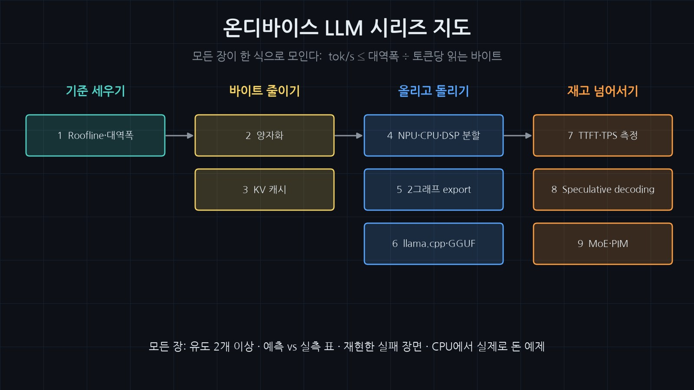

LLM을 **서버가 아니라 작은 장치(엣지 NPU·노트북 CPU·보드)** 에서 돌릴 때 실제로 부딪히는 문제만 골라 만든 시리즈예요. 출발점은 한 줄이에요. "**decode 속도의 상한은 `대역폭 ÷ 토큰당 읽는 바이트`**". 1장에서 이 식을 세우고, 2–9장은 이 식의 분모를 줄이거나(양자화·KV 캐시·MoE), 한 번 읽어 여러 토큰을 내거나(speculative decoding), 분자를 키우는(PIM) 방법이에요. 4–6장은 그걸 실제 장치에 올리는 일, 7장은 결과를 정직하게 재는 법이에요.

**그림 1.** 시리즈 지도. **기준 세우기(1장)** → **바이트 줄이기(2–3장)** → **올리고 돌리기(4–6장)** → **재고 넘어서기(7–9장)**.

> **이 시리즈의 약속.** 모든 장에 ① 직접 따라 할 수 있는 유도 2개 이상, ② **예측 vs 실측** 표, ③ 일부러 재현한 **실패 장면**, ④ 확인 가능한 공개 참고 문헌이 들어가요. 숫자는 모두 CPU에서 실제로 돌린 예제에서 나왔고(SmolLM2-135M 등 공개 모델), 측정하지 않은 값은 **가정**이라고 표시했어요.

> 이 시리즈는 공개 자료만 사용했고, 어떤 회사의 공식 입장도 아닙니다. 글에 나오는 "가상 엣지 NPU"(80 TOPS, 153.6 GB/s 등)는 공개된 일반 스펙 수준의 값에 가정을 더한 계산용 예시예요.

## 먼저 읽으면 좋은 글

- [PyTorch 시리즈 목차](/blog/2026/10/25/pytorch-series/) — 특히 [7장 torch.export](/blog/2026/10/25/pytorch-07-torch-export/), [9장 컴파일러 최적화](/blog/2026/10/25/pytorch-09-compiler-opt/), [10장 양자화](/blog/2026/10/25/pytorch-10-quantization/), [11장 LLM 추론](/blog/2026/10/25/pytorch-11-llm-inference/)
- [On-Device LLM: Prefill·Decode·KV 캐시](/blog/2026/10/25/ondevice-llm-prefill-decode-kv-cache/) — 이 시리즈의 개념편
- [tokens 시리즈 0편 — prefill·decode와 TTFT/TPS](/blog/2026/10/30/tokens-00-prologue-prefill-decode/)

## 목차

| 장 | 제목 | 이것만은 꼭 |
|---|---|---|
| 1 | [80 TOPS인데 왜 30 tok/s일까 — Roofline과 메모리 대역폭](/blog/2026/11/16/ondevice-llm-01-roofline-bandwidth/) | decode는 대역폭, prefill은 계산. ridge point 계산 |
| 2 | [4비트로 줄이고도 답을 지키는 법 — LLM 양자화 실전](/blog/2026/11/16/ondevice-llm-02-llm-quantization/) | 실효 비트 `4 + 16/g`, GPTQ·AWQ·SmoothQuant, W4A16 vs W8A8 |
| 3 | [메모장이 가중치보다 커질 때 — KV 캐시 설계](/blog/2026/11/16/ondevice-llm-03-kv-cache-design/) | `2·L·H_kv·d·b`, GQA, 정적 캐시, KV 양자화, attention sink |
| 4 | [어떤 연산을 어디서 돌릴까 — NPU·CPU·DSP 연산 분할](/blog/2026/11/16/ondevice-llm-04-npu-cpu-dsp-split/) | Amdahl, 경계 비용, LUT·online softmax, FP16 함정 |
| 5 | [PyTorch 모델을 NPU용 그래프로 — prefill/decode 2그래프 export](/blog/2026/11/16/ondevice-llm-05-llm-graph-export/) | 2그래프, Dim guard, 버킷 낭비, 가중치 공유, in-place KV |
| 6 | [llama.cpp와 GGUF 해부](/blog/2026/11/16/ondevice-llm-06-llamacpp-gguf/) | 파일 구조·정렬, Q8_0/Q4_0/Q4_K bpw, fallback, llama-bench |
| 7 | [TTFT·TPS를 제대로 재는 법](/blog/2026/11/16/ondevice-llm-07-ttft-tps-benchmark/) | TTFT·TPOT·E2E 정의, 측정 함정, 토크나이저 차이 |
| 8 | [추측해서 한 번에 검증하기 — Speculative decoding](/blog/2026/11/16/ondevice-llm-08-speculative-decoding/) | 수락률 α, `(1−α^(γ+1))/(1−α)`, KV 되감기, prompt lookup |
| 9 | [큰 모델을 작은 대역폭으로 — MoE와 PIM](/blog/2026/11/16/ondevice-llm-09-moe-pim/) | 활성 vs 총 파라미터, 전문가 캐시, PIM의 Amdahl 벽 |

**추천 순서**: 1 → 2 → 3을 먼저(모든 장이 이 셋의 식을 다시 써요). 그다음은 관심 따라: 장치에 올리는 일은 4 → 5 → 6, 속도를 재고 올리는 일은 7 → 8 → 9.

## 예제 코드

예제 코드 저장소: <https://github.com/kjoh94/ondevice-llm-examples> (장별 폴더, `python example.py`, 공개 모델은 `--real`).

모든 예제는 CPU(PyTorch 2.15 CPU 빌드, llama.cpp CPU 빌드)에서 확인했어요. 측정값은 실행한 머신의 대역폭에 따라 달라지니, 각 표에 그 실행의 대역폭을 함께 적었어요.
